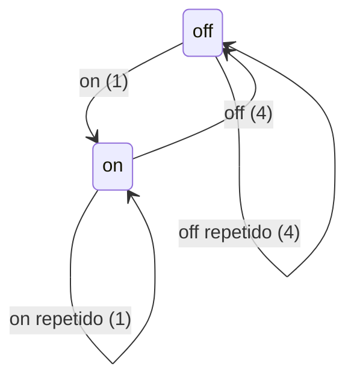

# Observação local com `on` e `off`

> Implementar com **tlc-implement** depois da aprovação do proprietário.
> Cada critério vira uma prova independente. `Unresolved` não é decisão para o builder.

## Intent

Hoje o usuário precisa criar uma captura, copiar o ID e passar duas variáveis de ambiente a cada agente. O proprietário viu o README da #21 e considerou esse fluxo complexo para o uso normal de skills.

Após a entrega, o usuário liga a observação local com `on`, usa Claude Code, Codex CLI ou Hermes normalmente, desliga com `off` e localiza o que foi capturado para consultar os passos e comandos. O fluxo preserva a sanitização e não atribui uma skill sem evidência suficiente.

7 critérios em 3 resultados observáveis · 1 mudança de contrato de privacidade possível · 2 decisões em aberto, ambas bloqueantes.

## Criteria

### Ativar e desligar

1. Dada a configuração inicial aprovada, quando o usuário executa `on`, `status` informa `on` em outro processo; repetir `on` mantém uma só autorização ativa e não cria uma nova captura por repetição.
2. Dado `on`, quando um hook de Claude/Codex ou a entrega Hermes de uma integração instalada e confiável recebe um evento com identidade de sessão válida, a observação o envia à política local e o persiste sem `SKILL_ME_CAPTURE_ROOT` ou `SKILL_ME_CAPTURE_ID` no processo do agente.
3. Quando duas sessões emitem eventos intercalados, a consulta não mistura IDs pseudonimizados nem atribui evento sem identidade segura à outra sessão.
4. Quando o usuário executa `off`, `status` informa `off` e produtores ainda abertos não acrescentam eventos à observação automática; repetir `off` mantém `off`. Capturas existentes continuam disponíveis para consulta, e capturas manuais explicitamente vinculadas seguem seus comandos `privacy stop/disable`.

### Consultar o uso normal

5. Após uma sessão observada, o usuário localiza a captura e emite um relatório sem ter anotado previamente raiz e ID; o relatório distingue evidência nativa de atribuição heurística e lacunas.

### Preservar privacidade e explicar o contrato

6. Cada evento persistido passa por `applyPolicy` e pelos limites do store; nenhuma entrega de observação automática envia dados pela rede. Os comandos manuais de `privacy start/stop/report` continuam funcionando com seus argumentos atuais.
7. README e guias ensinam o fluxo de uma linha por ação (`on`, uso do agente, `off`, consulta), a preparação feita uma vez e os limites reais: hooks só após confiança nativa, ferramentas hospedadas do Codex fora da cobertura de hooks, e sem evento de ativação de skill no contrato Codex consultado.

## States

## Out of scope

- Executar comandos do `SKILL.md` ou o agente pelo observador; ele só recebe eventos.
- Capturar raciocínio interno, ferramentas hospedadas sem hook local ou inferir ativação de skill como fato no Codex.
- Rede, daemon e publicação do pacote privado; não há necessidade demonstrada.
- Alterar os dois repositórios pilotos ou o motor vendorizado de revisão.

## Observable

| Superfície | Decisão | Destino |
| --- | --- | --- |
| CLI `on/off/status` | comandos e estado | 1, 4 |
| CLI `on/off/status` | flags/defaults da primeira configuração | Unresolved 1 |
| CLI `on/off/status` | formato de saída e falha parcial | existing - envelope JSON `schemaVersion: 1` e códigos fechados 0/2/3/4/5 de `privacy` |
| CLI `on/off/status` | chamadas repetidas | 1, 4 |
| Hook/entrega | ausência de identidade segura | 3 |
| Hook/entrega | integração sem confiança ou indisponível | 7; sem evento nativo não há persistência |
| Consulta | localizar sessão sem ID anotado | 5 |
| Documentação | primeiro uso e próximo passo | 7 |

## Swept

- validation: 3; vínculo inválido não escolhe outra sessão.
- failure modes: existing - comandos de `privacy` devolvem códigos fechados 0/2/3/4/5, sem ecoar valores ou exceções; entrega interna nunca bloqueia o agente.
- idempotency and retry: 1, 4.
- authorization: Unresolved 2; o alcance do consentimento `on` precisa de decisão explícita.
- concurrency and ordering: 3, 4; produtores simultâneos e `off` concorrem com escrita.
- data lifecycle: Unresolved 2; capturas sucessivas ou limite da captura atual.
- external-dependency failure: 7; sem integração confiável o agente segue normalmente e não há evento gravado.
- state transitions: 1, 4.
- observability: 1, 4, 5; estado, capturas e relatório são consultáveis.

## Impact

| Frente | O que muda |
| --- | --- |
| domínio | `observação automática` é o consentimento persistente entre processos; `capture` hoje é a unidade individual de consentimento, chave HMAC, limites e retenção. |
| domínio | `captureBinding` hoje só aceita o par de variáveis; hooks/ingest/wrapper recorrem a ela. Uma rota automática nova não pode converter par incompleto em seleção implícita. |
| dados armazenados | Novo estado local de on/off e vínculo de sessões com capturas exige formato, ownership e limpeza; capturas existentes permanecem legíveis sem migração de conteúdo. |
| integrações | Claude/Codex têm `session_id` nos hooks; Hermes envia `session_id` quando fornecido e hoje requer `SKILL_ME_HERMES_DELIVERY` no ambiente. Instalação/confiança permanecem fronteiras distintas. |
| testes | Provar CLI, isolamento/concorrência/off e as três integrações com eventos nativos de fixture; usar Verifier independente no perfil `light`. |

## Decided

| Decisão | Forma | Alternativa descartada |
| --- | --- | --- |
| Preservar evidência de skill | Native/heuristic/inconclusive continuam separados no relatório atual. | Dizer que leitura de `SKILL.md` prova ativação de skill; hooks Codex não oferecem tal evento. |

## Surface

| Comando | Entrada | Saída | Código | Critérios |
| --- | --- | --- | --- | --- |
| `on` | Unresolved 1 e 2 | JSON `schemaVersion: 1`, estado on e configuração efetiva | 0/2/3/4/5 | 1, 2, 6 |
| `off` | nenhum argumento no uso normal | JSON `schemaVersion: 1`, estado off | 0/2/3/4/5 | 4 |
| `status` | nenhum argumento no uso normal | JSON `schemaVersion: 1`, on/off, integração/capturas | 0/2/3/4/5 | 1, 4 |
| consulta | sem raiz/ID anotados | relatório existente | 0/2/3/4/5 | 5 |

## Sources

- Pedido do proprietário nesta conversa, 24/10/2026: “vi o readme mas ficou muito complexo o ativa a captura queria de fato um on / off”.
- [Issue #23](https://github.com/oldboydev/skill-me/issues/23) — problema e critérios, com decisões pendentes.
- `.tasks/issue-5-privacidade.md` e `docs/privacidade.md` — consentimento individual, sanitização, limites e retenção atuais.
- `.tasks/issue-8-traces.md` e `docs/traces.md` — vínculo explícito atual por raiz/ID.
- [OpenAI Docs: Hooks](https://learn.chatgpt.com/docs/hooks) — cobertura e limites dos hooks do Codex; não lista evento de ativação de skill.

## Unresolved

| # | Kind | Question | Until answered |
| --- | --- | --- | --- |
| 1 | blocks | A primeira ativação depende de configuração explícita única ou o próprio `on` configura raiz e integrações? | Sem definir onde os dados podem ser criados, os critérios 1, 2 e 5 não são implementáveis. Confiança nativa continua manual. |
| 2 | blocks | `on` autoriza capturas sucessivas até `off` ou apenas uma captura limitada a 500 eventos/8 MiB? | Não ampliar o consentimento da #5 implicitamente. O critério 2 fica sem garantia de duração. |
