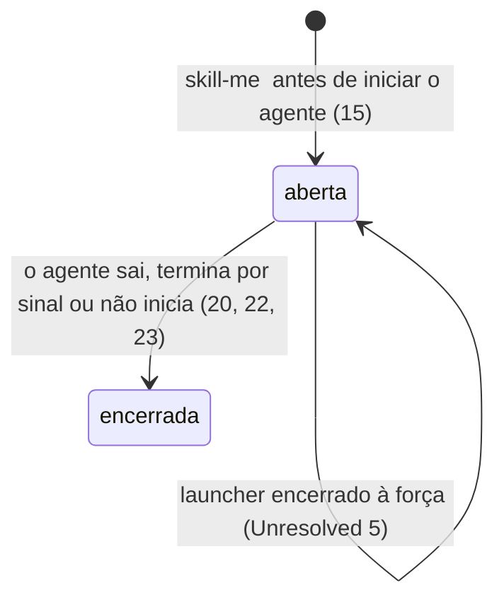
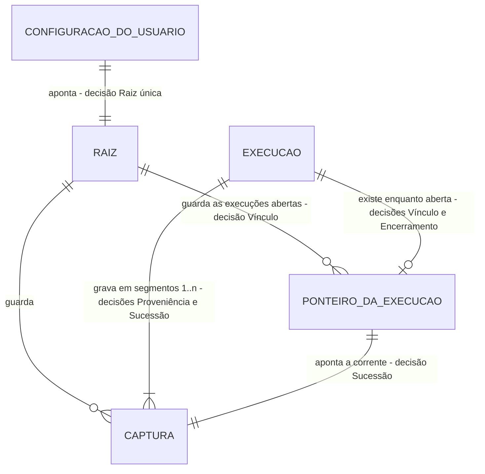

# Iniciar o agente com captura: `skill-me <agente>`

> Implementar com **tlc-implement**. Cada critério abaixo vira um check com prova, referenciado
> pelo número. Nada em `Unresolved` é decidido durante a implementação. A questão bloqueante
> (capturas sucessivas) foi respondida pelo proprietário em 26/10/2026 com a alternativa B (ver
> `Sources`). Em 26/10/2026, o proprietário aprovou o plano completo e o checklist com:
> “Aprovar plano completo e implementar”.

## Intent

Para observar uma sessão hoje, o usuário instala os hooks de cada agente com `--target`, cria uma
pasta e roda `observe setup`, liga com `npm run on`, abre o agente, desliga com `npm run off` e
pede o relatório pela CLI interna (`node src/integrations/cli.mjs report --latest`). Tudo isso
roda a partir do checkout. Além disso, o consentimento do `on` vale para toda sessão de qualquer
agente até o `off`, e não apenas para a sessão que o usuário quer observar. O proprietário paga
esse custo a cada uso. Ele pediu um comando cotidiano como `skill-me codex` (issue #25). A issue
não informa frequência de uso nem custo medido.

Depois da entrega, o usuário instala o comando uma vez a partir do checkout (`npm link`).
Depois, roda `skill-me codex`, `skill-me claude` ou `skill-me hermes` e o agente abre no terminal,
como abriria sem o comando. No primeiro uso, o próprio comando mostra a pasta das capturas, a
instalação da integração e o passo de confiança nativa, e só aplica as mudanças depois da
confirmação. Cada invocação abre uma execução própria e grava apenas a sessão iniciada por ela,
em capturas locais sucessivas: ao chegar a 500 eventos ou 8 MiB, a execução continua numa nova
captura, com chave e limites próprios, até o agente sair. A execução termina quando o agente sai,
e `skill-me report` consulta a execução inteira, captura por captura, sem que o usuário copie um
ID. A observação global `on`/`off` não muda.

34 critérios em 6 fatias · 6 decisões sem volta aprovadas com o plano · 4 questões em aberto: nenhuma bloqueia a implementação e 1 bloqueia o uso real. A fatia da harness foi autorizada em 26/10/2026 (ver Sources); os critérios 33–34 são regressões da revisão formal dentro de AC1, AC3 e AC4.

## Criteria

### Disponibilizar o comando e abrir o agente

1. Dado o checkout com `npm ci`, quando o usuário executa `npm link` nele (nas provas, com um
   prefixo npm temporário), então `skill-me --help` executado de outro diretório sai com 0 e
   imprime o uso em stdout, e o `package.json` continua com `"private": true`.
2. Dados a raiz configurada e a integração instalada, quando o usuário executa
   `skill-me <agente> <args…>` (`<agente>` ∈ `codex`, `claude`, `hermes`), então o executável que
   o PATH resolve para esse agente inicia sem shell, com exatamente `<args…>` na mesma ordem
   (inclusive argumentos com espaço, aspas, Unicode e `--`) e com stdin, stdout e stderr do
   terminal herdados. O launcher não escreve nada em stdout.
3. Quando o agente sai com o código N (0 e 7 nas provas), `skill-me` sai com N.
4. No Windows, quando o primeiro `codex` do PATH é o shim `codex.cmd` do npm, cujo pacote o
   doctor reconhece (`versionSource: package_metadata`), então `skill-me codex` inicia, com o Node
   e sem shell, o `@openai/codex/bin/codex.js` que o shim referencia, com os argumentos intactos.
   Outro `.cmd`/`.bat` não é iniciado: o comando sai com 127, o stderr mostra
   `launcher_requires_shell` e nenhuma captura é criada.
5. Enquanto o agente roda, SIGINT, SIGQUIT e SIGHUP entregues pelo terminal ao grupo de
   processos (Ctrl+C, Ctrl+\, terminal fechado) chegam ao agente uma única vez cada e não encerram
   o launcher antes dele. No Windows, Ctrl+C no console também não encerra o launcher antes do
   agente.
6. Quando o launcher recebe SIGTERM (POSIX), o agente recebe SIGTERM uma vez.

### Primeiro uso conduzido pelo próprio comando

7. Quando o agente pedido não está no PATH (doctor: `presence: absent`), `skill-me <agente>` sai
   com 127 e o stderr mostra `executable_not_found`. O comando não pergunta nada e não cria pasta,
   configuração, instalação nem captura.
8. Dado `<home>/.skill-me/observe.json` ausente, ou o `plan` da integração do agente com mudanças,
   num terminal interativo, quando o usuário executa `skill-me <agente>`, então, antes de qualquer
   escrita, o stderr mostra:
   - a pasta proposta para as capturas: `%LOCALAPPDATA%\skill-me\capturas` no Windows,
     `$HOME/.local/share/skill-me/capturas` no POSIX. O usuário aceita com Enter ou digita outro
     caminho absoluto;
   - as mudanças do `plan` no diretório de configuração de usuário do agente (`claudeHome`,
     `codexHome` e `hermesHome` do doctor, que seguem `CLAUDE_CONFIG_DIR`, `CODEX_HOME` e
     `HERMES_HOME`);
   - que cada invocação grava localmente os argumentos e resultados suportados depois da
     sanitização, em capturas sucessivas de até 500 eventos ou 8 MiB, com retenção de 7 dias;
   - a pergunta de confirmação.
9. Quando o usuário confirma, então a pasta é criada se faltar, a raiz é gravada em
   `.skill-me/observe.json` no formato da #23 e a integração é aplicada pelo `install --apply`
   existente. O stderr mostra o passo manual de confiança do agente (os `manualSteps` do
   instalador: workspace confiável e `/hooks` no Claude, `/hooks` e projeto confiável no Codex,
   `hermes plugins enable skill-me-observer` no Hermes) e o agente inicia.
10. Quando o usuário recusa ou responde qualquer coisa diferente da confirmação, nada é criado nem
    alterado (pasta, `.skill-me/observe.json`, configuração do agente), o agente não inicia e o
    comando sai com 3 (`setup_declined`).
11. Quando o caminho digitado é relativo, nenhuma pasta é criada, o `.skill-me/observe.json` não é
    gravado e o comando sai com 2 (`root_not_absolute`, a validação atual do `observe setup`).
12. Se a preparação estiver pendente e stdin ou stderr não for um terminal, o comando sai com 3
    (`setup_required`) sem perguntar nem alterar nada, e o stderr orienta rodar
    `skill-me <agente>` num terminal.
13. Dado o preparo concluído, quando `skill-me <agente>` roda de novo, nenhuma prévia nem pergunta
    aparece, os arquivos de configuração do agente e o `.skill-me/observe.json` mantêm o mesmo
    SHA-256 e o agente inicia.
14. Se a gravação da raiz (`observe setup`) ou o `plan`/`install --apply` responder conflito (4,
    por exemplo `observe_on` ou `lock_present`), configuração inválida (3) ou E/S incompleta (5),
    o stderr mostra o código e os itens do instalador, o agente não inicia e `skill-me` sai com
    esse código. A raiz já gravada permanece, e a próxima execução mostra só o que ainda falta.

### Execução isolada da invocação, em capturas sucessivas

15. Antes de iniciar o agente, `skill-me <agente>` abre uma execução nova na raiz configurada: um
    ID de execução próprio (32 hex) e a primeira captura dela, com `origin: "launch"`, o ID da
    execução em `invocation`, `segment: 1`, `content: true`, `retentionDays: 7`, chave própria e
    `limits` `{maxEvents: 500, maxBytes: 8388608}`. O ambiente do processo do agente recebe
    `SKILL_ME_LAUNCH_ROOT` (o caminho real absoluto da raiz) e `SKILL_ME_LAUNCH_ID` (o ID da
    execução); valores herdados de `SKILL_ME_LAUNCH_ROOT`, `SKILL_ME_LAUNCH_ID`,
    `SKILL_ME_CAPTURE_ROOT` e `SKILL_ME_CAPTURE_ID`, inclusive incompletos, não chegam ao agente.
    O usuário não define nenhuma variável nem roda `npm run on`/`off`.
16. Se a execução não puder ser aberta, o agente não inicia e o stderr mostra só o código fechado,
    sem caminho. Os códigos são: 3 para `root_not_found`, `root_not_directory` e `store_invalid`;
    4 para `lock_present` depois de 2 s, `link_refused`, `foreign_entry` e `root_changed`; 5 para
    `io_failure`.
17. Quando os hooks Claude e Codex, executados pela linha instalada, e o plugin Hermes, pelo
    `ingest`, recebem eventos nativos de fixture na sessão iniciada, cada evento suportado vira no
    máximo um registro `recordVersion: 1` na captura corrente da execução, com pseudônimos `h1:`
    da chave dessa captura e conteúdo só da matriz sanitizada. Nenhum registro vai para captura de
    outra execução, para uma captura manual nem para uma captura automática, também com a
    observação global `on`. Com o par `SKILL_ME_LAUNCH_*` incompleto ou inválido, nada é gravado
    (`binding_invalid`) e o evento não cai no par manual nem na observação automática.
18. Sempre, uma invocação deixa `<raiz>/skill-me-privacy/observe.json` e
    `<home>/.skill-me-authorization.json` com os mesmos bytes, ou ausentes, com a observação global
    `on` ou `off`.
19. Quando a captura corrente da execução não comporta o próximo registro (500 eventos ou 8 MiB),
    ela passa a `stopped` sem descartar nada, e uma captura sucessora da mesma execução
    (`segment` seguinte, mesma `invocation`, chave nova, os mesmos `limits`, `content` e retenção)
    recebe esse registro e os seguintes, inclusive em outro processo produtor. Nenhuma captura
    passa de 500 eventos ou 8 MiB.

### Encerramento verificável e consulta sem ID

20. Quando o agente sai, com qualquer código, o launcher espera 750 ms pelas entregas em voo e
    então encerra a execução: a captura corrente passa a `stopped`, com `endedAt`, e nenhum
    registro novo entra na execução, antes de o launcher sair. O stderr mostra o ID da execução e,
    por captura, o segmento, o ID, o estado `stopped`, o `counters.persisted` e os descartes. Com
    `persisted` 0 em todas, o resumo diz que nada foi gravado e repete o passo de confiança do
    agente.
21. Dado um Hermes de fixture cujo processo de entrega já está em execução (como depois do
    `on_session_start`) e cujo plugin entrega N registros (3 na prova) e sai logo depois do
    último, quando `skill-me hermes` termina, as capturas da execução somam
    `counters.persisted` = N e estão `stopped`.
22. Quando o agente termina por sinal (do terminal, ou SIGTERM repassado), a execução é encerrada
    como em 20 e o launcher termina pelo mesmo sinal no POSIX. No Windows, o launcher sai com o
    código do agente.
23. Se o agente não iniciar (`ENOENT` → 127; outro erro de início → 126), a execução é encerrada
    sem espera, com a captura `segment: 1` `stopped` e 0 eventos, e o stderr mostra o código de
    início.
24. Se o encerramento da execução falhar (lock ocupado por mais de 2 s, ou E/S), o stderr mostra o
    código fechado, que a captura corrente continua `active`, o ID dela e o comando `privacy stop`
    que a encerra. O código de saída continua o do agente.
25. Quando duas invocações rodam ao mesmo tempo, com agentes de fixture gravando de forma
    intercalada, cada uma tem ID de execução, capturas e chaves próprios e nenhuma captura contém
    registro da outra. A saída da primeira encerra só a execução dela: a captura da outra continua
    `active` e grava os eventos seguintes.
26. Quando `npm run off` ou `npm run on` roda durante uma invocação, a captura corrente dela
    continua `active` e o próximo evento da sessão é gravado nela.
27. Quando o usuário executa `skill-me report [--skill <SKILL.md>] [--format text|markdown|json]`,
    sem `--root` nem `--capture`, sai o relatório da execução `skill-me` iniciada por último na
    raiz configurada: todas as capturas encontradas dela, em ordem de segmento, uma seção por
    captura com o relatório existente dessa captura (linha `Captura: <id>`), precedidas do ID da
    execução, dos segmentos encontrados, dos segmentos ausentes e de se a execução ainda está
    aberta. No JSON, o mesmo em `skillMeLaunchReport` (Landing do checklist). Cada seção avalia só
    a própria captura. `integrations report --latest` e `npm run status` continuam escolhendo e
    listando só capturas `origin: "automatic"`.
28. Sem nenhuma captura `origin: "launch"` na raiz, `skill-me report` sai com 3
    (`no_launch_capture`). Sem raiz configurada, sai com 3 (`not_configured`). Os dois erros saem
    no JSON de erro `schemaVersion: 1` do `report` atual.

### Ajuda e documentação

29. `skill-me --help` (stdout, código 0) mostra:
    - o preparo único: `npm ci` e `npm link` no checkout, e depois o primeiro `skill-me <agente>`
      com a prévia e a confiança manual;
    - o fluxo diário de uma linha: `skill-me codex`, `skill-me claude`, `skill-me hermes`;
    - a consulta: `skill-me report`;
    - os limites do critério 30.

    `skill-me` sem argumento, ou com subcomando desconhecido, sai com 2 e imprime a ajuda em
    stderr.
30. O README apresenta esse preparo e o fluxo diário como o uso normal, antes do `on`/`off`, que
    continua documentado. O README e os guias (`docs/traces.md`, `docs/privacidade.md`,
    `docs/agent-observation.md`) declaram:
    - a confiança nativa é manual, por agente;
    - o Codex não tem evento nativo de ativação de skill: ler um `SKILL.md` aparece só como
      operação de ferramenta;
    - os hooks do Codex cobrem só ferramentas locais, e as hospedadas ficam fora;
    - cada captura tem até 500 eventos ou 8 MiB, e a execução continua em capturas sucessivas,
      com chave própria cada uma, até o agente sair;
    - entregas que chegam mais de 750 ms depois da saída do agente não entram na execução;
    - um encerramento forçado do launcher (SIGKILL, TerminateProcess) deixa a captura corrente
      `active` e a execução aberta;
    - o próximo passo depois da sessão é `skill-me report`.

    Os guias que descrevem o vínculo por ambiente passam a citar o par `SKILL_ME_LAUNCH_ROOT`/
    `SKILL_ME_LAUNCH_ID`, definido só pelo launcher, e a precedência dele sobre o par manual e o
    `on`.

### Concluir corretamente a espera da harness nativa do Hermes

31. Dada uma entrega ainda pendente cujos contadores ficam estáveis por mais de 300 ms,
    a harness não termina a espera como se a entrega tivesse concluído. Uma prova com
    inicialização atrasada além de 300 ms observa a conclusão efetiva e conserva os mesmos
    eventos e asserções das provas nativas existentes.
32. Quando o destino falha ou permanece travado, a espera distingue falha terminal de trabalho
    ainda pendente e conserva o prazo máximo `settleMaxMs` já configurado (5000 ms por padrão).
    Os callbacks e resultados das ferramentas continuam inalterados; as provas existentes e
    o gate completo são executados sem desabilitar casos nativos aplicáveis nem afrouxar
    asserções ou tolerâncias.

    Refinamento do critério 32 (gate B em `60bbda8`, Windows, Node 24.13.0; sem critério novo): a
    preparação das provas nativas e do I4-C35 instala o plugin de fixture versionado no `HERMES_HOME`
    temporário com os bytes exatos da fonte, também num caminho com “ação” no Node 24.13.0, e a remoção
    dele não esconde um plugin ausente. Plugins, argumentos, eventos, Unicode e asserções não mudam.

### Regressões da revisão formal (dentro de AC1, AC3 e AC4; sem escopo novo)

A revisão formal da feature em `2fd858a` (`.checks/code-review/issue-25/formal-review.stdout.txt`)
apontou dois defeitos bloqueantes P2. Os critérios abaixo fixam o comportamento já exigido por
AC3/AC4 (encerramento verificável, segmentos sucessivos com limites e chave próprios) e por AC1
(sinais aplicáveis), nos caminhos de falha que as provas não cobriam.

33. Se a publicação do ponteiro da sucessora falhar (escrita do temporário ou `rename`) depois
    de a sucessora ter sido criada, a entrega daquele lote sai com `io_failure` e conta as
    entradas como perdidas; a próxima entrega da mesma execução incorpora essa sucessora ao
    ponteiro (mesmo `id`, `segment` N+1), e nenhuma outra captura da execução recebe o
    número N+1. O encerramento normal deixa `stopped` toda captura `active` da execução —
    inclusive uma sucessora nunca publicada — e o resumo de sucesso nunca lista captura
    `active`; se parar uma delas falhar, o encerramento sai com o código, o stderr dá para
    cada captura que ficou `active` o comando `privacy stop` que a encerra, e a execução já
    não recebe registros. Capturas de outra execução da mesma raiz não mudam. Na abertura,
    se publicar o ponteiro falhar e parar o segmento 1 também falhar, o stderr diz que essa
    captura ficou `active` e dá o comando que a encerra. Se o encerramento não conseguir ler
    uma captura da raiz por falha de E/S, ele não se declara conferido: a execução já não
    recebe registros, toda captura legível dela fica `stopped`, nenhuma de outra execução muda,
    e o stderr lista as não lidas com o `privacy status` que as confere e o `privacy stop` que
    encerra a que for desta execução e estiver `active`. O encerramento só para — e o stderr
    só dá como desta execução — captura cujo estado diz ser dela: se o ponteiro da execução
    nomear uma captura de outra execução, essa captura não muda (estado, ponteiro dela e
    gravações seguintes), e nenhuma orientação manda pará-la como se fosse desta.
34. Um SIGINT, SIGQUIT ou SIGHUP do terminal, ou um SIGTERM, recebido depois do preparo e antes
    de o agente iniciar — durante a espera do lock na abertura, com a abertura em curso ou na
    conferência da entrada do shim — cancela a abertura: o agente não inicia; a captura já
    criada passa a `stopped` com 0 eventos e o ponteiro sai; o stderr mostra
    `skill-me: abertura cancelada por <SINAL>; o agente não foi iniciado.`; no POSIX o
    launcher termina pelo mesmo sinal e no Windows sai com 128 + o número do sinal (130 para
    Ctrl+C). Depois de o agente iniciar, os critérios 5, 6, 20 e 22 continuam valendo sem
    mudança.

### Regressões da segunda revisão formal (dentro de AC4 e AC6; sem escopo novo)

A segunda revisão formal, em `6d57e6e` (`.checks/code-review/issue-25/formal-review2.stdout.txt`),
apontou dois defeitos bloqueantes P2: `src/integrations/privacy/store.mjs:1042` (abertura que perde
a identidade quando a liberação do lock falha) e `tests/integrations/fixtures/hermes/settle.py:26`
(espera que termina sobre contadores transitórios de falha). Os critérios abaixo fixam o que AC4 e
AC6 já exigem nesses caminhos.

35. Se, na abertura, a captura do segmento 1 e o ponteiro já foram gravados e só a liberação do
    lock da raiz falhar, o agente não inicia e a execução não perde a identidade: o stderr diz
    `skill-me: a execução <invocation> foi aberta com a captura <id>, mas a liberação do lock da
    raiz falhou [<código>]; o agente não foi iniciado.` e o launcher tenta o encerramento de
    sempre. Se ele concluir, o resumo de sempre mostra a captura `stopped`; se não, a falha de
    sempre dá o `privacy stop` dela e nunca a declara encerrada. Quando a falha foi de E/S e o
    lock gravado pela invocação pode ter ficado, o stderr diz onde ele está, que enquanto existir
    gravações e comandos na raiz saem com `lock_present`, e que, quando a E/S voltar, se ele ainda
    contiver o `pid` do launcher e esse processo tiver terminado, removê-lo e só então rodar o
    comando mostrado encerra a captura. Lock trocado por outro ou ausente não é removido nem
    reivindicado. Outra execução da mesma raiz não muda. A saída é a do código (5 para
    `io_failure`, 4 para `root_changed`). O mesmo vale no encerramento: se as capturas da
    execução já pararam e o ponteiro saiu, e só a liberação do lock falhar, o resumo de sempre
    sai (as capturas estão `stopped`), seguido de `skill-me: a execução <invocation> foi
    encerrada, mas a liberação do lock da raiz falhou [<código>].` e, quando o lock da invocação
    pode ter ficado, da mesma linha do lock; a saída continua a do agente, e o stderr nunca diz
    que uma captura parada continua `active`.
36. A espera da harness nativa do Hermes só termina como falha terminal quando todo registro
    posto na fila tem destino contado (entregue, grande demais, não serializável ou contado em
    `deliveryFailed`). Uma leitura com a entrega desligada e registros ainda sem destino contado
    — por exemplo `active` falso com `deliveryFailed` 0, ou com só parte da perda contada —
    continua pendente até a contagem fechar ou até o `settleMaxMs` do cenário (5000 ms por
    padrão), quando termina como `timeout`. Sem destino configurado (nada posto na fila), a
    espera continua terminando na hora como `inactive`. Plugin, callbacks e prazos não mudam.

### Regressão da terceira revisão formal (dentro de AC1; sem escopo novo)

A terceira revisão formal, em `9cd06d5` (`.checks/code-review/issue-25/formal-review3.stdout.txt`),
apontou um defeito bloqueante P2 em `src/integrations/launch/agent.mjs:30`: componentes vazios do
PATH eram descartados no POSIX. O critério abaixo fixa o que AC1 já exige (iniciar o agente que o
PATH resolve) nesse caso.

37. No POSIX, cada componente vazio do PATH — no começo (`:/usr/bin`), no meio (`/a::/b`), no fim
    (`/a:`), repetido, ou o PATH inteiro definido como vazio — é o diretório em que `skill-me` foi
    executado, na posição dele, como no bash, no dash, no `execvp` e no `spawn` do Node. Então
    `skill-me <agente>` inicia o mesmo executável que a invocação direta iniciaria: o do diretório
    atual quando o componente vazio vem antes de outra instalação, o da outra instalação quando ela
    vem antes. Os argumentos continuam literais, stdin/stdout/stderr herdados, o código de saída é
    o do agente, e o PATH que o agente recebe é o mesmo. Com o PATH ausente, nada muda: sem
    diretórios, 127 com `executable_not_found`. No Windows, nada muda (componentes vazios
    continuam ignorados; PATHEXT e o shim do npm como antes), e a política do doctor também não.

### Regressão de fixture da CI do PR #28 (C28; critério 21 sem mudança)

O Verifier 7, em `a755c37`, registrou o C28 vermelho no Windows com o Node 24.13.0 da CI: o
primeiro registro do Hermes não foi gravado, a fixture esperou mais que o prazo do teste e o
resultado lido era o próprio cenário. A causa da perda do primeiro registro não é conhecida. O
critério 21 continua o mesmo; a prova passa a mostrar o que aconteceu quando ele não é cumprido: a
fixture termina dentro do prazo do teste, informa que o primeiro registro não foi gravado e não
dispara os outros hooks, e o launcher encerra a execução normalmente. Uma regressão só de teste
reproduz essa classe de falha (primeira entrega perdida), sem afirmar a causa original.

### Regressões da CI do PR #28 no Windows (C1 e C32; critérios 1 e 25 sem mudança)

Na CI 40443538957, o Windows falhou em duas provas. C1: num checkout com `core.autocrlf=true`
(o padrão do Git no Windows), o `npm link` reescreve a primeira linha de `cli.mjs` e o checkout fica
alterado — a causa foi reproduzida, e a correção é manter esse arquivo em LF em qualquer checkout.
C32: a espera pelos eventos intercalados esgotou o limite sem dizer por quê; a causa não é
conhecida. Os critérios 1 e 25 continuam os mesmos; a prova de C32 passa a falhar na hora quando uma
das invocações termina antes, a liberar os agentes de fixture e a trazer o que cada launcher
escreveu.

### Diagnóstico pontual da prova antiga T8-C15 (AC7; autorização 6440482031; C46)

Na 9ª verificação, em `dd89179`, o gate D (`npm test` no Windows, Node 24.22.1, teto de 8 arquivos)
falhou só no T8-C15 (`tests/integrations/traces/concurrency.cli.test.mjs:107`, issue #8): o produtor
`b` informou 40 entradas, 20 confirmadas e gravadas, 20 perdidas e `io_failure`; `a` confirmou 40. O
teste parou antes do export: não se sabe se as 20 sem confirmação ficaram no disco, quantos lotes
falharam, nem a operação e o código de erro. O caminho de E/S da captura manual não mudou na #25. Há
registro de `io_failure` nesse teste antes da #23, sem taxa nem causa igual demonstrada. Em 27/10/2026
o proprietário autorizou o diagnóstico pontual nesta entrega (AC7, ver `Sources`).

38. Quando dois produtores `ingest --agent hermes` simultâneos, de 40 eventos cada, gravam na mesma
    captura manual (T8-C15), a prova continua exigindo de cada um o status 0 e `{bound: true, code:
    null, entries: 40, committed: 40, persisted: 40, lost: 0}`, os 80 eventos únicos, o segmento
    coerente, os pares de hooks e a recusa com lock alheio, com os mesmos prazos e o teto de 8
    arquivos. Quando ela falha, a mensagem traz, por produtor, o relatório de entrega e as operações
    de E/S com erro (operação, tipo de arquivo, código e se ocorreram antes ou depois do commit) e,
    da captura, as contagens por produtor no export, os contadores do status, os segmentos, os
    temporários e o lock — ou que a inspeção não esteve disponível, com o código —, sem caminho,
    conteúdo, chave ou ambiente. Com uma falha injetada antes do commit, a mensagem mostra a operação
    e que as entradas perdidas não estão no export; com a confirmação perdida depois do commit,
    mostra que estão. A instrumentação não é a correção da causa. Uma correção só segue se a causa
    for demonstrada e couber nos contratos atuais (sem nova tentativa de E/S, aceitação de perdas,
    redução de concorrência ou mudança de prazos); senão, o caso concreto volta ao proprietário.

    Refinamento do critério 38 (CI 40709943742 e execução manual 40710014746 no Windows: T8-C3,
    T8-C8, T8-C14 e T8-C18, provas antigas da #8; descoberta necessária do mesmo trabalho de CI, sem
    critério novo). As quatro provas mantêm produtores, asserções e prazos. Quando a entrega de um
    produtor, ou o `privacy stop` do T8-C18, não vem como esperado, a mensagem traz por produtor:
    - o relatório de entrega;
    - as operações de disco com erro e as que ainda estavam em curso na saída, com a tomada do lock
      em que ocorreram e há quanto tempo;
    - a última operação concluída;
    - quando o processo começou e saiu;
    - o maior atraso do laço de eventos.

    Da captura, a mensagem traz o estado e os contadores, segmentos e temporários, e se o lock está
    presente e se o `pid` gravado nele coincide com o de algum produtor. A coincidência não prova
    sozinha quem deixou o arquivo. Não traz caminho, conteúdo, chave nem ambiente.

    Esses dados são evidências compatíveis com um tipo de espera, não a identificação do recurso nem
    da causa. A instrumentação não é a correção da causa; uma correção só segue se a causa for
    demonstrada e couber nos contratos atuais.

    Refinamento do critério 38 (CI 40728221657 e execução manual 40728249484 no Windows: T8-C12,
    T8-C13 e T8-C2, provas antigas da #8; descoberta necessária do mesmo trabalho de CI, sem critério
    novo). Os quatro produtores instrumentados antes passaram, e as falhas vieram de outros. Por isso a
    evidência passa à fronteira comum das provas, sem mudar produtores, asserções, prazos nem
    concorrência:
    - o formatter comum mostra o que a pré-carga já grava — as operações em curso na saída, o início,
      a saída e o laço de eventos —, sem confundir as concluídas com o total e sem zero para dado
      ausente;
    - nos arquivos de prova com produtores vermelhos nas CIs do PR, todo produtor iniciado pelos apoios
      leva a pré-carga, e, quando um teste falha, o mesmo erro sai com a evidência de todos os
      produtores do teste e das raízes deles (lock, capturas e pasta).

    Refinamento do critério 38 (gate C em `60bbda8`, WSL: I4-C36; sem critério novo): o apoio dos hooks
    instalados mede a duração de cada chamada pelo relógio monotônico, porque o relógio civil do WSL
    recua no meio das chamadas (comparação registrada). A faixa e o prazo do I4-C36 não mudam.

    Não traz caminho, conteúdo, chave nem ambiente. É evidência, não a causa nem a correção dela.

    Refinamento do critério 38 (gate B final em `cd4afc2`, Windows, Node 24.13.0: T8-C16 “tentativa
    cortada no prazo antes de obter o lock…”, `concurrency.cli.test.mjs:922`, `4 !== 3` criações do
    lock; prova antiga da #8; defeito de produto do mesmo contrato, sem critério novo). A regra já
    está decidida (`docs/traces.md`, “Falhas de entrega” e a tabela de códigos): só a recusa
    concluída do lock é repetida até o prazo; uma tentativa abandonada no prazo é a última da
    entrada; o lock obtido com o prazo esgotado não autoriza gravar. A entrega passa a cumpri-la
    também quando o timer do prazo dispara um pouco antes de o relógio da entrega chegar a ele
    (defeito demonstrado) e, só se a prova discriminante o reproduzir, quando o lock chega com o
    prazo já esgotado antes de o timer rodar (candidato). Os prazos de 750/650 ms, a espera de 10 ms
    entre tentativas, os códigos, as contagens e o store não mudam; o T8-C16 continua exigindo
    exatamente 3 criações. O defeito existe também na `main` (`63621c6`); isso não dispensa a
    correção nesta entrega.

    Refinamento do critério 38 (gate D em `dc0db9b`, interrompido pelo coordenador:
    `codex-run.cli.test.mjs` parado depois do I4-C16; prova antiga da #4 usada na regressão da #25;
    sem critério novo). O consumidor lento do I4-C16c resolve quando houver o `exit` do wrapper e o
    fim do stdout, em qualquer ordem, com os bytes e o status exatos. Carga, intervalo, wrapper,
    fixture, asserções e produto não mudam. A correção da prova não demonstra a causa da parada do D.

    Refinamento do critério 38 (F1 da verificação 19 em `5ee0e0f`, relatório em `67a459b`: o C46 (m)
    pede o pendente e o `pid` do lock na 3ª linha da árvore do produtor, e a prova só os punha na 1ª;
    lacuna de prova, sem critério novo nem defeito de produto demonstrado). A evidência mostra os 3
    processos da árvore uma vez cada, na ordem de saída, e aponta como dono possível do lock o processo
    cuja linha tem o `pid`, seja a 1ª ou a 3ª. A prova mantém o caso da 1ª linha como está e acrescenta
    o da 3ª, com valores literais. Só a prova muda; apoios, produto, prazos e asserções existentes, não.

### Regressão da execução completa instrumentada: primeira criação concorrente do store (C32; critério 25 sem mudança)

Na execução completa instrumentada em `710076e` (Windows, Node 24.22.1, teto de 8 arquivos), o T8-C15 e
os três C46 passaram e o I25-C32 falhou em 3,1 s com `eventos intercalados: B terminou antes`: B saiu
com 3 e `skill-me: não foi possível abrir a execução [store_invalid]`, sem iniciar o agente; A terminou
com 0 e 2 eventos. A raiz do C32 só tem o `observe setup`: a pasta do store nasce na primeira
abertura, e as duas invocações a criam juntas. Uma reprodução com o `io` do store injetado mostrou a
causa no código comum de criação do store (`openStore`/`initStore`, sem mudança desde a base): o
marcador é conferido antes do lock porque é imutável depois de criado, mas não durante a criação.
Com a primeira abertura dentro da criação exclusiva do `store.json` (arquivo criado, bytes ainda não
escritos), ou publicando-o entre a leitura e a listagem da segunda, a segunda sai com
`store_invalid`; se a segunda decide inicializar antes do lock e o toma depois da primeira, sai com
`io_failure`. O mesmo vale para o `privacy start` da base. A operação exata do gate não ficou
registrada. O critério 25 continua o mesmo: duas primeiras invocações na mesma raiz abrem execuções
próprias. A correção publica o marcador por temporário e `rename` e decide a adoção da pasta sob o
lock; a conferência do marcador antes do lock para store existente, a recusa de pasta alheia, link,
raiz trocada e lock alheio e os limites continuam (linha “Primeira criação concorrente do store” do
Landing; acréscimo em C32). Pedido do orquestrador em 27/10/2026: corrigir a causa demonstrada dentro
do escopo original da #25, sem retry novo, prazo maior, teto menor, serialização ou aceitação de store
inválido.

### Refinamento do diagnóstico de C32: captura em construção (Verifier 10; critério 25 sem mudança)

O Verifier 10, em `df259ed`, terminou FAIL só no ambiente C (WSL isolado): o
`I25-C32 diagnóstico das invocações simultâneas` recebeu como primeira linha um `ENOENT` ao abrir o
`state.json` de uma captura, não `eventos intercalados: B terminou antes`; o gate D não foi
iniciado. B terminou antes enquanto A ainda criava a captura da abertura (pasta presente, estado
ainda não), e a coleta do diagnóstico em `withOverlappingRuns` lançou antes de liberar as barreiras:
o erro dela mascarou o original e A ficaria na barreira até o limite do supervisor. O defeito é do
apoio de prova, não do produto. O contrato do diagnóstico fica na linha “Diagnóstico de C32 com
captura em construção” do Landing: inspeção de melhor esforço, indisponibilidade com código, e
liberação das barreiras e espera das invocações sempre, com o erro original preservado.

### CI 40514323240 no Windows: diagnóstico sem correção (critérios sem mudança)

Na CI real depois da formal 6 `ready` e do Verifier 11 PASS (`d0d5a7f`), o Windows falhou no I23-C10
(“codex A 0”) e no primeiro controle do C46, os dois por `delivery_timeout`, e o passo de integrações
terminou junto do limite de 10 min do job. No C46, os dois produtores pararam na criação do `.lock`
da abertura; o vermelho está certo, porque a precondição do controle não foi alcançada. O caminho do
I23-C10 não mudou de E/S na #25. Nenhuma correção cabe nos contratos vinculantes. A decisão é do
proprietário, com as propostas em `.checks/issue-25-agent-launch.ci40514323240-handoff.md`.

### Diagnóstico do I23-C10 e orçamento do job Windows (AC8; autorização 6460177952; C47, C48)

Em 28/10/2026 o proprietário aprovou a proposta `.checks/issue-25-agent-launch.ci40514323240-proposal.md`
(`df2441f`): diagnóstico sanitizado do I23-C10 com a pré-carga existente e provas controladas, e 20
minutos de orçamento total só para o job Windows da matriz `verify`. A causa dos `delivery_timeout` da
CI 40514323240 continua desconhecida; nenhum dos dois itens a corrige.

39. A prova I23-C10 mantém as sessões intercaladas (um hook de cada vez) e simultâneas (os três
    hooks juntos), o ingest Hermes com duas sessões, as contagens exatas, as cinco capturas com
    chaves próprias, o isolamento, os prazos e as asserções. Quando uma entrega não vem como
    esperado, a mensagem começa pela da asserção original e traz, para cada produtor da etapa, o
    relatório de entrega e as operações de disco da pré-carga de tempos existente (operação, tipo de
    arquivo, código, a tomada do lock em que ocorreram e a última operação concluída) e, da raiz, as
    capturas automáticas (estado e contadores, sem ID), os segmentos, os temporários e o lock — ou
    a indisponibilidade de cada inspeção, com o código —, sem caminho, conteúdo, IDs, chaves ou
    ambiente, e sem contagens inventadas. Provas controladas, com injeções existentes num hook pela
    mesma rotina, mostram a mensagem de antes (só o rótulo) e a de agora, e que nada vaza.

    Refinamento do critério 39 (CI 40728221657 no Windows: I23-C4; sem critério novo). O mesmo registro
    comum do critério 38 cobre os produtores do I23-C4: o hook da rota automática, cuja raiz vem do
    home temporário da prova, e os produtores em processo, medidos pela injeção pública de `io`, com o
    laço e a CPU do processo da prova. Asserções, prazos e passos não mudam.
40. No workflow, só o `timeout-minutes` do job `verify` muda, para
    `${{ matrix.os == 'windows-latest' && 20 || 10 }}`: 20 minutos no Windows, 10 no Ubuntu e no
    macOS; os jobs `changes` e `ci` continuam com 5. Passos, runner, comandos, matriz, concorrência,
    skips e os prazos de teste e de produto não mudam. A CI real valida a expressão.

### Medição comparativa do lock na CI Windows (AC9; autorização 6467154706; C49, C50)

A CI 40636157287 (`9244eea`) terminou vermelha no Windows com `lock_present` no I23-C4 e no T8-C11;
o diagnóstico em `d2d54cf` não demonstrou causa nem defeito do produto. Em 28/10/2026 o proprietário
aprovou a proposta `.checks/issue-25-agent-launch.ci-runner-measure-proposal.md` (`b2638db`): medir a
latência do lock no runner Windows, entre o temporário padrão e o `RUNNER_TEMP`, num job manual do
workflow existente. A medição não corrige nada e não substitui nenhum check regular.

**Exceção datada ao critério 40 (28/10/2026, AC9).** O critério 40 diz que, no workflow, só o
`timeout-minutes` do job `verify` muda. O AC9 autoriza **acrescentar** um job manual ao mesmo arquivo.
`changes`, `verify` e `ci` e os orçamentos 20/10/5 continuam exatamente como estão, e o critério 40
continua valendo para eles. A conferência do C48 passa a comparar os jobs regulares; o job novo é
provado pelo C49.

41. O workflow `.github/workflows/governance.yml` ganha o job `lock_diagnostics`, de nome
    `Diagnosticar lock Windows (manual)`, que só roda quando `github.event_name == 'workflow_dispatch'`.
    Ele roda em `windows-latest`, com `timeout-minutes: 10` e permissão `contents: read`, e usa os
    mesmos `checkout` e `setup-node` pinados, o Node 24.13.0, `npm ci --ignore-scripts` e
    `node scripts/ci-lock-latency.mjs`. Não entra em `ci.needs`, não tem `continue-on-error` e não
    muda nem substitui `changes`, `verify` e `ci`. Em `pull_request` e `push` ele não se aplica; esse
    skip não dispensa nenhum check regular.
42. O script `scripts/ci-lock-latency.mjs` usa `createStoreIo` e `holdLockFile` públicos, resolve os
    caminhos reais do temporário padrão e do `RUNNER_TEMP` e diz quando são o mesmo destino ou quando
    o `RUNNER_TEMP` não está disponível. Quando são distintos, roda A1 (padrão), B (`RUNNER_TEMP`) e
    A2 (padrão) no mesmo runner. Cada fase tem 3 produtores de 500 ciclos, cada um no próprio lock, e
    3 processos de carga gravando 64 KiB com flush, sob um teto de 120 s. Ele informa, por fase, os
    ciclos previstos, concluídos e incompletos, os erros por código (com `lock_present` separado dos
    de E/S) e p50, p99, máximo e as contagens ≥ 600 e ≥ 650 ms da tomada, da liberação e das
    operações de criação, escrita, fechamento e remoção do lock. Erro, ausência de dados ou término
    parcial nunca viram zero. A saída tem só rótulos e números. A limpeza só remove as próprias
    pastas, e o supervisor só encerra os filhos que criou. As provas ficam em
    `scripts/ci-lock-latency.test.mjs`, dentro de `npm run test:governance`.

    Refinamento do critério 42 (verificação 13 em `631e281`, achados 2 e 3 do relatório em
    `0e0325f`; correção necessária da ferramenta aprovada, sem critério novo):
    - **Limpeza**: uma falha ao remover a pasta própria de uma fase não derruba a medição. A guarda
      continua estrita. A falha sai na limpeza com o código, sem caminho. A pasta nunca é dada como
      removida. As fases medidas e as seguintes ficam no relatório.
    - **Supervisão**: qualquer erro do supervisor encerra só os filhos que ele criou e espera o
      fechamento de cada um, como no teto. Isso vale para um erro no início de uma fase, depois de
      filhos já iniciados, e para o erro assíncrono de um filho. A fase sai com o que já foi
      escrito, os incompletos e o código do erro, e a medição segue.

    Prazos, quantidades, carga e as demais regras deste critério não mudam.

    Refinamento do critério 42 (CI 40702252461 do PR #28, Ubuntu, `C50 caminhos` e `C50 relatório`;
    correção necessária da ferramenta aprovada, sem critério novo): o `RUNNER_TEMP` vem só do
    ambiente da medição, que é o do processo no CLI e o dado nas provas. Ausente nesse ambiente, a
    medição tem uma fase e diz que ele está ausente, mesmo que o processo tenha a variável.

## States

Ciclo de vida de cada captura `origin: "launch"`.

```mermaid
stateDiagram-v2
    [*] --> active: skill-me <agente> abre a execução com o segmento 1 (15)
    [*] --> active: a captura corrente não comporta o registro; nasce a sucessora (19)
    active --> stopped: não comporta o próximo registro; a sucessora assume (19)
    active --> stopped: o agente sai e a execução é encerrada (20)
    active --> stopped: o agente termina por sinal (22)
    active --> stopped: o agente não inicia (23)
    active --> active: o encerramento falha (24)
    active --> active: npm run on/off durante a invocação (26)
    active --> active: launcher encerrado à força (Unresolved 5)
    stopped --> disabled: privacy disable (existing)
    stopped --> [*]: privacy prune/delete --apply depois da retenção (existing)
```

Ciclo de vida da execução (o ponteiro do checklist).

## Out of scope

- Migração para SQLite e `skill-me teach`: são entregas próprias, segundo a issue.
- Publicar o pacote, enviar dados pela rede ou fazer merge automático: a issue não autoriza.
- Ligar ou desligar a observação global a partir do launcher, ou mudar `observe setup/on/off/status`, `integrations report --latest` e o wrapper `integrations run --agent codex`: a invocação autoriza só a própria sessão.
- Encerrar, numa execução seguinte, uma execução deixada aberta por encerramento forçado: depende da `Unresolved` 5 e exige um novo campo persistido.
- Avaliar a skill sobre a execução inteira, juntando capturas: seria um motor de avaliação novo; o relatório projeta o existente, uma seção por captura.
- Conceder confiança nativa ou ler a confiança de Claude/Codex: o instalador nunca altera `plugins.enabled` do Hermes, e não há fonte estática documentada para a confiança de Claude/Codex (`docs/agent-compatibility.md`).
- Primeiro uso não interativo (`--yes`), flags próprias misturadas aos argumentos do agente e escolha de outro diretório de configuração do agente por invocação: a issue não pede nenhum deles.
- Iniciar `.cmd`/`.bat` por shell: os argumentos deixariam de chegar literais. O wrapper atual já recusa pelo mesmo motivo.
- Executar um agente real ou alterar runtime, hooks e configurações pessoais nas provas. Esta entrega instrui assim: as provas usam home, prefixo npm, PATH e diretórios de configuração temporários, com agentes de fixture.
- Alterar os repositórios pilotos ou o motor vendorizado de revisão.

## Observable

| Superfície | Decisão | Destino |
| --- | --- | --- |
| comando `skill-me <agente> [args…]` | formato de saída e verbosidade | 2, 20 |
| comando `skill-me <agente> [args…]` | flags e defaults | 2: não há flag própria; todos os argumentos vão para o agente |
| comando `skill-me <agente> [args…]` | códigos de saída | 3, 4, 7, 22, 23 |
| comando `skill-me <agente> [args…]` | falha no meio | 14, 16, 23, 24 |
| comando `skill-me <agente>`, primeiro uso | prévia e confirmação antes de alterar | 8, 9, 10 |
| comando `skill-me <agente>`, primeiro uso | defaults propostos | 8 |
| comando `skill-me <agente>`, primeiro uso | códigos de saída | 10, 11, 12, 14 |
| comando `skill-me <agente>`, primeiro uso | execução repetida | 13 |
| comando `skill-me report` | formato de saída | 27: relatório existente por captura, com o cabeçalho da execução; JSON `skillMeLaunchReport` |
| comando `skill-me report` | flags e defaults | 27 |
| comando `skill-me report` | estado vazio e códigos | 28 |
| comando `skill-me report` | falha no meio | existing: consulta só leitura, sem lock; `lock_present` → 4 sem mudar nada |
| comando `skill-me --help` | conteúdo | 29 |
| comando `skill-me` sem argumento ou inválido | código e saída | 29 |
| comando `npm link` | saída, flags e códigos | n/a: é um comando do npm; o critério observa só o resultado (1) |
| documento README e guias | estrutura | 30 |
| documento README e guias | tom | existing: português direto, uma linha por ação, como o README atual |
| documento README e guias | profundidade dos limites | 30 |
| documento README e guias | próximo passo do leitor | 9 (confiança depois de instalar), 20 (passo de confiança quando nada foi gravado), 30 (`skill-me report`) |

## Swept

- validation: 4, 7, 11; 2 (argumentos repassados sem interpretação); 17 (par `SKILL_ME_LAUNCH_*` inválido).
- failure modes: 14, 16, 23, 24.
- idempotency and retry: 13. Existing: encerrar uma captura já `stopped` não muda nada (`transition` em `privacy/lifecycle.mjs`), e nenhuma entrega é reenviada (#8, `traces/delivery.mjs`).
- authorization: 9 e 10 (consentimento no primeiro uso), 15 (vínculo só no ambiente do agente), 18 (autorização global intacta), 20 (nenhum registro entra depois do encerramento).
- concurrency and ordering: 19 (sucessora criada sob o lock que gravou a cheia, também entre produtores), 21 (entregas Hermes em voo antes do encerramento), 25 (invocações simultâneas), 26 (`on`/`off` concorrentes).
- data lifecycle: 15 e 19 (retenção de 7 dias por captura) e 20 (`endedAt` inicia a retenção; a limpeza continua o `privacy prune` existente); Unresolved 5 (encerramento forçado).
- external-dependency failure: 7 (agente ausente), 20 (sem confiança, nada gravado e o resumo explica). Existing: uma falha de entrega nunca bloqueia o agente (#8, `docs/traces.md`).
- state transitions: 19, 20, 22, 23, 24, 26 (ver `States`).
- observability: 20 (resumo final), 27 e 28 (consulta sem ID, com segmentos e lacunas).

## Impact

| Frente | O que muda |
| --- | --- |
| domínio | Termo novo: `execução` (`invocation` nos dados). É uma execução de `skill-me <agente>`: um processo do agente e as capturas `origin: "launch"` sucessivas que ele grava, numeradas por `segment` a partir de 1. Vive no novo launcher, no `state.json` de cada captura e no ponteiro da execução aberta no store. |
| domínio | Termo existente: `origin`. Hoje fica ausente (manual) ou vale `automatic`; passa a aceitar `launch`, que traz também `invocation` e `segment`. Ramificam nele: `isValidState`, `publicCapture`, `automaticCaptures` (filtro do `off` e do `status`), `latestAutomaticCapture` (`report --latest`), a saída de `privacy list/status/export` e as provas de formato do store. |
| domínio | Termo existente: a sucessão de capturas por limite. Hoje só a observação automática a faz (`appendAutomatic`, chave por sessão no `observe.json` da raiz); passa a servir também à execução, pela mesma rotina, com o ponteiro da execução no lugar do mapa de sessões. |
| domínio | Termo existente: a `root` de `<home>/.skill-me/observe.json`. Hoje é a raiz da observação automática; passa a ser também a raiz das execuções do launcher, e o primeiro uso a grava. Dependem dela: `observe setup/on/off/status`, `report --latest`, a rota automática de hooks e `ingest`, e o plugin Hermes (`hermesDelivery`, gravado junto). Trocar a raiz pelo `setup` muda onde as próximas invocações gravam. |
| domínio | Vínculo por ambiente: hoje há o par manual `SKILL_ME_CAPTURE_ROOT`/`SKILL_ME_CAPTURE_ID`, com precedência sobre o `on`. Entra o par `SKILL_ME_LAUNCH_ROOT`/`SKILL_ME_LAUNCH_ID`, definido só pelo launcher no ambiente do agente, com precedência sobre os dois para hooks e `ingest`. Depende disso: `captureDeliveryFor` (hooks, `ingest` e wrapper; o wrapper continua só com o par manual). |
| pacote | `package.json` ganha `bin` com `skill-me` e continua `private: true`; os scripts não mudam. |
| configuração do agente | O primeiro uso grava hooks/plugin pelo instalador existente no diretório de configuração de usuário do agente, só depois da confirmação. Mover o checkout continua exigindo reinstalar, e o `plan` passa a mostrar a mudança. |
| dados armazenados | Nada a migrar: as capturas existentes continuam legíveis. A pasta do store ganha `launches/`, com um arquivo por execução aberta. Uma captura `launch` só é legível por um checkout com esta entrega; um checkout anterior responde `capture_invalid` para ela. |
| documentação | README, `docs/traces.md`, `docs/privacidade.md` e `docs/agent-observation.md` mudam (30). As provas de documentação existentes (`tests/integrations/**/docs*.test.mjs`) acompanham. |
| testes | Agentes de fixture no PATH, com home, prefixo npm e diretórios de configuração temporários. Verifier independente (perfil `light`). |

## Decided

Estas decisões derivam da issue, da resposta do proprietário e do código. A forma literal de
cada formato fica no `Landing` de `.checks/issue-25-agent-launch.md`, escrita antes do código.

| Decisão | Forma | Alternativa descartada |
| --- | --- | --- |
| Executável local | `package.json` → `"bin": { "skill-me": "<entrada do launcher>" }`, mantendo `"private": true`. O comando é disponibilizado por `npm link` (ou `npm install --global <checkout>`) a partir do checkout, ao qual fica ligado. | Instalador próprio que grava shims no PATH: cria um padrão de escrita fora do checkout sem outro consumidor. Publicar o pacote: a issue não autoriza. |
| Vínculo da execução | O launcher abre a execução antes do agente e põe só no ambiente do processo do agente o par novo `SKILL_ME_LAUNCH_ROOT`/`SKILL_ME_LAUNCH_ID` (raiz real e ID da execução). Os produtores encontram a captura corrente pelo ponteiro da execução no store, lido e trocado sob o `.lock` da raiz. Para hooks e `ingest`, o par novo tem precedência sobre o par manual e sobre o `on`; incompleto ou inválido não grava. O launcher encerra a execução no fim, e o ponteiro sai. | Par manual `SKILL_ME_CAPTURE_ROOT`/`SKILL_ME_CAPTURE_ID` com ID fixo: cada produtor ficaria preso à captura do início e não troca de captura no limite. Reusar `SKILL_ME_CAPTURE_ID` com o ID da execução: um checkout anterior o leria como ID de captura. Ligar o `on` global durante a invocação: autorizaria toda sessão do usuário até o `off`, e o `off` de uma invocação cortaria a outra. |
| Proveniência persistida | `state.json`, ainda `captureVersion: 1`, com `"origin":"launch"`, `"invocation"` e `"segment"` só nas capturas do launcher. As manuais e as `automatic` não mudam. Checkouts anteriores recusam essas capturas (`capture_invalid`). | `origin: "automatic"`: o `off` encerra toda captura automática ativa (`changeObservation` em `privacy/store.mjs`) e cortaria uma invocação em curso, e `status` e `report --latest` misturariam as duas origens. Lista de segmentos só no ponteiro: cresce sem limite e some com o ponteiro no fim. |
| Sucessão no limite | A mesma rotina de `appendAutomatic` (#23): numa só tomada do lock, a cheia vira `stopped` e a sucessora nasce com chave nova e recebe o registro que não coube. | Copiar a rotina para o launcher: duas regras de sucessão que divergem em silêncio. Descartar o excedente numa captura única (alternativa A): recusada pelo proprietário. |
| Encerramento | Depois da saída do agente, uma espera fixa de 750 ms (o prazo de entrega de um evento da #8) e o encerramento sob o lock: a corrente vira `stopped` e o ponteiro sai; entrega posterior é recusada sem gravar. | Encerrar sem espera: o `ingest` do Hermes lê o pipe depois da saída do agente e perderia os últimos eventos. Registro persistido de cada produtor vivo: mais estado em disco, e um produtor que ainda está iniciando continua fora dele. |
| Raiz única | As capturas do launcher usam a `root` de `<home>/.skill-me/observe.json`. O primeiro uso grava esse arquivo com o formato, a validação e a barreira do `observe setup` da #23. | Configuração própria do launcher: seria uma segunda raiz, um segundo preparo e outra fonte de verdade para o mesmo usuário. |

## Relations

## Surface

| Comando | Entrada | Saída | Código | Critérios |
| --- | --- | --- | --- | --- |
| `skill-me <codex\|claude\|hermes> [args…]` | argumentos literais para o agente; terminal herdado; no primeiro uso, as respostas à prévia | stdout e stderr do agente; no stderr do launcher, prévia, passo de confiança e resumo final | código do agente ou o mesmo sinal; 127/126 no início; 2 `root_not_absolute`; 3 `setup_declined`, `setup_required` ou execução indisponível; 4/5 do setup, do instalador ou do store | 2–26 |
| ambiente do agente | — | `SKILL_ME_LAUNCH_ROOT` e `SKILL_ME_LAUNCH_ID` da execução | — | 15, 17 |
| `skill-me report` | `--skill <SKILL.md>`, `--format text\|markdown\|json` | cabeçalho da execução e relatório existente de cada captura; JSON `skillMeLaunchReport` | 0; 2; 3 `no_launch_capture` ou `not_configured`; 4; 5 | 27, 28 |
| `skill-me --help`, `skill-me help` | — | ajuda em stdout | 0 | 29 |
| `skill-me` sem argumento ou com subcomando desconhecido | — | ajuda em stderr | 2 | 29 |
| `package.json` `bin` | `npm link` no checkout | comando `skill-me` no prefixo npm | do npm | 1 |

## Sources
- [Medição comparativa do lock na CI Windows, 28/10/2026](https://github.com/oldboydev/skill-me/issues/25#issuecomment-6467154706): o proprietário respondeu “Pode fazer a medição comparativa. Mantém os testes e prazos e segue até a CI ficar toda verde para fazer o merge do PR #28.”, aprovando a proposta `.checks/issue-25-agent-launch.ci-runner-measure-proposal.md` (`b2638db`): um job manual Windows de até 10 min no workflow existente e o script de medição A1/B/A2 (critérios 41 e 42). Produto, testes funcionais existentes, prazos de 750/650 ms, contagens, perdas/retry, carga e orçamentos regulares 20/10/5 ficam iguais; nenhuma mitigação automática; o job manual não substitui os checks regulares. A issue ganhou o AC9; contexto em `.checks/code-review/issue-25/context-ci28-verifier13-approved.json` (23 comentários, 9 ACs). Verifier 12 PASS e formal 7 `ready` ficam no histórico; as próximas rodadas seguem “Pode fazer quantas precisar”; publicar só depois de PASS e `ready`; merge com toda a CI regular verde.
- [Diagnóstico do I23-C10 e orçamento Windows, 28/10/2026](https://github.com/oldboydev/skill-me/issues/25#issuecomment-6460177952): o proprietário respondeu “Autorizar diagnóstico e orçamento Windows (recomendado)” à proposta `.checks/issue-25-agent-launch.ci40514323240-proposal.md` (`df2441f`), só nesta entrega: diagnóstico sanitizado do I23-C10 com a pré-carga existente e provas controladas, e orçamento total de 20 minutos só no job Windows da matriz `verify` (Ubuntu e macOS 10, demais jobs 5). Prazos de produto e de testes, concorrência, carga, contagens, asserções, skips e contratos ficam iguais; sem retry novo nem aceitação de perdas (critérios 39 e 40). A issue ganhou o AC8; contexto em `.checks/code-review/issue-25/context-ci28-verifier12-approved.json` (20 comentários, 8 ACs). As 11 verificações e as 6 revisões ficam preservadas; as próximas rodadas seguem “Pode fazer quantas precisar”, registradas uma a uma; depois de PASS e `ready`, publicar no PR #28, rodar a CI do novo HEAD e fazer o merge só com todos os checks verdes; nenhuma publicação do pacote.
- [Uso da autorização para a 11ª verificação, 27/10/2026](https://github.com/oldboydev/skill-me/issues/25#issuecomment-6442514838): o proprietário autorizou “Pode fazer quantas precisar”. Após o FAIL10 preservado em `788d160` e a correção concreta do diagnóstico de C32 em `619c8e0` (registro `9e289f3`, alvo122 verde nos três ambientes e npm test1004/984pass/0fail/20skips), a próxima rodada necessária é a 11ª, exclusiva da #25 e com as dez anteriores preservadas. A sexta revisão formal já está autorizada e disponível; nenhum aumento formal ou de configuração. Contexto em `.checks/code-review/issue-25/context-ci28-verifier11-approved.json`. Não repetir execução inalterada para procurar verde; PASS e ready do conteúdo novo precedem push, e merge permanece autorizado somente com toda a CI verde. Pacote privado.
- [Ajuste pontual do T8-C15 e 10ª verificação, 27/10/2026](https://github.com/oldboydev/skill-me/issues/25#issuecomment-6440482031): o proprietário respondeu “Autorizar ajuste pontual e 10ª verificação”, à proposta do comentário 6435260406 e de `.checks/issue-25-agent-launch.t8c15-handoff.md` (`a718865`). Inclui nesta entrega o diagnóstico pontual do teste antigo T8-C15 e a correção mínima de defeito confirmado dentro dos contratos atuais, preservando os 80 eventos, os produtores sobrepostos, as asserções, os prazos, o teto 8 e o histórico; sem nova tentativa de E/S, aceitação de perdas ou mudança de política (critério 38). Autoriza uma 10ª verificação independente depois das provas do autor, só para a #25; as nove anteriores ficam, inclusive o FAIL da 9ª em `4e66de2`. A 6ª revisão formal continua autorizada e não consumida; o teto formal continua 6, com 5 consumidas. Merge do PR #28 só depois de PASS, `ready` e toda a CI verde; nenhuma publicação. A issue ganhou o AC7; contexto em `.checks/code-review/issue-25/context-ci28-verifier10-approved.json` (18 comentários, 7 ACs).
- [Exceção para a 9ª verificação e a 6ª revisão, 27/10/2026](https://github.com/oldboydev/skill-me/issues/25#issuecomment-6434588924): o proprietário respondeu “Autorizar a 9ª verificação e a 6ª revisão”, somente para a #25 e com histórico preservado (handoff em [6433972110](https://github.com/oldboydev/skill-me/issues/25#issuecomment-6433972110)). Tetos: 9 verificações independentes e 6 tentativas formais no total (`roundOverrides["25"]`, perfil light, `maxRounds` 6). As oito verificações e as cinco revisões anteriores ficam no histórico; o PASS da 8ª e o `ready` da 5ª cobrem o conteúdo anterior, e o Verifier 9 e a revisão formal 6 são as únicas rodadas novas. Depois do PASS e do `ready` do conteúdo novo, atualizar o PR #28 e fazer o merge com toda a CI verde segue autorizado; o pacote continua privado e sem publicação. Contexto em `.checks/code-review/issue-25/context-ci28-verifier9-approved.json` (16 comentários, 6 ACs).
- [Exceção para C28, 26/10/2026](https://github.com/oldboydev/skill-me/issues/25#issuecomment-6432258457): o proprietário respondeu “Autorizar a 8ª verificação”, somente para a #25 e com histórico preservado. O teto do Verifier passa de 7 para 8; o formal permanece 5 (quatro consumidas). A correção da fixture estava pronta em `22e8fc5`, com regressão e provas do autor verdes. PASS e `ready` exigidos antes da atualização do PR #28; merge autorizado quando a CI estiver toda verde. Contexto em `.checks/code-review/issue-25/context-ci28-verifier8-approved.json`.
- [Exceção para a correção da CI do PR #28, 26/10/2026](https://github.com/oldboydev/skill-me/issues/25#issuecomment-6431483843): o proprietário autorizou “Autorizar a 7ª verificação”, exclusivamente para a #25, com histórico preservado. O teto do Verifier passa de 6 para 7; o de revisões formais permanece 5 (quatro consumidas). A correção e o merge após CI verde foram autorizados no pedido atual. O pacote continua privado. Contexto em `.checks/code-review/issue-25/context-ci28-verifier7-approved.json`.

- [Autorização adicional do proprietário, 26/10/2026](https://github.com/oldboydev/skill-me/issues/25#issuecomment-6419121665): “Autorizar ajuste pontual da harness”. Inclui somente a espera da harness antiga e suas provas nesta entrega, preservando o prazo máximo e as asserções; não autoriza mudar o plugin do produto ou runtimes pessoais. O AC6 da issue registra essa ampliação.

- [Exceção do proprietário para rodadas adicionais, 26/10/2026](https://github.com/oldboydev/skill-me/issues/25#issuecomment-6423912091): “Autorizar as duas rodadas adicionais”, em resposta à pergunta sobre uma 4ª verificação independente e uma 3ª revisão Codex, exclusivas da #25. Tetos desta entrega: 4 rodadas de Verifier no total e 3 revisões formais no total (`roundOverrides["25"]`, perfil light, `maxRounds` 3), preservadas as três verificações e as duas revisões `changes_requested` anteriores. A verificação precisa passar antes da revisão; push e PR só com `ready`; merge e publicação não foram autorizados. Nenhuma outra rodada foi autorizada. Contexto em `.checks/code-review/issue-25/context-exception-approved.json`.

- [Nova exceção do proprietário, 26/10/2026](https://github.com/oldboydev/skill-me/issues/25#issuecomment-6425235841): “Autorizar até 2 de cada (tetos 6/5)”, em resposta à pergunta que limitou a até mais 2 verificações independentes e 2 revisões Codex, só para a #25, com o histórico preservado e parada no primeiro `ready`. Substitui apenas o teto da exceção anterior (registro acima mantido): até 6 rodadas de Verifier e 5 revisões formais no total (`roundOverrides["25"]`, perfil light, `maxRounds` 5), preservadas as 4 verificações e as 3 revisões `changes_requested` anteriores. Usar só as rodadas necessárias; o primeiro `ready` encerra a etapa. Push e PR só com verificação aprovada e revisão `ready` do conteúdo atual; merge e publicação não foram autorizados. Contexto em `.checks/code-review/issue-25/context-bounded65-approved.json`.

- [Issue #25](https://github.com/oldboydev/skill-me/issues/25), lida de
  `.checks/code-review/issue-25/context.json`, com o AC3 atualizado. Define o problema, o
  resultado e os critérios de aceite. Trechos que decidem:
  - “O proprietário pediu nesta conversa `skill-me codex` como forma de uso e confirmou que o
    comando deve abrir o Codex CLI, capturar automaticamente até sair e seguir o mesmo padrão para
    Claude e Hermes.”
  - AC3: “Ao atingir 500 eventos ou 8 MiB, a invocação continua em capturas sucessivas até o
    agente sair, preservando os limites e a chave própria de cada captura.”
  - “Esta issue trata da experiência de execução; a migração para SQLite e o futuro
    `skill-me teach` ficam em entregas próprias. Não há autorização para publicar o pacote, enviar
    dados pela rede ou fazer merge automático.”
- [Decisão do proprietário, 26/10/2026](https://github.com/oldboydev/skill-me/issues/25#issuecomment-6407670364),
  resposta à antiga `Unresolved` 1 (A: descarte numa captura; B: capturas sucessivas): “Capturas
  sucessivas até o agente sair (recomendado)”. Fecha a questão bloqueante com B e substitui o
  descarte do plano inicial (critério 19 e decisão “Vínculo” reescritos acima).
- Pedido do proprietário nesta sessão (sem endereço): “pega a proxima issue planejar e
  implementar”. Autoriza executar o escopo decidido da #25; não aprova decisões novas.
- `.tasks/issue-23-observacao-on-off.md` e o Landing de `.checks/issue-23-observacao-on-off.md`:
  configuração única, `origin: "automatic"`, a sucessão de capturas por limite, o `off` encerra as
  automáticas, conteúdo ligado pelo `on`, códigos 0/2/3/4/5 e a paciência de 2 s com o lock.
- `.tasks/issue-8-traces.md` e `docs/traces.md`: o par herdado pelo agente, a precedência sobre o
  `on`, o prazo de entrega de 750 ms e os códigos de entrega.
- `.tasks/issue-5-privacidade.md` e `docs/privacidade.md`: a política, os limites de 500 eventos/8
  MiB e a retenção de 7 dias.
- `docs/agent-observation.md` e `src/integrations/install/run.mjs`: o instalador, `plan`,
  `install --apply`, `manualSteps` e a confiança manual.
- `docs/agent-compatibility.md`, `src/doctor/agent-resolution.mjs`,
  `src/doctor/config-sources.mjs` e `src/doctor/launcher-link/codex.mjs`: a resolução no PATH, o
  shim `codex.cmd` quando encontrado no PATH, os diretórios de configuração e a falta de
  uma fonte estática de confiança para Claude e Codex.
- `src/integrations/codex-run.mjs`: o precedente de repasse de sinais, dos códigos 127/126 e da
  recusa de `.cmd`/`.bat`.
- `src/integrations/privacy/store.mjs`: `isValidState`, `automaticCaptures`,
  `changeObservation`, `appendAutomatic` e `latestAutomaticCapture`.
- `src/integrations/hermes/plugin/__init__.py`: o plugin entrega por uma thread daemon a um
  processo `ingest` que herda o ambiente do Hermes e lê o pipe até o EOF, depois da saída dele.
- `README.md`: as pastas sugeridas para as capturas, usadas como defaults em 8.
- [OpenAI Docs: Hooks](https://learn.chatgpt.com/docs/hooks): a cobertura só de ferramentas
  locais e a falta de evento de skill. A #23 já citava esta página; este plano não a consultou de
  novo.

Os padrões que este plano escreveu enquanto o proprietário não responde estão nas linhas `open`
de `Unresolved`. Eles não são decisões do proprietário.

Este plano é o registro da decisão. Se um documento vinculado divergir, pergunte antes de
implementar.

## Unresolved

A antiga questão 1 (o que fazer no limite de 500 eventos ou 8 MiB) foi respondida pelo
proprietário com B (ver `Sources`) e saiu desta tabela; as demais mantêm o número.

| # | Kind | Question | Until answered |
| --- | --- | --- | --- |
| 2 | blocks go-live | Para o uso real, o proprietário precisa confirmar a confiança de cada agente (`/hooks` no Claude e no Codex, `hermes plugins enable skill-me-observer`) e rodar uma sessão real com `skill-me <agente>`. Só essa sessão confirma que os hooks do agente herdam o par da execução. | As provas usam agentes de fixture e não iniciam nenhum agente real. Até essa sessão, o uso real não está comprovado; sem confiança, o resumo final mostra 0 eventos gravados (20). |
| 3 | open | Conteúdo nas capturas da invocação: o padrão é `content: true`, como no `on` aprovado na #23. O critério de aceite 3 fala em eventos “sanitizados”, e o relatório depende dos comandos literais. A prévia do primeiro uso anuncia esse comportamento. A alternativa é deixar o conteúdo desligado; aí o relatório não comprova comandos. | Os critérios 8, 15 e 19 foram escritos com `content: true`. |
| 4 | open | Falha de preparação (recusa, instalador, raiz ou execução indisponível): o padrão é não iniciar o agente e sair com o código. A alternativa é iniciar o agente sem captura, com um aviso. | Os critérios 10, 14 e 16 foram escritos com o padrão. |
| 5 | open | Encerramento forçado do launcher (SIGKILL, TerminateProcess, queda de energia): o padrão é a captura corrente ficar `active` e a execução aberta, visíveis em `skill-me report` e `privacy list`, com a captura encerrável por `privacy stop` e o limite documentado. A alternativa é a próxima invocação encerrar execuções órfãs, o que exige gravar o processo dono num campo persistido novo. | `States` mostra as arestas sem critério; o critério 30 documenta o limite. |

## Registro da ordem das provas remotas — 28/10/2026

A formal8 (`bedda5c`) ficou `blocked`/`insufficient`: AC1–AC8 `met`, AC9 `unverified`, pois a medição no Actions ainda não ocorreu. O relatório e o histórico permanecem. A proposta aprovada já exige PASS/ready antes de publicar e executar uma vez o job manual na branch publicada (proposta, linhas23 e45–46). O AC9 da issue foi alinhado a essa ordem: a revisão do código comprova ferramenta, integração e provas locais; a execução e os resultados remotos permanecem obrigatórios antes do merge, junto dos cinco checks regulares verdes no HEAD aprovado, na seção própria da issue. Ready permite publicar para obter as provas remotas; não declara que já ocorreram nem libera o merge enquanto faltarem. Não foi removida nenhuma condição de entrega, prova, teste, prazo, contagem ou carga.

Registro das rodadas concretamente necessárias15/9, sob a autorização humana já vigente: https://github.com/oldboydev/skill-me/issues/25#issuecomment-6470507482. A verificação15 examina esta correção documental e a identidade dos blobs de código/testes, carregando com SHA explícito as provas executadas da R14; não afirma novas execuções nem repete testes de código inalterado. A formal9 avalia o novo contexto, preservando as oito tentativas anteriores. O código permanece `6a242a2`, provado pelo autor e independentemente em A/B/C (151/145/0/6) e D (1023/1003/0/20, doze nativos), com relato R14 em `bedda5c`. Nenhuma execução remota foi feita até este registro.

## Ambiente do passo de integrações no Windows — 28/10/2026 (CI de `86c7677`; sem critério novo)

O HEAD `86c7677` foi publicado com o Verifier 20 PASS (50/50) e a formal 12 `ready`. Na CI dele, o PR
40790722204 passou nos cinco checks (Windows 1.055/1.024/0/31). A execução manual 40790906319 terminou com o
diagnóstico, o Ubuntu e o macOS verdes e o Windows e o agregado vermelhos. No Windows, só o passo de integrações
falhou (597/570/3/24; governança 25/25, motor 16/16, doctor 410/0/7):

- dois I23-C4: `control.cli.test.mjs:547` (`listCaptures` com `lock_present`, depois de um `writeExclusive
  segmento.tmp` pendente há 310 ms após 424 ms de operações concluídas) e `:906` (um hook com `open lock`
  pendente há 651 ms, laço de eventos 25,6 ms, CPU 15 ms e lock de 0 byte);
- o controle positivo do C46 em `concurrency.cli.test.mjs:1008` (`delivery_timeout`, sem produtor registrado).

Log integral em `.checks/code-review/issue-25/ci86-windows-manual40790906319.log`. Nenhuma causa física
(antivírus, disco, hardware) foi demonstrada. Nada aqui afirma defeito do produto nem a correção dele.

No mesmo job, a medição A1/B/A2 (`measurement40790906319.json`, `-validation.json` e `.log`) completou
4.500/4.500 ciclos, sem erro, incompleto ou amostra ≥ 600 ms, com os destinos `C:` (padrão) e `D:`
(`RUNNER_TEMP`). Tomada p50/p99/máximo: A1 0,832/6,491/46,601 ms, B 0,539/1,629/4,262 ms e A2
0,834/6,374/17,222 ms. Liberação: A1 1,043/5,765/14,875 ms, B 0,912/3,003/10,243 ms e A2 1,069/5,149/7,703 ms.
Ela compara o componente de E/S do lock sob carga comparável no mesmo runner. Não reproduz o pipeline das provas,
não demonstra a causa das falhas e não prova que elas deixam de ocorrer.

**Decisão de implementação do coordenador** ([handoff 6484289722](https://github.com/oldboydev/skill-me/issues/25#issuecomment-6484289722);
reversível e restrita à CI; o usuário foi informado): o passo de integrações da matriz Windows usa o
`RUNNER_TEMP` como `TEMP` e `TMP`, só no processo do passo e nos filhos dele. Os outros sistemas e passos, o
produto, os testes funcionais, os prazos, a carga, o paralelismo, retry, perdas, os orçamentos 20/10/5 e 10, os
jobs e a medição (com os dois destinos originais) ficam como estão. Mesmas autorizações 6467154706 (“Pode fazer a
medição comparativa. Mantém os testes e prazos e segue até a CI ficar toda verde para fazer o merge do PR #28.”)
e 6442514838 (“Pode fazer quantas precisar”).

**Exceção datada ao critério 40 (28/10/2026).** O critério 40 diz que passos e comandos do workflow não mudam, e
a exceção do AC9 manteve `changes`, `verify` e `ci` como estavam. Esta decisão troca, só no `verify`, o passo
`npm run test:integrations` por dois ramos exclusivos por `matrix.os`: o mesmo passo nos sistemas que não são
Windows e, no Windows, o mesmo comando com `TEMP`/`TMP` no `RUNNER_TEMP`, que para antes do npm se o
`RUNNER_TEMP` não for o caminho absoluto de uma pasta existente. O resto do critério 40 continua valendo. O C48
recebe o acréscimo das provas; a forma literal está nas linhas “Ambiente do passo de integrações no Windows” e
“Exceção ao C48 (passo de integrações)” do Landing.

Alternativas rejeitadas: aumentar prazos ou orçamento, reduzir carga ou paralelismo, repetir tentativas ou aceitar
perda (vetados por “Mantém os testes e prazos”); trocar o temporário no job, no workflow, em `GITHUB_ENV` ou no
registro (alcançaria outros passos e persistiria fora do passo); mudar produto ou testes funcionais sem defeito
demonstrado; cair em silêncio no temporário padrão quando o `RUNNER_TEMP` falta.

## Diagnóstico do T8-C20 do D da verificação 21 — 28/10/2026 (sem critério novo)

A verificação 21 (HEAD `5a0f231`, relatório preservado em `3a15d79`) teve todas as provas nomeadas e a governança
A/B/C verdes, mas o `npm test` completo terminou sozinho com exit 1: 1.057 testes, 1.036 aprovados, 1 falha e 20
skips. Falhou só o teste antigo `T8-C20 … o exemplo é o que um hook com lock ocupado grava`
(`tests/integrations/traces/docs.test.mjs:134-184`): o hook Claude real saiu com 0 e sem saída, e o arquivo
`diagnóstico de entrega.ndjson` não existia na leitura (`ENOENT`). Ele passou na R20, no D do autor anterior e na
manual 40790906319. O log não traz tempos nem dados do hook.

**Diagnóstico** (sonda própria fora do repositório, com o cenário exato do T8-C20; detalhes na linha “Diagnóstico do
T8-C20” do Landing e no build): sem falha injetada, a linha foi gravada nas 20 execuções, ~335–349 ms antes do prazo
de 1.000 ms do relatório. Quatro classes de falha compatíveis com o contrato dão o mesmo sintoma da R21 — gravação
parada até o prazo (no `open` ou no `realpath`), `open` com erro de E/S e laço de eventos parado —, e só a linha da
pré-carga de tempos as distingue. A causa da R21 continua desconhecida e não é atribuída a nenhuma delas.

**Decisão** (dentro das autorizações 6467154706 — “Pode fazer a medição comparativa. Mantém os testes e prazos e
segue até a CI ficar toda verde para fazer o merge do PR #28.” — e 6442514838 — “Pode fazer quantas precisar”):
nenhum defeito do produto foi demonstrado, porque perder a linha no prazo ou numa falha de E/S é o melhor esforço
do contrato da #8. O defeito demonstrado é de observação da prova: a falha do T8-C20 não diz qual classe ocorreu.
A correção fica só na prova e na pré-carga de provas: o `docs.test.mjs` adota a evidência comum, o hook entra no
registro com o mesmo comando, a mesma entrada e o mesmo ambiente (mais só a pré-carga de tempos), e dois controles
com knobs novos da pré-carga provam que a mensagem distingue o prazo e a falha de E/S. O T8-C20, o guia, o produto,
os prazos 1.000/750/650 ms, o payload, as contagens, a carga e o paralelismo não mudam. O C46 recebe o refinamento
(r).

Alternativas rejeitadas: mudar o produto para garantir a linha (prazo maior, espera além do prazo, nova tentativa,
reserva do prazo), que transformaria o melhor esforço em promessa nova; aceitar a perda no guia ou na prova, pular,
repetir ou reduzir carga, vetados pelo pedido; controle com o knob de laço parado existente, cuja corrida a sonda
mediu (1 de 5 gravou a linha).

Se uma falha futura do T8-C20 mostrar, com essa evidência, a gravação parada até o prazo sob carga, a prova
positiva continuaria dependente do melhor esforço; resolver isso exigiria renegociar prazo, carga ou asserção, o
que fica com o coordenador e o proprietário.

## Ciclo de vida do `follow` no T8-C19 — 29/10/2026 (CI de `066bd98`; sem critério novo)

Na CI do HEAD publicado `066bd98` (Verifier 22 PASS, formal 13 `ready`), o PR 40814315171 falhou só no I23-C6
Claude (`delivery_timeout` do produtor 7, `sync key` 601 ms; não é defeito do produto demonstrado), e a execução
manual 40814471097 teve o Windows cancelado no teto de 20 min, sem totais das integrações. Dos 1.059 rótulos do PR,
39 não saíram, a partir do `T8-C19 trace walkthrough`.

**Diagnóstico** (sondas próprias numa cópia do HEAD, com o T8-C19 instrumentado só na cópia; detalhes na linha
“Ciclo de vida do `follow` no T8-C19” do Landing e no build): numa falha do T8-C19 antes do `stop`, o filho
`privacy follow` continua vivo até a limpeza do arquivo apagar a pasta, o que o encerra por acaso; em 1 de 20 a
limpeza colidiu com ele (`ENOTEMPTY`), e, quando ela não o alcança, o processo do arquivo fica vivo e o reporter
retém os resultados dos arquivos seguintes. Nenhuma falha natural prendeu o processo. A causa do cancelamento
continua desconhecida: o log não distingue entre o processo do `delivery.unit` (último arquivo impresso) ainda vivo,
o T8-C19 sem terminar ou o `demo.e2e` sem começar.

**Decisão** (dentro das autorizações 6467154706 — “Pode fazer a medição comparativa. Mantém os testes e prazos e
segue até a CI ficar toda verde para fazer o merge do PR #28.” — e 6442514838 — “Pode fazer quantas precisar”): a
correção fica só na harness do T8-C19. O corpo vira uma rotina do próprio arquivo, e o follow que ela inicia é
encerrado pelo próprio objeto, com o `close` real esperado, em toda saída da rotina, sem engolir a falha. Um controle
com a injeção existente da pré-carga no hook prova o mesmo erro e o follow já fechado quando a falha sai. O T8-C19,
o produto, os prazos, as cargas, as contagens, o paralelismo e o runner não mudam. O C46 recebe o refinamento (s).

Alternativas rejeitadas: `t.after` ou o `after` do arquivo (dependem do fim do corpo ou da limpeza); só enviar o
sinal; encerrar pelo pid, pela árvore ou por prefixo; `--test-force-exit` ou timeout novo; apoio comum com o
`follow.cli.test.mjs`, que tem o mesmo padrão e fica fora desta fatia (comunicado, não corrigido).

**Pendente com o coordenador — observação do runner** (proposta, não implementada): esta correção não localiza o
pendente de uma futura execução cancelada. A menor observação medida é um 2º reporter em `scripts/test-integrations.mjs`,
com destino stderr, que imprime uma linha com a hora para cada `test:dequeue` e `test:complete` de nível 0 (arquivo e
teste de topo), mantendo o reporter padrão em stdout, a seleção, o teto 8/CPU−1, os atores e o código de saída. Esses
eventos chegam a um reporter em tempo real, enquanto os resultados ficam retidos na ordem dos arquivos (sondado).
Toca o runner das integrações e as provas da governança dele, fora desta fatia, e exige Landing e prova antes do
código.

**Acréscimo depois do código** (gates B e C; o texto acima fica como estava): o “nenhuma falha natural prendeu o
processo” vale para o Node 24.22.1 das sondas. No Node 24.13.0, que a CI usa, `rmSync` recursivo de um caminho com
acento não remove nada no Windows e não dá erro. Por isso, no código anterior, uma falha do T8-C19 antes do `stop`
prendeu o processo do arquivo em 3 de 3, até a sonda encerrar o follow; com a correção, a rotina o encerra e o arquivo
termina. Isso confirma o mecanismo no runtime da CI sem atribuir o cancelamento da manual 40814471097. Ficam
comunicados, fora desta fatia: as pastas das provas deixadas no `RUNNER_TEMP` por esse `rmSync`, e o mesmo padrão do
follow em `follow.cli.test.mjs`, que nesse runtime prenderia o arquivo numa falha.

## Ciclo de vida do `follow` em `follow.cli.test.mjs` — 29/10/2026 (T8-C12 e T8-C13; sem critério novo)

Depois de `97baf13`, o coordenador incluiu numa fatia nova a correção do mesmo defeito do C46 (s) em
`tests/integrations/traces/follow.cli.test.mjs`, sob as autorizações 6467154706 (“Pode fazer a medição comparativa.
Mantém os testes e prazos e segue até a CI ficar toda verde para fazer o merge do PR #28.”) e 6442514838 (“Pode fazer
quantas precisar”). Não há aprovação humana específica nova; o “fora desta fatia” da seção anterior fica como estava,
como registro daquela fatia.

**Diagnóstico** (sondas próprias em cópias de `97baf13`, só com instrumentação e falhas injetadas na cópia; detalhes na
linha “Ciclo de vida do `follow` em `follow.cli.test.mjs`” do Landing): numa falha do T8-C12 antes do `stop` (passo do
hook com a injeção existente de E/S na promoção do segmento) ou do T8-C13 com o follow parado no portão, o follow
continua vivo depois de a falha sair. No Node 24.22.1, ele só termina quando a limpeza do arquivo apaga as pastas (T8-C12)
ou quando vence o prazo de 30 s do portão da pré-carga (T8-C13, ~22 s depois do último teste); no Node 24.13.0 do
Windows, a limpeza não remove nada e o processo do arquivo fica preso até o vigia da sonda. A causa do cancelamento da
manual 40814471097 continua desconhecida. Uma das sondas foi cortada pela interrupção do host e refeita uma vez.

**Decisão**: a correção fica só nesse arquivo. A rotina do T8-C12 encerra o follow que recebe, e a exclusão do T8-C13
vira uma rotina do arquivo que encerra o follow que inicia; nas duas, o encerramento é pelo próprio objeto, com o
`close` real esperado, em toda saída, sem engolir a falha, e um filho que já saiu não recebe sinal. Dois controles, um
por rotina, pelas rotinas reais com as injeções existentes, provam o mesmo erro e o follow já fechado quando a falha
sai. O T8-C12, o T8-C13, o produto, a pré-carga, os prazos, as cargas, as contagens, o paralelismo e o runner não
mudam. O C46 recebe o refinamento (t). O reporter adicional proposto na seção anterior continua não implementado.

Alternativas rejeitadas: `t.after`, `afterEach` ou o `after` do arquivo; só enviar o sinal; encerrar pelo pid, pela
árvore ou por prefixo; `--test-force-exit`, timeout novo, prazo menor do portão ou o `go` escrito na saída; um apoio
comum com o `demo.e2e.test.mjs`, que mudaria aquele arquivo, verde em `19a5a5c`, e um apoio importado por muitas provas
(a repetição de duas linhas fica justificada no Landing); uma injeção nova para falhar o `stop`.

## Liberação segura do lock — 29/10/2026 (D1–D3 aprovados; refinamento dos critérios 38 e 42; sem critério novo)

A verificação 23 terminou **FAIL 49/50** em `6204613` (relatório em `d80b246`): no D, o T8-C15 saudável teve
`open lock EPERM (tomada do lock)` no produtor `b` e capturou 79/80. O diagnóstico isolado
(`builder-eperm-diagnostic/`, ignorado pelo Git) demonstrou no Windows a janela entre a marca de exclusão do `.lock` e o
fechamento do handle: nela, a tomada normal de outro processo recebe `EPERM`. Não atribuiu as falhas históricas. O
plano versionado `.tasks/issue-25-lock-release-proposal.md` (`2c276d5`) foi aprovado pelo proprietário em
[6502294779](https://github.com/oldboydev/skill-me/issues/25#issuecomment-6502294779): “Pode aplicar o plano completo nas
três plataformas, mantendo os testes e prazos, e seguir até a CI ficar toda verde para fazer o merge e finalizar.” A
aprovação cobre D1–D3 e todos os ajustes do Root, que prevalecem sobre as recomendações do `release-plan-proposal.md`
ignorado. Não dispensa prova, verificação, revisão nem CI.

**Refinamento do critério 38 (C46 (u)).** Continuam iguais a tomada (`wx`, bytes com `pid` e nonce, sem flush), a
prioridade do erro do callback, a repetição de 10 ms só em `lock_present`, o `EPERM` real como `io_failure`, os prazos
750/650 ms, 1.000 ms com o settle de 650, 2.000 ms do stdin (faixa 1.900–6.000), 5 s do Hermes, 500 eventos/8 MiB/7 dias,
o T8-C15 (80 eventos, 40 por produtor, 2 produtores sobrepostos, 4 linhas intercaladas, payloads, export 80), o T8-C16
(3 criações do lock), o runner min(CPU−1, 8), os jobs 20/10/5 e o manual 10. O que muda e se observa:

1. A liberação do lock do store e do lock do home é a mesma, em Windows, Linux e macOS: uma pasta nova reservada ao lado
   do lock (`<nome do lock>-release-XXXXXX`), o `.lock` conferido e **renomeado** para dentro dela — o instante da
   liberação —, depois o arquivo retirado relido e apagado e a pasta removida. Numa liberação bem-sucedida não sobra
   nada.
2. Cada etapa roda no máximo uma vez; nenhuma falha é repetida, convertida em sucesso ou escondida. Vale o erro do
   callback e, depois dele, a primeira falha da liberação. Uma falha de E/S sai `io_failure` (no launcher, `lockLeft:
   true`). Bytes alheios no lock, ou no arquivo retirado, continuam o código fechado de hoje (`root_changed` no store,
   `foreign_entry` no home), e o alheio nunca é movido de volta nem apagado. Uma pasta reservada que não é pasta real,
   que é link ou cuja identidade mudou nunca é atravessada nem limpa; sai como erro interno, na fronteira `io_failure`
   com `lockLeft: true`, porque antes da retirada o lock da operação ficou.
3. Uma queda antes do rename deixa o lock (como hoje) e talvez a pasta vazia; depois do rename, o lock está livre e pode
   sobrar a pasta, vazia ou com o arquivo retirado (`pid` e nonce, sem chave nem conteúdo). Nada as remove sozinho, nem
   pela retenção de 7 dias das capturas. Com `store.json`, a sobra não muda nenhum comando; sem ele, a criação do store
   sai `store_invalid` até a remoção manual (D2). `docs/traces.md` diz como conferir e remover.
4. A evidência das provas mostra a reserva, o rename, a releitura, o apagamento e o `rmdir`, com os erros, e, depois de um
   rename com erro, a posse **indeterminada** em vez de “fora do lock”. As injeções existentes de lock que fica e de
   confirmação perdida passam do `unlink` para o rename que libera, com os mesmos efeitos e contagens.
5. Uma prova de disputa real (dois processos no mesmo `.lock`), estatística e declarada como tal, termina sem nenhum erro
   que não seja `lock_present`; no Windows ela é vermelha no código anterior.

**Refinamento do critério 42 (C50 (o)).** A medição continua a do critério 42 (3 produtores × 500 ciclos, cada um no
próprio lock, 3 cargas de 64 KiB com flush, 120 s, faixas 600/650 só diagnósticas) e passa a declarar que o namespace é
individual (não mede disputa), a separar a retirada, a reserva, o rename, a remoção do retirado e o `rmdir`, e a chamar a
liberação de completa. A operação antiga `remocao` sai do esquema, que passa à versão 2.

**Limites.** Não demonstra a causa das falhas da R23 e do B de `407edc5`, nem garante uma CI futura verde. O POSIX só é
provado pelo gate C (WSL) e pela CI. O custo é medido no código final, nas condições do E5 declaradas antes; os números
do protótipo não são do produto. Detalhes: linha “Liberação do lock por reserva exclusiva” do Landing, C46 (u), C50 (o)
e o bloco “Liberação segura do lock” do `Handoff`.

## Formatter do I23-C10 com a posse indeterminada — 29/10/2026 (F1 da verificação 24; item 4 do refinamento do critério 38; sem critério novo)

A verificação independente 24 terminou **FAIL 49/50** em `34466ab` (relatório preservado em `0e0c91d`), com todos os gates
verdes (A/B 640/627/0/13, C 640/618/0/22, D 1.073/1.053/0/20) e o produto `13ecc07` aprovado pela leitura e pelas provas. O
F1: o item 4 acima exige, depois de um rename com erro, a posse **indeterminada** em vez de “fora do lock”, e o formatter do
diagnóstico do I23-C10 (`placeOf`, `tests/integrations/observe/agents.e2e.test.mjs:239`) ignorava essa incerteza. Era o quarto
rotulador de lugar; o Landing enumerava três. Nenhuma prova falhava por isso.

A correção cumpre a regra já aprovada (aprovação 6502294779, plano `:53`), sem critério, escopo, aceite ou decisão nova: só o
apoio de prova `tests/integrations/helpers/traces.mjs` (exporta o lugar neutro que já existia) e o consumidor do I23-C10 mudam,
com provas no hook real (rename do lock com erro antes e depois do movimento, pelas injeções existentes), nos ramos de limpeza
falha ou pendente e na função exportada. Produto, prazos (750/650 ms, 1.000 ms com settle de 650, 2.000 ms do stdin e a faixa
1.900–6.000, 5 s do Hermes), limites (500 eventos, 8 MiB, 7 dias), repetição só em `EEXIST` (10 ms), T8-C15 (80 eventos, 40 por
produtor, 2 produtores, 4 linhas intercaladas, payloads, export 80), T8-C16 (3 criações), cargas, concorrência, política de
perda, jobs 20/10/5 e o manual 10 ficam como estão. Detalhes: linha “Lugar da posse no formatter do I23-C10” do Landing,
refinamento F1 do C46 (u) e o bloco de mesmo nome do `Handoff`.

**Limites.** Não muda o veredito da R24 retroativamente nem dispensa a verificação independente 25, a formal 14, a
publicação, a medição manual e os cinco checks verdes antes do merge já autorizado.

**Fechamento do autor (S14).** Código em `a1156da`.
- **Provas da correção**: RED 19/16/3, GREEN 19/19 e os controles K1–K3 vermelhos.
- **Gates do último código**, uma execução de cada, término natural: A 643/630/0/13, B 643/630/0/13, C2 643/621/0/22 e D
  1.076/1.056/0/20, com os 11 nativos do Hermes e o I4-C35.
- **Gate C inicial**: não iniciado, por erro de infraestrutura do Root, e preservado.

Detalhes no bloco S14 do `Handoff` e no build. Pendentes: a verificação independente 25, a formal 14, a publicação, a
medição manual e os cinco checks verdes. Não é PASS global.

## Lock tardio na prova do C46 (p) — 29/10/2026 (F1 da verificação 25; item do refinamento do critério 38 de `cd4afc2`; sem critério novo)

A verificação independente 25 terminou **FAIL** em `80cfccf` (relatório preservado em `8545051`): A 643/630/0/13 natural,
B 643/628/2/13 natural, C e D não executados. **F1**: no B, o `I25-C46 prazo da entrega: lock obtido com o relógio no prazo ou
depois…` (`concurrency.cli.test.mjs:992`) viu `[3, 1]` em vez de `[3, 2]` liberações logo depois da entrega, com o relatório
certo. **F2**: o T8-C8 perdeu as 2 entregas do wrapper Codex com `delivery_timeout`, depois de um `open lock` de 26,7 s.

Um probe em processo, só com interfaces públicas e o `io`/`clock` já injetáveis, rodou uma vez em cada Node (Windows 24.22.1
e 24.13.0, 117 entregas cada, 0 divergências). Ele demonstrou, **em reprodução controlada**, que o mesmo `[3, 1]` sai quando o
timer real resolve a corrida com a operação do store ainda em voo; a liberação termina depois, sem nova tentativa nem
gravação. Com a liberação falhando, o estado fica e a forma nova da prova continua vermelha. Sem intervenção (200 entregas),
as 2 liberações já estavam concluídas no retorno, o que não prova quem resolveu a corrida. O que ocorreu no B — o timer em voo
ou uma liberação que falhou — **não está discriminado**.

A correção é só da prova, dentro da regra já aprovada (plano `:73`): esperar, com o apoio existente, o fim da liberação antes
das mesmas asserções exatas, com um diagnóstico só descritivo e o nome do teste verdadeiro (“antes do `onLock`”, que o roteiro
garante, em vez de “antes de o timer rodar”, que ele não controla). Produto, apoios, prazos (750/650 ms, 10 ms), cargas,
contagens, política de perdas, o `delivery.unit` (que prova o defeito 2 de forma determinística) e o T8-C8 não mudam.
Detalhes: linha “Fim da liberação esperado na prova do lock tardio” do Landing, refinamento F1 da verificação 25 do C46 (p) e o
bloco “Lock tardio na prova do C46 (p)” do `Handoff`.

**Limites.** Esta espera não corrige nem demonstra a causa do vermelho do B, e o item deste refinamento que pede causa
demonstrada para uma correção (`:332-334`) fica registrado como tensão para o coordenador: aqui se sincroniza a prova com o
contrato, sem mudar o produto. O F2 continua FAIL com causa física desconhecida; as provas da identidade nova incluem o T8-C8
inalterado, o que não resolve o F2 histórico. Não muda o veredito da R25 nem dispensa a verificação independente 26, a formal
14, a publicação, a medição manual e os cinco checks verdes antes do merge já autorizado.

**Decisão do coordenador Root sobre a tensão registrada (antes do código).** A causa do defeito que esta fatia corrige
é demonstrada: nos 32 controles K1–K3, um caminho permitido pelo contrato devolve o relatório enquanto a operação ainda
está em voo, e a asserção síncrona acusa falta da segunda liberação; depois da conclusão, todas as mesmas pós-condições
são verdadeiras. Os dois K4 continuam recusados. Isso autoriza sincronizar a prova, preservando o critério 38. Não
autoriza atribuir ao B histórico H1 em vez de H3, nem declarar corrigidas as duas falhas daquele gate. A falha real de
limpeza continua vermelha, o F2 não muda e a identidade nova exige provas próprias que incluam ambos os casos.

**Fechamento do autor (S15).** Código em `eb6999e` (registro antes do código em `d4687eb`).
- **Provas**: o probe (2 × 117 entregas) mostrou a causa do defeito da prova em 32 controles e manteve vermelhos os 2 K4. O
  B histórico continua não discriminado entre H1 e H3.
- **Gates do último código**, término natural:
  - A 34/33/0/1, B 34/33/0/1 e C 34/34/0/0, nos três arquivos inteiros.
  - O D original **FAIL** 43/41/2, com C5/C6 `Filename too long` sob o TEMP de 130 caracteres; doctor e integrações não
    rodaram.
  - A comparação controlada deu 130 → 2 falhas e 68 → 2 passes, sem mudança no core.
  - O D2, com TEMP curto, deu **1.076/1.056/0/20**, com os 11 nativos do Hermes e o I4-C35.
- **Desvio de método**: o D2 foi chamado em segundo plano, com 2 h de limite, e não em primeiro plano com 900000 ms.

Detalhes no bloco S15 do `Handoff` e no build. O F2 continua com causa desconhecida. Pendentes: a verificação independente
26, a formal 14, a publicação, a medição manual e os cinco checks verdes. Não é PASS global.

## Diagnóstico do I25-C43 após recuperar o lock — S16 (CI manual40969866439)

Continuação do coordenador dentro do critério35/AC4 e do contrato de observabilidade já existente, sob os pedidos de corrigir CI mantendo testes/przos até verde/merge e rodadas necessárias. Fonte técnica vinculante: [.tasks/issue-25-c43-diagnostic-plan.md](issue-25-c43-diagnostic-plan.md), registrada antes do código. Causa do timeout posterior à recuperação desconhecida; nenhuma alteração de produto nem redução do C43(a) autorizada por esta fatia.

R26PASS50/50 e formal14ready no58ffff4 foram seguidos de PR40969777477 com cinco checks verdes e manual40969866439 Windows/CI FAIL: integrações616/591/1/24. O end.e2e:832 recebeu delivery_timeout1/0/0/1, onde exige LAUNCHED(1), depois de passar pelas asserções da recuperação e isolamento. A falha permanece; nenhum rerun inalterado.

Root decide reutilizar o registro comum em end.e2e e extrair só a rotina transitória para os três controles, com os mesmos argumentos/payload/contagens/ordem/asserções. Produto, apoios, preload, workflow e core não mudam. P1 em cópias prova o erro natural acrescido de evidência; preload+timing explícitos nos dois lados mantêm a injeção efetiva semregistro. Refinamento do C43, Sources/Landing/Swept/Handoff no checklist. A sessão diagnóstica encerrou antes doBUILD ao declarar170k; um autor novo recebe uma S16 inteira com estimativa≤150k de leitura, vista literal da fatia e diff; a verificação final continua sobre C1–C50 completos.

Medição40969866439 validada: schema2/A1-B-A2/4500completos/zeroerro/incompleto, dez métricas1500amostras/fase. PicosA1>=650 em métricas sobrepostas, B/A2nenhum; namespaceindividual, sem medição do pipeline comchave ou causa doC43. Não é substituta da CI vermelha.

Nenhuma implementação/prova nesta abertura. Ordem: autor/provas/commit → Verifier27 frescoRoot → relatório/commit → formal15 → ready → push/uma nova manual+PR → ambos cinco checks verdes+comparação → merge já autorizado. Histórico de26verificações/14formais, FAILs/omissões/interrupções e incidentes preservado; novo teto/contexto específico sóRootquando necessário.

## Diagnóstico das instalações Hermes que falharam no D da S16 — S17

Plano vinculante Root antes do código: [.tasks/issue-25-hermes-install-diagnostic-plan.md](issue-25-hermes-install-diagnostic-plan.md). Mesma autorização para CIverde/merge preservando testes/prazos e rodadas necessárias; não acrescenta capacidade de produto. S16ceb RED/P1/ABC válidos, mas D1079/1057/2/20naturalFAIL em I4-C34g instalaçãoexitCode5 e I4-C34f instalaçãoCLIstatus5. Erros/fases não impressos; nenhum defeito ou causa física comprovados. Não relaxar asserções e não repetir inalterado.

Claude diagnóstico S17 sóleitura/report, CLI73564/PID70744/UUIDbf1d494e-f889-4bd4-b894-37574b62ea52 terminou0/0BG, HEADceb limpo; relatório ownfindings lido inteiro peloRoot e ranges conferidos. Claude novo implementa uma S17 inteira: salvar resultados e projetar evidência nas duas asserções, wrapperlocalneutro FS_OPS somenteC34ginstall; todo restanteinalterado. Caminhosrelativos ao home/externosneutralizados, sem bytes/stack/env/target; mesmoerro, args/this/valor euma chamada. Controles RED/K1/K2/K3/CLI e neutralidade em cópias, gates ABCdoisarquivosinteiros/Dfull semfiltro/mesmoslimites. Landing/Sources/Handoff/Swept aditivos no checklist, orçamento medido antesBUILD. Rootcoordena/code-reviewRO, nãoimplementa produto/testes.

S16 permaneceaberta peloD; fechamento global exige freshVerifier27C1–C50/9AC/ABCintegraçõesinteiras+gov/Dfull, formal15ready, contexto/refsfrescos, nova publicação eambasCIs cinco checksverdes+schema2A1/B/A24500. Preserve26indep/14formais e todohistórico; nenhumregistro27/15aindanesteponto. Causashistóricasnão resolvidasporverde. GlobalTemp/xpreexistente sobrescrito semcópiaconhecida/impactodesconhecido, semtocar novamente, e limites de auditoria/auto-reviewpreservados.

## S17 A vermelho e experimento S18 antes de executar

S17 fonte7e82e3b: oito controles válidos, naturais, REDunit/K1/K2/K3/REDcli/K4 cada2/1/1/0skip, REDN1/0/1 eNcorrigido1/1/0. F1loggerpushmascaravaerrocomarrayfrozen; snapshotpre-fix1autoralnãoGit, mesmaNantes/depois comprova regressão. A40/36/3/1naturalFAIL03:19:20–03:21:17UTC30/10, cancel0, três instalaçõesHermes5vs0: unitinstalledTarget793/C30d,CLIC27:552,CLIC34f:1593partial-orphan, fora dos pontos instrumentados. B/C/DNÃOexecutados. AutoraCLI89756terminou0/0BG03:22:22.554UTC/sourceclean, RootleuEXECinteiro; nãoéPASS nemcausa. “Falha sóvisíveldepois”retificadopeloRoot: evidênciadeoperaçãoapenasdepois, errojávermelhoantes/depois. Débitoprojeçãoduplicada2consumidoreslocaisaceito/semrefactorforaescopo. Tudoanteriorpreservado.

Plano técnico vinculante Root [.tasks/issue-25-hermes-install-probe-plan.md](../.tasks/issue-25-hermes-install-probe-plan.md), antes do experimento. FatiaS18 inteira: Claude novo escreve sópuretransform+relatório próprios, nenhumSourceversionado; cópiaownedunitapenda1testediagnóstico selecionadosozinho. DuasinvocaçõessequenciaisNode24.22.1/24.13.0, cada100instalaçõesHermes/50homesvazios+50fixtureCLI/mesmaordem/Source/concurrency8/TEMPprivado. Reusetrace/projectionexistentes, guardarcódigo/fase/rejeições/duração semSLO. Contagem100medeCOLETA,nãoexige100sucessos: experimentoexit0NÃOgateverde. NãoéT8-80nemmedição4500. Source/tests/helpers/core/workflow/package/retries/prazos/contagensoriginaisintactos. Autor≤150ktokensmedidoantesescrita,vistasdeclaradas, RootmantémC1–C50/9ACeVerifier27finalcompleto. Semrerungateinalterado, semprodutofixporhipótese, semnovoheadCIantesready.

Abandonado: ampliaràscegasimplantação/retry/aquecer/tolerar5/ignorarerroouvalidargateporcontrole. Ampliar mensagens dos demais setups é opção agora demonstrada pela migração, a ser concretizada após dados sem nova pergunta de rodadas. Próximocódigoexigeplano/Landingantescomoantes. AindaNÃOindep27/formal15/push/CI/merge;14formais/26indepconsumidos,histórico/auto-review/Temp/xglobalpreexistentesobrescritoSEMknowncopy/unknownimpactjamais tocar, controlesferramentanãoOSsandbox/auditoriametadadoslimitadapreservados.

### S18 concluída e proposta S19 aguardando decisão (sem código novo)

S18ClaudeD381PREPARE78650/PID95220 natural0/0BG03:42:16.507UTC eEXEC86045/PID20472 natural0/0BG03:50:04.719UTC30/10, FonteHEADf0af0fd clean. Pacote2054/2054linhasexatas/14Reads, zeroerro/mismatch,10fontes/vistas; estimativaRoot54750+20kreserva eautor≈73k+20k=93k. RootleuReport/módulopuro4984da36inteiros; verificaçãoPURAdeliterais/prefixo/fixtures/newlinerealpassou, nãoNodeProduct. Somenteownartefatoseditados.SourceHashmanifestworkingCRLFvsGitLFseparados/pinned; RootSourceguardsexigiramamboscorretos.

Duascoletas umaexecuçãocada,default8/sótestediagnóstico100instalaçõesseq/50empty+50configured/cada, natural0/tests1/1/0/0skip/cancel0. A24.22.1 03:48:25.044–03:48:31.436,99exit0+1exit5(index5empty20.57ms); B24.13.0 03:48:36.130–03:48:41.995,98exit0+2exit5(indices15/99empty16.76/22.73ms). MesmagráficaSource; diferença deFonteapendadaesperadapelo reportPathliteralpróprio, nãoalteraProduct. Todos3incomplete/errorsEPERM/artifactsfailed/únicarejeição≠ENOENTrenameplugins/.skill-me-observer.skill-me-tmp→plugins/skill-me-observerEPERM,29ENOENTnormaisantes/statdestinoENOENTdepois. Arquivos/relatóriosRootwxvazioanteschild/appendapenas/identidadedevinotypeigualdepois,raízesclonesretidos/childscratchcleanup. Nenhumretry/Sourcefix/novoagentecomoFixture. Zero da coleta NÃOproduto verde;3/200NÃOatribuiçãoaNode/caso/AV/handle; nãoexplicaautomaticamenteS16/S17semoperaçãohistórica.

PropostaS18readonlyCLI33565/PID68776 03:58:21.549–04:02:22.698UTC natural0/0BG/clean, SourceReading≈103ktokens, SEMBash/código; RootleuFULLPREPARE/EXEC/PROPOSTA. FontepropostaS19Root .tasks/issue-25-hermes-staging-retry-proposal.md prontaANTEScódigo, PENDENTEproprietário. Novo comportamento até630msadicionaisnaetapaDIR/mesmos6delays7attemptsEPERM/EACCES/EBUSYWindows, EIO/POSIX1; nãoaumentalimitesentrega/testes/jobs, masjanela de hermes.lockmaior.GuardasidentidadeBigInt/completude3bytes/destinoausente/ancestraiscadavez e limpeza; Rootrejeitafallbacksemidentidade →5fechado,semerrnoinventado; corrigeafirmaçãoerrada“POSIXsemnovoawait”parasemnovaesperaderetry.RetificaçãoRoot: C29bwaitedUnderOneSecondfazDate.now()-started-accessMs<1000+500, manterexpressãoexata1500ajustados,não1s.

Justificativadadecisão: AGENTSaprovaçãoexplícitaparaescopo/decisõesbloqueantes; planosdiagnósticosS17/S18deixaramprodutoretryfora. Autorizaçãoderodadasnãoaprovaessaampliaçãoautomaticamente.InterpretaçãoéRoot, não rejeiçãoautomáticanova. NenhumCodeS19foiescrito; apenasplano.Provasnovastransiente0/permanente7→5/EIO1/POSIX1/guardssemacessoalheio/delays630exatos, existingtestsalldoNotChange; compararS18AFTERmesmogerador100x2semSLOdepoisAPROVAÇÃO/correção.PropostaTECHcompleta,exceçãodecontrolesS17antigos1attemptpermanentesNÃOreescrevehistórico, novosS19seguem7.No Source/helper/core/workflow/packagechangeagora.

S16D/S17AcontinuamFAIL; BCDS17omissõesdeclaradas. Aindasemindep27/formal15/push/novoCI/merge.14formais/26indepconsumidospreservados. Pacoteprivado/HandoffnovoautorS19estimado93k+20kmedirantesBUILD; RootmantémfeatureC1–C50/9AC. Auditoria27futurapartirFINAL26incluiS18atéD27real, sómetadadosWSLnãoimpactozero. Histórico/incidentes/limitesAutoReview/GlobalTemp/xPREEXISTENTEsobrescritoSEMknowncopy/unknownimpactsemnovotoqueinalterados.

### S19 aprovada — início antes do BUILD

Proprietário respondeu “Autorizar correção pontual e seguir até merge”, registrado em https://github.com/oldboydev/skill-me/issues/25#issuecomment-6520123791. A decisão pendente dos blocos anteriores foi resolvida; preservar esses registros como história. Plano .tasks/issue-25-hermes-staging-retry-proposal.md agora tem atualização e contrato técnico Root antes do código. Autorizados7attempts/630msDirectoryWindows, guardasBigInt/bytes/ancestrais/destino e falhafechada; EIO/POSIX1/erropermanente5/testesprzosintactos. Ainda nenhum códigoS19/prova nova foi escrito/executado neste registro.

Root concretiza prova determinística das esperas: helper interno com efeito wait(defaultsleep) compartilhado por2consumidoresreais e provaC34l com lista literal10/20/40/80/160/320+ordem/soma630; sem nova opção em runIntegrationCommand/CLI ou mockglobal. FonteS19run.mjs e APPENDnovoC34k/C34l naunit; importcontratosepreciso. Doisarquivos existentes+docsRoot, semnovohelper global. GuardasBigIntantescadauso/cleanup; identidadeindisponívelio_error5, nuncafallback; rootstate trocado preserva política de lock existente e não autoriza acessoatravésalheio.

TDD antesproduto: autor novo recebe pacote literal com plano/contrato/tabela/Sourceviews, orçamento medido≤150k; lê e desenha, escreve testesprimeiro, REDcontroladoRoot, alteraSource, GREEN/ABC/D e comparaçãoS18AFTERmesmascondições. DepoisRootwholeVerifier27fresh50/9/fullABCD, histórico/auditoria, formal15ready, contexto/refsfrescos, push e PR+manualtodos5checks+schema2A1/B/A24500green, merge jáautorizado. Sem pedirnovasautorizaçõesrotineiras/rodadas. TodosFAILs/omissões/incidentes/Temp/xsobrescritoPREEXISTENTEsemknowncopy/unknownimpactsemnovotoque preservados. Pacoteprivado.

### S19 — progresso TDD e F1 antes da correção

Testes f03b0d2/f9872ba:607linhas APPEND, prefixo antigo2838linhas EXATO LF; namespace import evita erro de ligação. RED inicial no f9872ba executou9/1/8/0skip natural1: G7 preservação de arquivos passou, G1–G6/helperausente e C34k diferenciaram contrato anterior; controles positivos da tabela são inferência por linhas não divergentes, não passes nomeados separados. K6POSIX/K7esymlinkprivilegiado limitados no Windows por diagnóstico. Cópias reais alheias/lock idêntico foram lidos e apagados nos casos controlados, comunicados ao proprietário; não extrapolar para máquina pessoal.

P0 fb88ac5 implementou política e guardas, ainda SEM GREEN. Root encontrou F1: rootSame já capturada não usada antes do mkdir plugins ausente, realpath deixa passar raiz REAL substituta. Prova nova I4-C34m APPEND79linhas em34ab57e, Rootrevisou inteira/sintaxe/ausência de mudanças anteriores. REDm no mesmo produto1/0/1natural, semsignal/erro/cancel/skip: injeçãoefetiva, mkdir plugins em through, foreign alterado e pasta alheia criada; demais campos coincidiam. Landing aditivo no checklist e proposta; autor corrigirá só a guarda e GREEN será A completo, sem narrowGREEN redundante.

Issue25 atualizada em30/10 às11:07UTC para propagar a aprovação6520123791 ao AC2 e ressalva precisa do AC9: promoção Hermes Windows7/630 é a única exceção nova; entrega/perdas/retry/prazos/testes/CI continuam. Permanecem9AC, todos50checks e valores anteriores; snapshots before/after ignorados preservados. Comentários45, contexto futuro deve refazer fetch; nenhuma revisão antiga é válida para o novo texto/HEAD.

Orçamento: estimativa autoral150k ao RED foi preservada; medida Root de tool_result públicos+prompts (inclusive runtime/prefixos/Grep/Edit) deu317528chars/2,5=127012tokens estimados, não tokenizer. Produto e REDm acrescentaram leituras pontuais; estimativa autor≈135,5k<150k, reserva inicial20k consumida em parte. Teto150k não ampliado, mesma S19 inteira/mesmo autor; Root recontará antes de liberar próximos comandos. Frase contraditória “nenhum Read/Grep de Source” retificada no relatório: houve Grep/Read da unit1140–1214. Sem afirmar que o autor leu fontes canônicas inteiras a partir dos extratos. Não há Verifier27/formal15/novo push/CI/merge neste registro.

### S19 encerrada pelo autor — próxima verificação27/revisão15 registradas

Cabeça executada f9039f6f64a4f23d93c0f1ba307407f03586d952, autorClaude sessão2e16a68e-ddc7-4a1d-b7e7-b2ee4265680f. R4 A56/55/0/1, B56/55/0/1, C56/55/0/1, D1095/1075/0/20, todos naturais0/zero cancelamentos/sem mudança de Source durante gates. A/B dois arquivos completos de instalação, C mesmos dois emWSLNode24.13LF/conc7, DnpmtestcompletoWindowsNode24.22.1/conc8/TEMPcurtoOWNdesdeinício; WindowsNode24.13cloneautocrlftrue emB. Controles nomeados C34k/l/m/n/o e consumidores reais executados; n/o provam as contagens simuladas EXATAS3/[10,20] eEIO1/[]/mesmoerro, sem operação do instalador enquanto montagem pendente. A simulação não inclui rename físico; montagem posterior usa política/guards existentes e propaga falhas. Relatório autoral ignorado builder-s19/report.md SHA2568744b090e85c5ed3d7b95b10f357c0ef975f2a6f09d5733cdec0e5485e012640; unitrawSHA9ccb19219057ea32672b722f21d154611bb2960e999d0b00ffe45098168c509f. Root leu diff inteiro de cada correção, conferiu restauração literal de todas as asserções e fez somente revisão estática/sintaxe, não se atribui execução autoral.

Produto S19 c94cdab (P0fb88ac5/F1rootbeforemkdir corrigido) mantém helper único renameRetrying; DIRWindows só3códigos7attempts/630ms, FILEsequência existente preservada, EIO/POSIX1. Captura devBigInt>=0/ino>0/dirrealroot/plugins/staging; revalida identidade/completude3bytes/destino antescadaattempt/limpeza e protege manifest/lock pela identidade adotada. Sem identidade falha5semfallback/errnoinventado. Não é CAS; janelas concorrentes e mesmoarquivo combytesiguais dentroMESMAdir não distinguíveis pelo contrato. Única ampliação autorizada6520123791 incorporadaAC2/AC9 mantendo9AC/50checks e prazos.

Falhas preservadas: S19Aoriginal50/48/1/1FAILC34híndice8/ENOENTlisting semoperação anterior registrada; BCD/AFTER não rodaram. ProbeC34h100x2 identificou7renameSyncEPERMdaFIXTURE, não erro físico de write; não prova causa histórica específica. Correção awaitswap e mover na montagemC34h (14cenários/assertsintactos), REDn3/0/3 natural1; R2A53/52/0/1PASS, B53/51/1/1FAILC34i/artifact1/swapfalse/EPERM5, operação físicaB desconhecida; C/D/AFTER omitidos. Extração do runner existente deN paraN+O mantém assertions; REDn/o6/3/3natural1 (N3PASS/O3FAIL). Correção awaitswap/mover noC34i (13cenários/assertsintactos) em8b690bd. R3A56/53/2/1FAIL: Ncontava4/[10,20,40] ao misturar3ºrenameREAL comfakes, outros camposiguais; BCD/AFTER omitidos. Decisão Rootb2f583e antesfix f9039f6 separaE/Sfísica econtagemcontrolada, SEM relaxarasserts, novoR4 inteiro verde. Históricos REDk/l9/1/8 eREDm1/0/1 também preservados. Prefixoantigo2838exato era fato pré-fixfixtures; finalnãoalega prefixointeiroigual, e simasserts/expected/payloads/ordem/casos/prazos preservados por restauração inteira dos trechospermitidos.

ComparaçãoS18antes/AFTERmesmogerador100x2/50empty+50configured/Nodes24.22.1+24.13/mesmaordem+conc8+TEMPcurto: antes99/100e98/100saídas0,3EPERM promoçãoDIR; depois100/100cadaNode,0saídasnãozero. Coletaexit0sozinha não é produtoPASS; Root conferiu todosregistros/fontes/hashes/arithmetic, comparison-root.json. Durações observadas semSLO/AV/Node/handleowner/causalidade histórica; sistema/tempo não são controlados. Não substitui esquema2A1/B/A2/4500 remoto FINALHEAD.

Orçamento S19fontes teto150k mantido/sameautor/mesmafatia inteira; medidaRoot130186SOURCE+19131RUNTIME emreading-classified-root.json corrigecontagem148810all-output antesR2, originalhandoffdistinguiaruntime e TLCreserva restantejanela para failingtests/runner. Prompts/metadados/packimutável conservadoramenteSource, sómesmobatchBash/TaskOutput/logs classificadoRuntime; estimativasautorações subsequentes declaradas, não tokenizer. Histórico dos contadores antigos preservado; nenhuma ampliação deperfil/tetoaprovada porsilêncio. Root/Verifier mantêm50/9fontesinteiras, autorrecebeuvistasdeclaradas; sematribuirleitura canônica inteira aoautor.

Registro específico https://github.com/oldboydev/skill-me/issues/25#issuecomment-6523482087, sob6502294779/6442514838 e6520123791: próxima independente27 fresca sobre featureinteira50/9 e formal15 necessária, histórico26/14preservado, sóissue25/lightmax15/global2/core5mesmos. AindaNÃOexecutadas/PASS/ready/CI. Auditoria27baselineFINAL26(29Oct22:41:56UTC12113) inclui formal14/CI58/S16/17/18/S19atéD27real; fecha sódepoisD27, nãoinventaD25/final25. TodosFAILs/incidentes/skips/omissões anteriores mantidos. GlobalTemp/x PREEXISTENTE sobrescrito S14, SEMcópiaconhecida/impactodesconhecido/nunca mais tocar; broadresume auto-review recusadoantesstart, alternativa restrita não é sandboxSO/TEMPnão remapeia/tmp. Auditoria metadadosWSL/stringtarget não prova conteúdos/Windows/PS/rede/TEMP/proveniência/impactozero.

Próximo: Verifier27 lê cópia fiel de todasfontes exigidas, carryR26 sócomGitblobidentity de4deltas executáveis, atualS19fresh e ABCall68integrações+2governança/Dfull. LiteralPASS prepend.verified495744bytesanteriores exatos, formal15ready/sufficient/9met; parar primeiroreadyválido. Contexto/refsfrescos/pushbranch, umanovaCI manual ePR mesmoHEAD, ambos5regularesverdes e esquema2A1/B/A2/4500novo antesexpectedSHAmergejáautorizado; issue25fechada/Project3Done. SemnovoPR,mainpush,publicação ou novosprzos. S17controlepermanente1attempt histórico nãoalega policyatual7PASS.

Conferência final Root: leituraSource136947tokens estimados/150000, runtime20761separados, saldoSource13053; reading-final-r4-root.json preserva classificador anterior. AutorCLI13:00:12.304UTC encerrou0/0BG, Sourceclean. Rootconferiu5nomesnovos/G1–G7emABC; noD11HermesnativossemSKIP(622–633exceto632), PythonSistemaseparado632, I4C35linha1114;20skipscomnomes/motivosretidos, A/BLinuxACL1cada, CWindowsDACL1. Nos200registrosAFTERtodosstatusapplied/2stepsdone/errors[]/conflicts[], índices1–100alternandoempty/configured50+50, nenhumrejectednãoENOENT; sempromessaestatística. P50antesA18,4699/B16,6571ms→depoisA38,0345/B38,4269ms; p99antes43,7895/23,7143→depois142,7235/66,7284ms; máximos65,8561/24,0123→145,6040/84,2245ms. A duração aumentou nesta amostra; não é SLO nemprova de causa, tempo/cargadoSO não controlados. Nãoocultar essetroco por sórecontarsaídas0. Rootretificouguardadeinfraíndice0pararelatório1–100ANTESdeemitirreceipt, nãofoirerundetest/produto.

### Verifier27 FAIL preservado; S20 diagnóstico antes de qualquer mudança

Relatório literal .checks/issue-25-agent-launch.round27-failed.md (48087bytes/SHA2566c5d1344f8f757a32b456b800fe84145ee4ce2bd701a448601f604d0df69719c). Root leu relatório original45621bytes inteiro5chunks e toda retificação factualdiff; CLIexec0terminou13:33:09.420UTC, mesma sessãoClarify0terminou13:36:47.093, zero tarefas pendentes/semrerun. ABC662/649/0/13,662/649/0/13,662/640/0/22naturais0; D43/42/1/0natural1, governança27/27+motor16/15/1/C11readyTypeError349/attempts[0]undefined, doctor+integraçõesD nãoexecutados. Causa DESCONHECIDA; stdout/stderrCLI nãoobservados. Core5samebase636; nãoatribuir à feature, caminho/TEMP/AV/Node semdados. O FAIL é global, nenhum dos50checks éPASS/0dos9AC, nãoexisteformal15/push/CI/merge novos. Verified495744bytes anteriores intactos, nenhumprependPASS.

Retificação27: nativosHermes11+PythonSistema+I4C35 passaramA/B (145–156/637); C11nativesskipruntimeausente, PythonSistema154/I4C35611PASS. SóDfaltou; AC6exigegatecompleto econtinuaFAIL. R1potencialfixtureK7/K10/K11/m não se manifestouABC, fica dívida semfixcosmético. Fontes recebidas18354/18354/24/117Reads exactnoerrors, não prova de cognição; RootmantémC1–C50/9AC e limitaçõescarryR26 explícitas.

Auditoria27Root apósD27PARCIAL real: 2026-10-29T22:41:56.814Z→2026-10-30T13:39:20.800Z,12113antes/depois/zero differences+errors/mesmoalvoporstring; inclui formal14/CI58/S16S17S18S19atéD27parcial, nãoinventarD25/final25/D27completo. Primeira chamadaWSLsandboxnegouE_ACCESSDENIEDantescoleta, escaladareadonlycompletou; nãonovarejeiçãoauto-review. SómetadadosWSL, nãoconteúdos/Windows/PS/rede/TEMP/proveniência/causalidade/impactozero. Todosincidentes/FAILs preservados; globalTemp/x PREEXISTENTEsobrescritoS14/semcópiaconhecida/impactodesconhecido/nunca mais tocar.

Precisão documentalS19 (retifica abreviação anterior, semSource/testesalterados): completudeEXATA3artefatos/bytes e destinoausente antesdecadaPROMOÇÃO. Limpeza reconfere identidadeancestrais/staging e cadaarquivo ainda presente/propriedadebytes antesdeunlink; stagingparcial/sobra própria é permitido e nãoexige3apósunlink. Guarda de promoção recusada não limpa; falha do rename tenta limpeza conferida/preservaerro. Códigoaprovado794–805/889–918, não é novo contrato.

S20plano .tasks/issue-25-core-c11-diagnostic-plan.md: coletar100casosporNode comhelpersC11originais emcópiasowned/prefixo literal+APPENDdiagnóstico; registrarCLIestado+stderr sanitizado, semalterarcore/gate/prazos/asserts e semretry/nova formal/publicação. AmbienteGitsemconfigreal/transporte ePATHsóGit, nenhumagentereal. Coleta0prova100registros, nãoprodutoPASS; nãoatribuircausa histórica poramostragem. AutorClaude novo prepara móduloPURE/Rootrevisaantes2comandosliterais, leitura medidateto150k+runtime separado/vistasdeclaradas/Rootwholefeature. Rodadasnecessárias jáautorizadas; próximaVerifier28fresh/fullgatesapósresolução, formal15aindasemuso/teto15/global2inalterados, pararprimeiroPASS/readyválido, PR/manual5green+schema2A1/B/A24500noHEADnovo antesmergejáautorizado.

### S20 diagnóstico concluído; proposta S21 pendente de exceção vendorizada

AutorClaude novo1a024862-cd9a-47a0-9a08-8f3d8f855f27: PREPARE0encerrou13:49:28.432UTC, EXEC0encerrou14:01:50.278, PLANreadonly0encerrou14:09:05.997, 0tarefasBG. Rootleu móduloPUREinteiro/reportinteiro+toda§6, comprovou2501/2501linhaspacoteexatas/noerrors, prefixoLFcopiainteiro+APPEND/sintaxe/core5samebase; nãoexecutou testesdeproduto. SourceprepRoot73750tokensconservadores, upperboundfinalFONTES+TODOSoutputs78142/150000 (inclui runtimeaqui por conservadorismo, não redefineteto). Task/checklist/difffeaturenãolidosinteirospeloautor, vistasdeclaradas; Rootmantém50/9. LiteralS20 .checks/issue-25-agent-launch.s20-diagnostic.md (24843bytes/SHA256380f262dbe14dd2f716feb5f8c0769204ce149ed160f791d46ba31a14933a99d) preservado.

Uma coletaA24.22.1(13:54:01–13:57:12),umaB24.13.0(13:57:15–14:01:02),100casoscada/concurrency1, doiscoletores1/1natural0/0cancel/0skip. Issoéintegridadedos200registros, NÃOgreenC11/core/produto. A100normais/B98normais+2CLIfalhos18/43: status1 eEPERMrealrenamecommon.state.json.tmp→common.state.json; comum/local0attempts/tempcomumtrue/templocalfalse/lockausente/semcheckout, fórmulasC11null/null/false/false/true. CLIerro,nãoerrodecoleta; byErrorCodenone100noBsignificaapenascoletor. Rootconferiu todos200registros e fontesgeradasexatas, única diferençaliteralreportabsolutoowned, comparaçãoRootretidaSHAdataA97bed969.../B0990cc55...;198normaiscleanupremoved/2semcheckoutnotapplicable. Prefixotesteoriginalintacto, corecanonical5semalteração. CLIhelpersinais/errorindisponíveisdeclarados.

ObservadoB:falhano2ºsaveStatecomumdepoisdo push emmemória, antescheckout; formatoigualaTypeErrorD27, NÃOprovaqualoperaçãofalhouhistoricamenteali(stdoutstderrnãoobservados). GIT/PATH/TEMPisoladosdiferemD27/semcredenciais/transporte/modelosreais. A0/B2nãoidentificacausaAV/Node/handleowner/carga nemprovaestatística. Pais/cópias/logs/resultados/identidadesretidos; nenhumretry/rerungateinalterado/push/CI/merge. TodosFAILs/incidentes/nativosretificados/auditoria27parcial/verif495744intactos preservados; globalTemp/xPREEXISTENTEsobrescritoS14/NOknowncopy/impactodesconhecido/nunca mais tocar.

PropostaRootconcreta .tasks/issue-25-core-save-retry-proposal.md(S21) PENDENTE: sóEPERMWindowsno renameestado,7attempts/6esperas10..320=630msporsave/até3.780msesperasreviewnovoou2.520mscache, guardasidentidade+bytesTMP/DESTincluindoediçãomesmoinode, falhafechada/últimoerrooriginal/comumautoridade/nenhumrollback/falsoReady, POSIX/outros1semwait; exportinternaltestseamsemAPIdeCLI,16testesexistentesintactos/novosREDGREEN/ABCD/Verifier28/formal15/PR+manual5green/esquema2A1B A24500antesmerge. Issoalteraria3corefiles(review.mjs/test/README), cli/schemaintactos; exceçãoLOCALexplícitaAGENTS/hashes5antes/depois, nãoaltera2pilotos/teto35. RegraAGENTS127–128eexceção7nãoautorizamnovodrift; ownerprecisadecidir essaexceção/escopo novo, não outra rodada. Nenhumcódigo/protótipodafiximplementado. Formal15continuaSEMUSO/teto15/global2; futuroVerifier28depoisresolução, jáautorizadorodadas.

### S21 aprovada — contrato e Landing antes do código

Proprietário respondeu “Autorizar correção local e seguir”, registro https://github.com/oldboydev/skill-me/issues/25#issuecomment-6525782289. Exceção LOCAL explicitada emAGENTS e plano .tasks/issue-25-core-save-retry-proposal.md agoraAPROVADO; issue mantém9AC com ressalvaS21 noAC9 para remover contradição com “somenteS19”. Preservados50checks,16testescoreatuais/todosprzos/pilotos/teto35/filas/contadores/erros. NenhumSourceS21foiescrito neste registro. Configmax15da25 continuausada14, formal15aindasemuso; rodadas necessárias não exigem nova autorização rotineira.

| Landing | Decisão concreta antes da implementação | Alternativas rejeitadas / prova |
| --- | --- | --- |
| S21 persistência do estado do core | Helper síncrono de módulo interno exportado promoteStateTemp(temp,destination,expectedBytes,{platform=process.platform,io,wait}), io padrão lstatSync/readFileSync/renameSync e wait síncrono local; save escreve UMA vez e chama-o para os consumidores comum/local. Sem novas chaves deps/CLI/config, sem importar src do motor vendorizado. | Reutilizar helperasyncproduto alteraria assinatura/fronteira e portabilidade; duplicar saveState ou retryreview muda histórico. Export é seam interno de testes, não nova API daCLI. |
| Política S21 | SóEPERMWindows7attempts/6wait10,20,40,80,160,320=630; sucesso0wait; outroscódigos/semcódigo/POSIX1semwait. POSIX permanece caminho direto sem guardas/esperas extras; Windows recebe conferências aprovadas. | NãoEACCES/EBUSY por hipótese, não fallbackescrita direta/revisãorepetida. P1unitvaloresliterais/erroúltimoobjeto/order e P2C11real. |
| Guardas S21 | expectedBytes é Buffer serializado/copiadocomo referência imutável. Windows captura tempregularsemLink/devBigInt>=0n/inoBigInt>0n+bytesesperados e destino com lstat semseguirlink (ausente ou tipo+identidade; bytes searquivo). Antes de cada repetição exige mesmosIDs/tipos/bytes/ausência; rechecagem rejeitaediçãoMESMOinode. Ausência/identidadeindisponível/mudança falha fechada; semregravar/promover/limpar o alterado. NãoCAS. | Só identidade não pega ediçãoinplace; só bytes não pega cópiaidêntica emoutraentrada. Não seguirlinkspara conferir conteúdo de nãoarquivo. Não inventar isolamento contra proprietário arbitrário de repo. Guarda fora do catch derename: nãoretrydefalhadeguarda; errorealdeE/Spropaga, mudanças/identidadeinválidamensagemprópriasemerrnoinventado. |
| Estado e limites S21 | Últimoerrooriginal noesgotamento, guardascomdiagnósticopróprio; comum→local/autoridadecomum/cache/counter/lock/finallyiguais. Até6savesnew/4cache, máximoSÓDEESPERAS3780/2520ms comlockretido, E/Snão temteto; não muda prazoscontratuais. | Não transação/rollback/pairmirrorcritérionovo; chamada que falha não emite ready. Secommonrelatório válido/local falhou, próxima chamada podeusarcachecomum comoantes. |

Tabela de decisões/provas S21 obrigatórias (refina ferramentasC48, não cria C51): P1(0…6EPERM e sucesso/7permanentes, deltasexatos/soma630/semwaitapossucesso/mesmoúltimoerro); P2EACCES/EBUSY/ENOENT/EXDEV/EIO/semcódigoWindows+EPERMPOSIX1/semwait; P3guardasTMP+DESTtipo/ID/bytes/ausência, cópiasidênticas/trocadas/mesmoinodeeditado/inválidodevino semrenameindevido; P4writeTMPfalha1/nãoretry,nãoreescritaTMPentretries; P5realC11original viaI/Ocontrolado transitório/permanente; P6ordemcommonlocal/proprioredonativeError/contador/lock/cleanup/cache porfaseinitial/attempt/relatório/cache. Teste que sóasserte exportausente não substitui RED nafronteiraC11; namespaceimport evita REDporlinkagem. Os16existentes preservados bytea byte; appendnovosimports/tests sepreciso. SourceTDDTESTantesPRODUCT, Rootrevisanovostestes/commitclean → REDcontrolado → Claudeimplementa → GREENarquivoCOREinteiro nos3ambientes, semnarrowGREENredundante → ABCintegrações+governança/Dfull+S20AFTER100x2; RootSource/no testexecautoral.

Swept S21: validação=IDs/tipos/bytes/ausência; falhas=EPERMboundedoutros1/guardafailclosed; idempotência=cachefingerprintinalterado; autorização=exceção6525782289somente25/local; concorrência=lockwx e waitretémposse/sem escritornovolegítimo; lifecycle=temporáriofalhoficacomoantes/históricopreservado/semnovogc; externaE/S=renameSyncúltimoerro/semredes/modelosnasfixtures; estados=commonprimeiro/mirrorlocal/copiacomumautoritativa/semrollback; observabilidade=CLIerrooriginal/guardasclaras/semerrnoinventado. Não surgem UI/Coverage/Testpolicy/faultinjection extra deperfil.

Handoff S21: umafatia inteira nova de persistênciacore, authorClaude novo(defaultmodel) com pacoteCore/contrato/provas/Fontesvistasdeclaradas≤130ktokensestimados+20kreserva=150k; mediríndicefinalANTESBUILD, runtime àparte. RootmantémfeatureC1–C50/9AC, autora nãoseráVerifier. NãohaveráhandoffmidRED ou releitura dehistóricosinteiros mascaradacomocompleta. S20diagnósticoanteriorfechoucoletaintegra, evidenciou2CLI1em200, nãoPASSdecore; SourceRootfixdocnãoapagaFAIL27. NovoVerifier28fresco/50&9/gatesfull/auditoriaBaselineFINAL27parcialD27/formal15ready/novoHEADPR+manual5green+schema2A1/B/A24500antesexpectedSHAmergejáautorizado. Pacoteprivado/pilotosintactos; globalTemp/xPREEXISTENTEsobrescrito/NOknowncopy/impactodesconhecido/nunca mais tocar preservado.

### Landing S21 — revisão do desenho, antes do TEST

Root leu relatórioREAD inteiro/recepção2923linhas20Reads exatas/noerrors/CLI0/0BG. AprovaD1io completo NodeSync/retornoundefined/D2mensagensCHANGED eUNAVAILABLEliteraisdo report comdestination/semerrno/D3ausênciaTEMPchanged/DESTabsentvalid/invalidBigIntunavailable/outrosE/Smesmoobjeto/D4POSIXdireto/D5preloadsomenteNodeOptionsdosnovostestesrestauradofinally/originalhelpersintactos/D6uma prova defaultwait comhrtimemonotônico>=630somenteinferior/sem teto novo. ComplementoD3: ENOENT da leitura após lstat de arquivo existente é mudança; demaisIOerrors, inclusiveEPERM, propagammesmoobjetoSEMretryguarda.

Ajustes Root antes dos testes (não renegociam barra): unitP1–P4 usaIOvirtualdeterminístico como dado decontratofs(ID/tipo/Buffer), waits injetados e tracedechamadas, sem modelar políticaemfake; hardware real fica P5/P6/C11/S20AFTER. Isso evita repetir falsoRED de fixturesrenamejáobservadoS19; não usar renameSync de montagem susceptível aEPERM nos unitários. G11diretório não pode exigir sucesso nativo file→dir: 2EPERM e depoisEISDIR, últimoobjetoEISDIR/3rename/[10,20]/diretório nãolido/estado preservado, emIOvirtual. G11arquivo permanece sucesso. Acrescentar2guardcasesEPERM: capturaeapóswait, mesmoobjeto/0renameou1respectivamente/semwaitextra; EIO/EACCESsozinhosnão discriminamcatcherradoguardaEPERM. P5C11usar segunda gravação(attempt) comum/local para reproduzirformaS20, nãoprimeira(inicial), jácobertaP6; permaTMPtem1attempt/reportnull, comum/local conformeordem, semTypeErrorantesstatus. Totalplanejado89novos(47unit/6P5/36P6P4), nãoquotaobrigatória; reportcontagensREAIS. Traceapenasordemcontratual(wait→guardas→rename), não impor númerosdeleiturasinventados/encurtarvalidação. 16testes/prefixo894linhasexatos: sóAPPENDimports/helpers/novostestes, namespaceevitaREDlinkagem.

### S21 TEST revisão Root — antes do ajuste pontual (sem execução)

AutorTEST0encerrou15:32:01.923UTC/0BG, sócoretest+ownreport;878linhasAPPEND. Rootleu4chunkscontíguos34253chars/SHA774aa8fa366274d65adc84e808611fd7caeece8d523c947f759f70f1d3914367+report§7/sintaxe; prefixo894linhas/16testesoriginaisEXATOLF. Produto/README/cli/schemaintactos. AindaSEMRED/PASS. TestesderivamP1–P6, contagensplanned89; corrigirANTESRED F1nomesvirtuaisCglobalpara namespacealeatório sobTMPprivado(continuamsemI/Oreal); F2novohelpercleanupcapturaidentidadequandoCLIretornacheckout e confereabsoluto/diretóriorealsemlink/lexical+realpathdirectchildTMPprefixcodex-code-review-/mesmoBigIntdevino antesf.gitworktreeremoveforce. Recusa/falhacleanupdeveaparecerjuntocomerrooriginal(aggregateharness), nuncamascararasserção/nãofingirremovido/retry. Helpers e16testesoriginaisnãoalterar. Não novos critérios/prazos: isolamento/limpeza dentrocontratoAGENTS eWindows. Registarajustes/novohashantesexec.

### S21 — revisão Root dos testes antes do RED

Autor Claude encerrou TESTFIX1 naturalmente em 2026-10-30T15:46:02.613Z, exit0/sem sinal/0background. Root leu todo o diff dos ajustes e §8: caminhos unitários virtuais únicos sob TMP privado; remoção do checkout condicionada a caminho lexical/real, tipo e identidade BigInt capturada; falha primária preservada junto da falha de limpeza. Prefixo original de894linhas/16testes exato LF, sintaxe válida e mesmos89casos/asserts/prazos. Nenhum teste executado ainda; produto/README intactos. Liberação somente para RED controlado no core antigo, não PASS.

### S21 — produto escrito pelo Claude e revisado antes do GREEN

Autor e9f1dd46 encerrou naturalmente em 2026-10-30T15:53:16.731Z, exit0/sem sinal/0background. Root leu o diff inteiro de review.mjs/README e §10; sintaxe válida, prefixo original894linhas/16testes exatoLF. RED anterior89/10/79/0skip natural1 foi conferido nas asserções reais, incluindo CLI EPERM1 vs7, semTypeError/setup/cleanuperrors. Implementação limitada ao contrato S21 autorizado: sóWindowsEPERM7/630ms, escrita única, guardasfora catch de rename, IDsBigInt/tipo/bytes+ausência, últimoerrooriginal, POSIXdireto1, ordem comum→local/cache/counters/lock intocados. NãoháPASSainda.

Hashes dos cinco arquivos em LF, antesb51bbe1/base636 e depoisS21:

| Arquivo | SHA256 antes | SHA256 depois | Estado |
| --- | --- | --- | --- |
| scripts/code-review/README.md | 0bfcbdec697c681dcf7970db90bc9af8cb52a93cefd36bfcdb038f65a9c3e17d | 8d5bfec20e877e9181be7b67c970f35d3fada8a27190ea8faa258a6d5b9b1e3e | exceção S21 |
| scripts/code-review/cli.mjs | 4ff9a5e7a50950bda2857f6d76f0d7b690630a9feaef5fd7471e7ba1b66dd4a0 | 4ff9a5e7a50950bda2857f6d76f0d7b690630a9feaef5fd7471e7ba1b66dd4a0 | igual |
| scripts/code-review/schema.json | 09381948e36666bd22234eb2ce39c61d7208bbb93a6ffb95861d2d92ea1b983c | 09381948e36666bd22234eb2ce39c61d7208bbb93a6ffb95861d2d92ea1b983c | igual |
| scripts/code-review/review.mjs | 499891502b83e048b0bc18b3a91ea6e29e5a68a815308f5c9a416fe08e590555 | fdf8dc6615fa98aea03379b482d893c85c170379f59cf9d8c472095a3adc3f4f | exceção S21 |
| scripts/code-review/review.test.mjs | a48aff48c96c77fbc5d6254b09b39a9aa59fac510d94d86af00de1dc8134e108 | ec6743f27c364985a55f371445e911e3eddacdbeca61a40ea7c3af8ac42014bc | exceção S21 |

A exceçãoLOCAL#25 foi aprovada emhttps://github.com/oldboydev/skill-me/issues/25#issuecomment-6525782289; só3arquivos divergem desta base, cli/schema iguais, pilotos nãoalterados nemconferidosagora. Teto35inalterado. Identidade indisponível falha fechada, inclusivevolumessem`ino>0n`; semCAS/isolamentoarbitrário, parcomum/localnãoétransação; esperasaté3780msnova/2520cachecomlock+E/Ssemtetonovo. Sourceautor≈89k<150k/runtime separado, semhandoffmidRED.

Provas liberadas: ABC alvos INTEIROS integrações+governança+core emumaexecuçãoporambiente, concorrência8/8/7, A/B/DcomTMPprivadocurtodesdeinício; issofazGREENdocore105casosecoberturaafetadaABCsemduplicarrodadanarrow. Dnpmtestcompleto eS20AFTERmesmogerador100x2/ordem/ambiente. Nenhumteste/prazo/asserçãoreduzido. DepoisVerifier28fresco50checks/9AC, formal15, CIPR+manualdoHEADfinal5regulares/schema2A1/B/A2/4500verdesantesmerge.

### S21 encerrada pelo autor; verificação28/revisão15 registradas

Cabeça executada 37b804852ddebd08dca9f4fd626729f37d3fa08b; Claude sessãoe9f1dd46-1b18-4f2a-b3dd-7e5018c43081, CLI natural0/sem sinal/0background. A767/754/0/13, B767/754/0/13, C767/745/0/22, D1184/1164/0/20 (testes/pass/fail/skip), todos naturais0/zero cancelamentos, umaexecuçãopor etapa. ABC alvos completos68integrações+2governança+core105 em uma invocaçãopor ambiente; AWindows24.22.1/8, BWindows24.13cloneautocrlftrue/8, CWSL24.13LF/treeguard/env-i/7. DfullnpmtestWindows24.22/runner8, TMPprivadocurtodesdeinícioA/B/D. Root conferiu89novos+16antigos por nomes nos4logs; 11HermesnativosPASSA/B/D eSKIPesperadoWSL; PythonSistemaseparado/I4C35PASSnos4. Motivos de todos skips e subcasos de links sem privilégio preservados nos logs/relatório, macOSdependeCI.

A primeira preparação AFTER_A recusou as três âncoras duplicadas antes de executar casos; AFTER_B não iniciou. Falha preservada. Root registrou a decisão ANTES do novo controlador: em cópia diagnóstica própria, conferir o arquivo completo atual e extrair o prefixo original894linhas/16testes byte a byte/SHAigualaoBEFORE, fornecendo o mesmo input ao mesmo gerador. Os89novos continuam versionados/ABCDinteirosPASS, não integram o experimento C11original. Nenhuma Source alterada; segunda CLI autoral fechou0/0background após100x2. A notificação automática fechou D realnatural0 depois do destaque involuntário pelo limite600s; não houve duplicação ou alteração de prazo.

Relatório autoral literal [.checks/issue-25-agent-launch.s21-author-report.md](issue-25-agent-launch.s21-author-report.md), SHA2563ed430e4b65316b5bb93d147205fe938c64c1b3e6b56cd64f610e6ef783b0f21. Root leu desenho/testes/diffs/correções/relatório/execuções como evidências e fez sintaxeestática; não se atribui os testes do autor. RED89/10/79/0skip/natural1 no anterior4953c5f inclui47asserçõesdehelperausente+32regressõesCLI EPERM1vs7/status1vs0ou2/guardas; 10preservaçãoEIO/write jáverdes. SemTypeError/módulo/cleanupmascarandoRED. Original894linhas/16testes exatosLF. F1/F2 de isolamento corrigidosANTESRED, semteste/prazo/asserçãoreduzido. ProdutoS21agora3corefilesdivergentesbase636(README/review/review.test); cli/schemaiguais, pilotosintocados/nãoconferidosagora, hashesantes/depois registrados acima. Exceçãoexplicitamenteaprovada6525782289, nãoalegarcore5inalteradosatual.

S20comparação100casosoriginaisC11 porNode, mesmogeradorPUREhash0bb54a2b/ordem/env/dadosoriginais/16testes: antesA100/100normais,B98/100+2EPERMcommonTMP→state(18/43); depoisA100/100 eB100/100 cumpremtodasasserçõesoriginais/semTMPoulocksobrando, limpeza100/100cada. Rootvalidoutodos200registros/identidades/transformação/fontes, author-s21-after-r1/comparison-root.json. Coleta1/1nãoéprodutoPASSpor si. Semduraçãoindividualcoletada/garantiafutura/cargaOScontrolada/causalidadehistóricaD27ouAV/Node/handleowner. Nãoémediçãoesquema2A1/B/A2/4500remotafinal.

OrçamentoSourceauthorRootconservador107624/150000antesfimgreen, runtime9360separados, estimativachar/2.5nãoTokenizer/overheadfixonãomedido; medidafinalretida separadamente. Prompts/packhistóricointeiro/metadadoscontamSource; sólogs/Bash/TaskOutputmesmabatchcontamruntime; argumentos/prosaautoraissãoprodução,nãoleiturarecebida. NenhumhandoffmidRED/escoporeduzido/tetoaumentado.

Registro específicohttps://github.com/oldboydev/skill-me/issues/25#issuecomment-6528143595 sobautorizaçãoilimitada6442514838/plano3plataformas6502294779/S21explicita6525782289: independente28FRESCAwholefeature50checks/9ACapóslastbatch; formal15jáautorizada/nãousada. Históricos27verificações/14revisões, FAIL27literal e.verified495744bytes antigos intactos; nãoinferirPASSR27deABCsemD. Configmax15inalterado/global2/demaisissuesintactos; aprovação atualizada para registrar exceçãocore3, semnovo teto.

Próximo: freshVerifier28ReadExact/cópialiteralcarryR26sócomidentityGitTODOsrc/tests/scripts/.github/packageexatamente7deltas(4feature+3core),novoscontratosanalisadosfrescos,ABCagoraincluicoreinteiro/Dfull. Audit28baselineFINAL27parcial30Oct13:39:20UTC12113fecha sóDEPOISD28real,metadadosWSL/stringtargetsomente, nãoconteúdo/Windows/PS/rede/TEMP/proveniência/impactozero. PASSverdadeiroprependliteralpreservahistórico, formal15ready/sufficient/9met/contextofresh/pushbranchPR28existente, ambos5regularesPR+manuale4500schema2A1/B/A2nomesmoHEADantesexpectedSHAmergejáautorizado. Issue25closed/Project3Done sóapósmerge. GlobalTemp/x PREEXISTENTEsobrescritoS14/SEMknowncopy/impactodesconhecido/NUNCAtocar/mencionarnofinal; ferramentasestritasnãoSandboxSO/TEMPnãoremapeia/tmp. TodosFAILs/incidentes/omissõesanteriorespreservados.

### S21 — conferência final Root da leitura e da preparação S20

A medida conservadora final do autor foi de 113808 tokens estimados de leitura Source, teto150000; runtime 17382 separado, saldo 36192. É estimativa de caracteres/2,5 com prompts e metadados, não tokenizer; overhead fixo não medido. Relatórios anteriores com estimativas autorais menores permanecem como história, sem substituir esta medição. Relatório §12 integral lido pelo Root; comparação r1 conferida nos200 registros e na transformação exata, identidades preservadas.

A metodologia S20 dizia cópia literal inteira: no BEFORE isso era exatamente o arquivo original de894linhas/16testes. Depois da S21 o arquivo cresceu e repetiu âncoras; a primeira preparação foi recusada antes de qualquer caso. O ajuste da infraestrutura usa, somente na cópia diagnóstica, aquele arquivo original inteiro como input exato do mesmo gerador, após conferir o arquivo atual completo do HEAD e a igualdade byte a byte/SHA do prefixo. O produto importado é o atual. Os89novos não são executados por esse experimento de C11original, assim como os16registrados são filtrados pelo teste único de coleta; todos105 foram executados nos4gates completos. Isso preserva a comparação do mesmo arnês, sem alterar qualquer fonte, asserção ou prazo. A decisão Root foi registrada antes do controlador r1; não se alega cópia integral do arquivo atual ampliado dentro desse experimento.

Tempos de execução completos do coletor (incluem100chamadas+Git/fixtures, sem controle da carga doSO): BEFORE A187036ms/B223619ms; AFTER A265991ms e B conforme metadados retidos. Não há duração individual coletada nem atribuição causal; amostras saudáveis não provam ausência futura. A medição remota4500 permanece obrigatória.

A revisão automática recusou um comentário extenso por destino não verificado e excesso de detalhes internos. Root conferiu o remoto Git, o PR e a issue existente do proprietário e publicou apenas o registro mínimo de rodadas6528143595, sem detalhes internos; evidências completas locais. A alternativa foi aceita, sem pendência de aprovação.

Conferência de duração B do coletor AFTER: 224686ms; antes223619ms. São tempos totais de100chamadas+fixtures/Git sobcarga não controlada, sem inferir custo isolado ou causalidade.

### Verifier28 FAIL preservado; handoff para S22 dentro do escopo

Em6477023, Verifier novo16afb3f2 encerrouread0/exec0/Sourceclean/0background. Root leu INTEIRO o relatório final em8chunks:74729bytes/SHAf3a900bcb5c7700647beed9f4ad49773adbebd2ab57c8d7790df77e66fdd8521. A767/754/0/13 natural0; B767/753/1/13 natural1; C/D NÃOEXECUTADOS. Global0/50checks/0of9AC, F1bloqueanteI4C34kK7d: esperado1tentativa/exit4/conflict/foreignintacto/owncompleto; atual2/exit0/applied/foreign—/ownausente. Montagem não registrada, moverpróprioausente; exceção da fixture ocorre dentro do rename instrumentado antes de swapped, produto repete a recusa que vê. Código exato/causa física desconhecidos, sem atribuição aAV/Node/handle. Não há PASSnovo, formal15/push/CI/merge. LiteralFAIL28emround28-failed; .verified495744bytes anteriores intactos. Uma tentativaBash extra de leituraJSONfoi recusada pelo hook antes de executar; Verifier usouRead/Grep depois, nenhum efeito Source.

Auditoria28 fechada DEPOISB28parcial, seminventarD28: 2026-10-30T13:39:20.800Z → 2026-10-30T17:23:46.716Z,12113/12113entradasWSL/0diferenças/erros/mesmaalvostring. Metadadossomente, semconteúdos/Windows/PS/rede/TEMP/proveniência/causalidade/impactozero. Próxima29baselineFINAL28parcial. GlobalTemp/xPREEXISTENTEsobrescritoS14/SEMknowncopy/impactodesconhecido/NUNCAtocar preservado.

Handoff antes de código S22: (1) batchS21corefechouINTEIROverde37b8048, ABC767/754/0/13,767/754/0/13,767/745/0/22; D1184/1164/0/20 eS20r1AFTER200saudáveis, core3aprovados/cli+schema/baseiguais/16antigos+89novospassados. NãohandoffmidRED. (2) Usuário já autorizou rodadas necessárias e correções na entrega preservando testes/prazos atéCIverde/merge; S22 corrige a própria prova desta entrega, sem nova política de produto. Plano concreto .tasks/issue-25-promotion-fixture-plan.md. Root guarda50/9; autorNOVO recebe fontes/vistas com≤150k, ownershipsomenteunitinstallapply/ownreport. (3) Rejeitado repetirBinalterado, enfraquecerK7d, tocarcoreS21ouaceitarmontagemfalha; usar controles determinísticos RED do mecanismo antes do ajuste mínimo. Esboço do autor/RootreviewANTESescrita, reuso mover aguardado/política existente comguards, erro originalidentificável/sem efeitos enquanto pendente, arrays e asserções exatas intactas. Formal15aindanãousada/teto15/global2inalterados; Verifier29fresco após provas, depoisready/CI5PR+5manual+4500sameHEADmerge.

### S22 encerrada verde no autor; Verifier29 ainda pendente

Fixture no commit 098544dd868ac55bc881bf566174e74fe334345a: somente tests/integrations/install-apply.unit.test.mjs. Landing L1–L5 registrada em004195a antes do código;7controles em6581f3d, REDP1antigo1/0/1/0skip natural1 por asserção (atual2tentativas/applied/exit0; esperado1/incomplete/5), sem TypeError/setup/módulo. Correção098544d aguarda swap, preserva erro original emprobe.mountError/cause e recusa semcode para não alimentar retry de produto; K7 reutiliza mover existente7/630, L2falha explícita nomeada, observador encaminha platform. Root leu todo diff13hunks e conferiu APPEND7byteexato/asserções antigas intactas; produto/core/CLI/workflows congelados.

Autor inteiroarquivoABC:45/44/0/1cada (tests/pass/fail/skip), natural0/0cancel e7novos nomes+C34k/l/m/n/oconfirmados. AWin24.22.1/BcloneWin24.13conc8;CWSL24.13LFenv-i/treeguardconc7. Skips:ACL POSIX sóLinux emA/B, DACLWindows emC; subcasoslinksfile semprivilégioWindows declarados/cobertosWSL. H3rawrenamepasta vazia passou, não prova ausência futura de recusa. CLIgreen0/0background. Source recebido estimado121301/150000tokens (chars/2.5), runtime separado13514; batch inteiroverde, semhandoffmidRED. Relatório literal29822bytes em.checks/issue-25-agent-launch.s22-author-report.md/SHA2318619642e7ccd6c25ec8424ad2b360e4c687d53d5100f110ffb73377655866.

Rastro: 1ªCLIread interrompidaRoot antes Source para completar somente vistas faltantes sem duplicação; cobertura combinada3379/3379 e retomada natural0. TESTinicial1/ENOTFOUND antes ferramentas/Source/testes, mesma faseNative retomada natural0 com registro preservado. Um Edit sem âncora reaplicado; checks Root de linhas tiveram off-by-one3096/3097 corrigido no leitor, sem alteração Source. Causa física/errnoFAIL28 continuam desconhecidos; nãoexecutarBinalterado para pescarverde. Provas S21/S20/S18carryporidentidade, não novaexecução.

Handoff: Root detémTODOS50checks/9AC e despacha Verifier29fresco apósestaúltimafatia; ABCglobais68integrações+2governança+core105 eDnpmtestcompleto, mesmosprazos/concorrências, nenhuma omissão de gates. Registro29/formal15 https://github.com/oldboydev/skill-me/issues/25#issuecomment-6529962311; ilimitadasrodadasnecessáriasautorizadas, maxformal15/global2 nãoaumentados,14formaisanteriores preservadas. .verified495744bytesanterior intacto, FAIL28separado. Auditoria29baselineFINAL28parcialB30Oct17:23:46UTC; fechaapósD29actual, limitesmetadadosWSL/stringtargetsemimpactozero preservados. DepoisPASS/ready, novoHEADCI5PR+5manual/actualschema2A1/B/A2/4500antesmergejáautorizado. GlobalTemp/xPREEXISTENTEsobrescritoS14/semcópiaconhecida/impactodesconhecido nunca tocar e manter no resumo final.

### Verifier29 PASS; revisão formal15 e gates remotos pendentes

O Verifier Claude fresco d189c0dc-39f3-48c1-9ff7-ef30c595dd0c verificou toda a entrega no código 4becf46ca8baf4590ab4b56becf355daa12c0282, base63621c691f132dc8d591414269d36cfa18fca594: 50/50checks e9/9AC atendidos no escopo local, nenhum achado bloqueante. Cópia fiel39fontes/28092partes recebida integralmente em170Reads exatos; compactação de contexto durante a leitura declarada. Análise pré-provas43923bytes lida inteira pelo Root; fechamento final e corpo anterior conferidos, corpo do Recibo até o fim preservado byte a byte. Relatório literal57540bytes/SHAc2d640514475b1826bf3c0fbc9afff6f2b1a0c38618d2db0d2fde3977891b40e incorporado em.checks/issue-25-agent-launch.verified.md;495744bytes anteriores preservados como sufixo exato. FAIL27/28 e incidentes não foram reclassificados.

A774/761/0/13, B774/761/0/13, C774/752/0/22, D1191/1171/0/20 (tests/pass/fail/skip), quatro saídas naturais0, zero cancelamentos/falhas, CLIexec0/0background. ABC são68integrações+2governança+core105 emuma invocação/ambiente, concorrência8/8/7; Dnpmtestcompleto: governança27/27,core105/105,doctor417/410/0/7,integrações642/629/0/13.105core por nome=89novosS21+16originais;7novosS22 e11nativosHermes confirmados nos4logs (nativosWSLskip esperado), PythonSistema separado/I4C35PASS. Skips de plataforma e subcasos semprivilégio declarados; macOS sóCI posterior. Não há garantia de ausência futura de recusa física.

Identidade de256fontes selecionadas versusR26: exatamente7deltas, trêsfeaturefiles iguaisf903,unitS22aprovada,core3arquivosaprovados/cli+schemaiguaisbase;prefixo894linhas/a48aff... exato. Carryanalítico é atribuído, não leitura inventada dosoriginais nem reexecução deS18/S20; causas físicas históricas continuam desconhecidas. Notas O-S22-1…4/R1/O2/N1/N3/N4/S21-O1…O5 preservadas, sem refatoração extra.

Auditoria29Root fechada apósD29real/CLI0: baselineFINAL28parcial 2026-10-30T17:23:46.716Z → 2026-10-30T18:48:31.646Z,12113/12113entradas/0diferenças/erros/mesmoalvostring. Somente metadadosWSL, semconteúdo/Windows/PS/rede/TEMP/proveniência/causalidade/impactozero. GlobalTemp/xPREEXISTENTEsobrescritoS14, semcópiaconhecida/impactodesconhecido, nunca tocado novamente; preservar no resumo final.

Este fechamento muda só evidências/documentação; código/testes/scripts/workflow/package permanecem idênticos ao HEAD dasprovas. Próxima etapa: formalCodex15 emprocessonovo/cópiaisolada/sandboxread-only, ready/sufficient/9met.14formais preservadas/max15/global2inalterados. Depois contexto e refs frescos, push da branch/PR28existente, CI5checksPR+5manual e actualmediçãoesquema2A1/B/A2/4500nomesmoHEADfinal antesdo merge já autorizado e issue25Done. Nenhum desses gates posteriores é declarado neste PASS.

## S23 — exceção de imagem macOS aprovada antes do código

S23 aprovada pelo proprietário em 31/10/2026: “Autorizar macOS 15 (recomendado)”. Registro https://github.com/oldboydev/skill-me/issues/25#issuecomment-6538188577. Exceção AC8/C48: somente imagem macOS e dois literais; testes, prazos e demais ambientes iguais. Próxima revisão formal 16 e Verifier 30 usam a autorização de quantas rodadas necessárias; preservar as 15 revisões e 29 verificações anteriores, global 2 e demais issues. Merge só com PASS, ready, CI5PR+5manual e medição4500 no mesmo HEAD.

A linha Landing S23 e o plano vinculante são `.tasks/issue-25-macos-runner-proposal.md`. Este acréscimo governa as referências históricas a macos-14: o C48 agora exige exatamente `[ubuntu-22.04, windows-latest, macos-15]`, sem novo check ou critério. O ramo POSIX mantém o comando de integrações; os dois literais esperados mudam com a imagem, preservando igualdade exata e os mesmos casos. O histórico anterior permanece literal. Autor recebe uma fatia completa, leitura medida abaixo de 150k; sem handoff durante RED. Fresh Verifier30 só após último batch, toda a feature50/9, carry atribuído por identidade desde R29 e provas frescas governança27 ABC + npm test completoD. A execução macOS15 real continua obrigatória na CI depois do ready.

## S23 autor encerrado GREEN; verificação30 ainda pendente

Claude c1af9363 executou a fatia inteira: teste4581ee4 RED27/26/1/0 com igualdade atual14/esperado15, único erro e EXIT1; workflow3e4d1ec troca somente o terceiro literal. Root conferiu bytes: dois arquivos, três substituições, nenhum outro byte. Governança completa ABC no3e4d1ec: A27/27/0/0, B27/27/0/0, C27/26/0/1, EXIT0 e zero cancelamentos; único skip é pwsh Windows no WSL. Os18C50 e C1C3/C48/C49 foram conferidos por nome. Source estimada64520 incluindo reserva, pacote completo1729 linhas não vazias de EOF/18pares, runtime separado. Primeira fase parou antes de código por nomes omitidos no briefing, foi retomada com nomes explícitos no mesmo autor e ficou preservada. Limite da ferramenta600000ms usado em lugar900000ms pedido, sem alterar prazos de testes/produto. Relatório literal em .checks/issue-25-agent-launch.s23-author-report.md. Não se declara execução macOS15 nem PASSfeature/ready; segue Verifier30 fresco whole50/9, carryR29 atribuído por identidade, governança27ABC e npmD completos, depois formal16 e CI/medição no novoHEAD. Sem handoff midRED; histórico e incidenteS14 preservados.

## Verifier 30 PASS; revisão 16 e CI do novo HEAD pendentes

O Claude independente 78ab565a verificou toda a feature no HEAD 5fd685bc9b0d5f1b7c415a5134d8e3cb2ca8727b: 50/50 checks e 9/9 critérios, sem bloqueantes. Governança completa A27/27/0/0, B27/27/0/0, C27/26/0/1 e npm test completo D1191/1171/0/20 (tests/pass/fail/skip), quatro términos naturais0 e nenhum cancelamento. Nomes do D conferidos: 89 S21 +16 originais do core, sete S22, os11 nativos do conjunto anterior, Python do sistema separado e I4-C35. Skips de plataforma/privilégio estão declarados; POSIX de produto e asserções inalteradas são carry R29 por identidade, não execução ABC fresca. A imagem macOS15 real só será provada na CI posterior.

Mapa Git das256fontes:254 iguais, duas fontes CI alteradas com exatamente três literais. Os256blobs do34b são iguais aos do PASS29 em4becf46. Configuração conferida separadamente: só issue25.maxRounds15→16 e aprovação acrescentada, global2 e demais issues iguais. Source pública estimada125854 por caracteres/2,5, planejamento148916 com reserva/150000; 37 pares e3622linhas+EOF recebidos por inteiro. Task/checklist são vistas e comentários anteriores/características inalteradas são atribuídos; não alegar releitura. Runtime é separado. As duas estimativas de pacote rejeitadas230086/157418 ocorreram antes de despachar o Verifier; o teto não foi ampliado.

Root leu a pré-análise24768bytes e o fechamento19867bytes, preservados literalmente no relatório final44635bytes. O novo .verified mantém como sufixo exato os555633bytes do histórico anterior. Notas O-S23-1…3 e todas as anteriores são não bloqueantes e permanecem sem refatoração extra. O rótulo herdado do driver que lista68integrações é apenas inventário; o comando real ABC executou dois arquivos completos de governança. Auditoria externa somente de metadados WSL, antes das provas30 até apósD e CLI:12113/12113 entradas, zero diferenças/erros, mesmo alvo por string. Não cobre conteúdo, Windows, PowerShell, rede, TEMP, proveniência, causalidade ou impacto global zero.

Este PASS autoriza seguir para formal16; ainda não é ready ou CI. Depois do primeiro ready válido, sem editar conteúdo versionado, conferir novamente contexto/referências e publicar a branch existente do PR28. Exigir cinco checks regulares verdes no PR e na execução manual e medição esquema2A1/B/A2/4500 no mesmo HEAD final antes do merge já autorizado. Não publicar pacote, deploy, novo PR/issue ou push na main. Falhas e omissões históricas não viram PASS retroativo. Incidente S14: arquivo global preexistente Temp/x sobrescrito, conteúdo anterior sem cópia conhecida, impacto desconhecido; nunca ler/tocar/remover/mover/restaurar e manter no resumo final.
