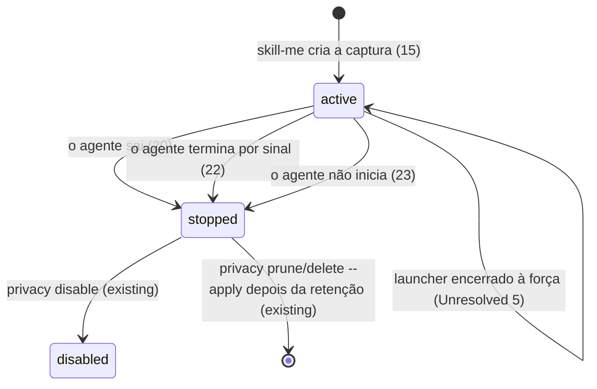
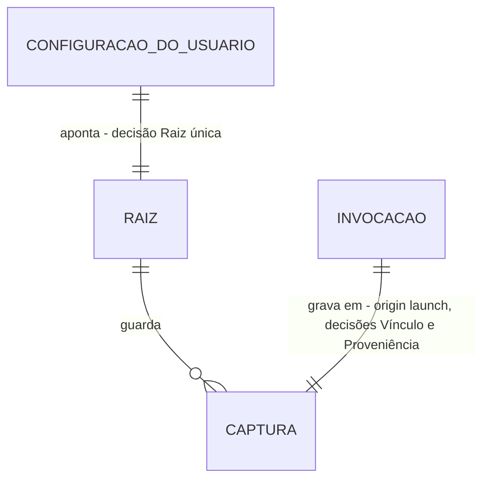

# Iniciar o agente com captura: `skill-me <agente>`

> Implementar com **tlc-implement** depois da aprovação do proprietário e da resposta à
> `Unresolved` 1. Cada critério abaixo vira um check com prova, referenciado pelo número.
> Nada em `Unresolved` é decidido durante a implementação.

## Intent

Para observar uma sessão hoje, o usuário instala os hooks de cada agente com `--target`, cria uma
pasta e roda `observe setup`, liga com `npm run on`, abre o agente, desliga com `npm run off` e
pede o relatório pela CLI interna (`node src/integrations/cli.mjs report --latest`). Tudo isso
roda a partir do checkout. Além disso, o consentimento do `on` vale para toda sessão de qualquer
agente até o `off`, e não apenas para a sessão que o usuário quer observar. O proprietário paga
esse custo a cada uso. Ele pediu um comando cotidiano como `skill-me codex` (issue #25). A issue
não informa frequência de uso nem custo medido.

Depois da entrega, o usuário instala o comando uma vez a partir do checkout (`npm link`).
Depois, roda `skill-me codex`, `skill-me claude` ou `skill-me hermes` e o agente abre no terminal,
como abriria sem o comando. No primeiro uso, o próprio comando mostra a pasta das capturas, a
instalação da integração e o passo de confiança nativa, e só aplica as mudanças depois da
confirmação. Cada invocação grava apenas a própria sessão numa captura local. A captura termina
quando o agente sai, e `skill-me report` consulta essa captura sem que o usuário copie um ID. A
observação global `on`/`off` não muda.

30 critérios em 5 fatias · 4 decisões sem volta, que valem quando o plano for aprovado · 5 questões em aberto: 1 bloqueia a implementação e 1 bloqueia o uso real.

## Criteria

### Disponibilizar o comando e abrir o agente

1. Dado o checkout com `npm ci`, quando o usuário executa `npm link` nele (nas provas, com um
   prefixo npm temporário), então `skill-me --help` executado de outro diretório sai com 0 e
   imprime o uso em stdout, e o `package.json` continua com `"private": true`.
2. Dados a raiz configurada e a integração instalada, quando o usuário executa
   `skill-me <agente> <args…>` (`<agente>` ∈ `codex`, `claude`, `hermes`), então o executável que
   o PATH resolve para esse agente inicia sem shell, com exatamente `<args…>` na mesma ordem
   (inclusive argumentos com espaço, aspas, Unicode e `--`) e com stdin, stdout e stderr do
   terminal herdados. O launcher não escreve nada em stdout.
3. Quando o agente sai com o código N (0 e 7 nas provas), `skill-me` sai com N.
4. No Windows, quando o primeiro `codex` do PATH é o shim `codex.cmd` do npm, cujo pacote o
   doctor reconhece (`versionSource: package_metadata`), então `skill-me codex` inicia, com o Node
   e sem shell, o `@openai/codex/bin/codex.js` que o shim referencia, com os argumentos intactos.
   Outro `.cmd`/`.bat` não é iniciado: o comando sai com 127, o stderr mostra
   `launcher_requires_shell` e nenhuma captura é criada.
5. Enquanto o agente roda, SIGINT, SIGQUIT e SIGHUP entregues pelo terminal ao grupo de
   processos (Ctrl+C, Ctrl+\, terminal fechado) chegam ao agente uma única vez cada e não encerram
   o launcher antes dele. No Windows, Ctrl+C no console também não encerra o launcher antes do
   agente.
6. Quando o launcher recebe SIGTERM (POSIX), o agente recebe SIGTERM uma vez.

### Primeiro uso conduzido pelo próprio comando

7. Quando o agente pedido não está no PATH (doctor: `presence: absent`), `skill-me <agente>` sai
   com 127 e o stderr mostra `executable_not_found`. O comando não pergunta nada e não cria pasta,
   configuração, instalação nem captura.
8. Dado `<home>/.skill-me/observe.json` ausente, ou o `plan` da integração do agente com mudanças,
   num terminal interativo, quando o usuário executa `skill-me <agente>`, então, antes de qualquer
   escrita, o stderr mostra:
   - a pasta proposta para as capturas: `%LOCALAPPDATA%\skill-me\capturas` no Windows,
     `$HOME/.local/share/skill-me/capturas` no POSIX. O usuário aceita com Enter ou digita outro
     caminho absoluto;
   - as mudanças do `plan` no diretório de configuração de usuário do agente (`claudeHome`,
     `codexHome` e `hermesHome` do doctor, que seguem `CLAUDE_CONFIG_DIR`, `CODEX_HOME` e
     `HERMES_HOME`);
   - que cada invocação grava localmente os argumentos e resultados suportados depois da
     sanitização, com retenção de 7 dias;
   - a pergunta de confirmação.
9. Quando o usuário confirma, então a pasta é criada se faltar, a raiz é gravada em
   `.skill-me/observe.json` no formato da #23 e a integração é aplicada pelo `install --apply`
   existente. O stderr mostra o passo manual de confiança do agente (os `manualSteps` do
   instalador: workspace confiável e `/hooks` no Claude, `/hooks` e projeto confiável no Codex,
   `hermes plugins enable skill-me-observer` no Hermes) e o agente inicia.
10. Quando o usuário recusa ou responde qualquer coisa diferente da confirmação, nada é criado nem
    alterado (pasta, `.skill-me/observe.json`, configuração do agente), o agente não inicia e o
    comando sai com 3 (`setup_declined`).
11. Quando o caminho digitado é relativo, nenhuma pasta é criada, o `.skill-me/observe.json` não é
    gravado e o comando sai com 2 (`root_not_absolute`, a validação atual do `observe setup`).
12. Se a preparação estiver pendente e stdin ou stderr não for um terminal, o comando sai com 3
    (`setup_required`) sem perguntar nem alterar nada, e o stderr orienta rodar
    `skill-me <agente>` num terminal.
13. Dado o preparo concluído, quando `skill-me <agente>` roda de novo, nenhuma prévia nem pergunta
    aparece, os arquivos de configuração do agente e o `.skill-me/observe.json` mantêm o mesmo
    SHA-256 e o agente inicia.
14. Se a gravação da raiz (`observe setup`) ou o `plan`/`install --apply` responder conflito (4,
    por exemplo `observe_on` ou `lock_present`), configuração inválida (3) ou E/S incompleta (5),
    o stderr mostra o código e os itens do instalador, o agente não inicia e `skill-me` sai com
    esse código. A raiz já gravada permanece, e a próxima execução mostra só o que ainda falta.

### Sessão isolada da invocação

15. Antes de iniciar o agente, `skill-me <agente>` cria uma captura nova na raiz configurada com
    `origin: "launch"`, `content: true`, `retentionDays: 7`, chave própria e
    `limits` `{maxEvents: 500, maxBytes: 8388608}`. O ambiente do processo do agente recebe o
    `SKILL_ME_CAPTURE_ROOT` (absoluto) e o `SKILL_ME_CAPTURE_ID` dessa captura, que substituem os
    valores herdados, inclusive um par incompleto. O usuário não define nenhuma variável nem roda
    `npm run on`/`off`.
16. Se a captura não puder ser criada, o agente não inicia e o stderr mostra só o código fechado,
    sem caminho. Os códigos são: 3 para `root_not_found`, `root_not_directory` e `store_invalid`;
    4 para `lock_present` depois de 2 s, `link_refused`, `foreign_entry` e `root_changed`; 5 para
    `io_failure`.
17. Quando os hooks Claude e Codex, executados pela linha instalada, e o plugin Hermes, pelo
    `ingest`, recebem eventos nativos de fixture na sessão iniciada, cada evento suportado vira no
    máximo um registro `recordVersion: 1` nessa captura, com pseudônimos `h1:` da chave dela e
    conteúdo só da matriz sanitizada. Nenhum registro vai para outra captura, nem para uma captura
    automática quando a observação global estiver `on`.
18. Sempre, uma invocação deixa `<raiz>/skill-me-privacy/observe.json` e
    `<home>/.skill-me-authorization.json` com os mesmos bytes, ou ausentes, com a observação global
    `on` ou `off`.
19. Se a sessão passar de 500 eventos ou 8 MiB, os excedentes são descartados e contados em
    `counters.dropped.capture_event_limit` ou `counters.dropped.capture_byte_limit` da mesma
    captura, sem que outra seja criada.

### Encerramento verificável e consulta sem ID

20. Quando o agente sai, com qualquer código, a captura da invocação passa a `stopped`, com
    `endedAt`, antes de o launcher sair. O stderr mostra o ID da captura, o estado `stopped`, o
    `counters.persisted` e os descartes. Com `persisted` 0, o resumo diz que nada foi gravado e
    repete o passo de confiança do agente.
21. Dado um Hermes de fixture cujo plugin entrega N registros (3 na prova) e sai logo depois do
    último, quando `skill-me hermes` termina, a captura tem `counters.persisted` = N e
    `state: "stopped"`.
22. Quando o agente termina por sinal (do terminal, ou SIGTERM repassado), a captura fica
    `stopped` e o launcher termina pelo mesmo sinal no POSIX. No Windows, o launcher sai com o
    código do agente.
23. Se o agente não iniciar (`ENOENT` → 127; outro erro de início → 126), a captura criada fica
    `stopped` com 0 eventos, e o stderr mostra o código de início.
24. Se o encerramento da captura falhar (lock ocupado por mais de 2 s, ou E/S), o stderr mostra o
    código fechado, que a captura continua `active`, o ID dela e o comando `privacy stop` que a
    encerra. O código de saída continua o do agente.
25. Quando duas invocações rodam ao mesmo tempo, com agentes de fixture gravando de forma
    intercalada, cada uma tem ID e chave próprios e nenhuma captura contém registro da outra. A
    saída da primeira encerra só a captura dela: a outra continua `active` e grava os eventos
    seguintes.
26. Quando `npm run off` ou `npm run on` roda durante uma invocação, a captura dela continua
    `active` e o próximo evento da sessão é gravado nela.
27. Quando o usuário executa `skill-me report [--skill <SKILL.md>] [--format text|markdown|json]`,
    sai o relatório existente da captura `origin: "launch"` de maior (`createdAt`, `id`) na raiz
    configurada, sem `--root` nem `--capture`, com a linha `Captura: <id>` (no JSON,
    `timeline.capture.id`). `integrations report --latest` e `npm run status` continuam
    escolhendo e listando só capturas `origin: "automatic"`.
28. Sem nenhuma captura `origin: "launch"` na raiz, `skill-me report` sai com 3
    (`no_launch_capture`). Sem raiz configurada, sai com 3 (`not_configured`). Os dois erros saem
    no JSON de erro `schemaVersion: 1` do `report` atual.

### Ajuda e documentação

29. `skill-me --help` (stdout, código 0) mostra:
    - o preparo único: `npm ci` e `npm link` no checkout, e depois o primeiro `skill-me <agente>`
      com a prévia e a confiança manual;
    - o fluxo diário de uma linha: `skill-me codex`, `skill-me claude`, `skill-me hermes`;
    - a consulta: `skill-me report`;
    - os limites do critério 30.

    `skill-me` sem argumento, ou com subcomando desconhecido, sai com 2 e imprime a ajuda em
    stderr.
30. O README apresenta esse preparo e o fluxo diário como o uso normal, antes do `on`/`off`, que
    continua documentado. O README e os guias (`docs/traces.md`, `docs/privacidade.md`,
    `docs/agent-observation.md`) declaram:
    - a confiança nativa é manual, por agente;
    - o Codex não tem evento nativo de ativação de skill: ler um `SKILL.md` aparece só como
      operação de ferramenta;
    - os hooks do Codex cobrem só ferramentas locais, e as hospedadas ficam fora;
    - o limite é de 500 eventos ou 8 MiB por invocação;
    - um encerramento forçado do launcher (SIGKILL, TerminateProcess) deixa a captura `active`;
    - o próximo passo depois da sessão é `skill-me report`.

    As frases dos guias que dizem que o par de variáveis só aponta para uma captura criada com
    `privacy start` passam a incluir a captura criada pela invocação.

## States

Ciclo de vida da captura `origin: "launch"`.

## Out of scope

- Migração para SQLite e `skill-me teach`: são entregas próprias, segundo a issue.
- Publicar o pacote, enviar dados pela rede ou fazer merge automático: a issue não autoriza.
- Ligar ou desligar a observação global a partir do launcher, ou mudar `observe setup/on/off/status`, `integrations report --latest` e o wrapper `integrations run --agent codex`: a invocação autoriza só a própria sessão.
- Capturas sucessivas dentro de uma invocação: a questão está aberta na `Unresolved` 1, e o plano foi escrito com o descarte.
- Encerrar, numa execução seguinte, uma captura deixada `active` por encerramento forçado: depende da `Unresolved` 5 e exige um novo campo persistido.
- Conceder confiança nativa ou ler a confiança de Claude/Codex: o instalador nunca altera `plugins.enabled` do Hermes, e não há fonte estática documentada para a confiança de Claude/Codex (`docs/agent-compatibility.md`).
- Primeiro uso não interativo (`--yes`), flags próprias misturadas aos argumentos do agente e escolha de outro diretório de configuração do agente por invocação: a issue não pede nenhum deles.
- Iniciar `.cmd`/`.bat` por shell: os argumentos deixariam de chegar literais. O wrapper atual já recusa pelo mesmo motivo.
- Executar um agente real ou alterar runtime, hooks e configurações pessoais nas provas. Esta entrega instrui assim: as provas usam home, prefixo npm, PATH e diretórios de configuração temporários, com agentes de fixture.
- Alterar os repositórios pilotos ou o motor vendorizado de revisão.

## Observable

| Superfície | Decisão | Destino |
| --- | --- | --- |
| comando `skill-me <agente> [args…]` | formato de saída e verbosidade | 2, 20 |
| comando `skill-me <agente> [args…]` | flags e defaults | 2: não há flag própria; todos os argumentos vão para o agente |
| comando `skill-me <agente> [args…]` | códigos de saída | 3, 4, 7, 22, 23 |
| comando `skill-me <agente> [args…]` | falha no meio | 14, 16, 23, 24 |
| comando `skill-me <agente>`, primeiro uso | prévia e confirmação antes de alterar | 8, 9, 10 |
| comando `skill-me <agente>`, primeiro uso | defaults propostos | 8 |
| comando `skill-me <agente>`, primeiro uso | códigos de saída | 10, 11, 12, 14 |
| comando `skill-me <agente>`, primeiro uso | execução repetida | 13 |
| comando `skill-me report` | formato de saída | existing: renderizador do `report` (texto, Markdown, JSON) |
| comando `skill-me report` | flags e defaults | 27 |
| comando `skill-me report` | estado vazio e códigos | 28 |
| comando `skill-me report` | falha no meio | existing: consulta só leitura, sem lock; `lock_present` → 4 sem mudar nada |
| comando `skill-me --help` | conteúdo | 29 |
| comando `skill-me` sem argumento ou inválido | código e saída | 29 |
| comando `npm link` | saída, flags e códigos | n/a: é um comando do npm; o critério observa só o resultado (1) |
| documento README e guias | estrutura | 30 |
| documento README e guias | tom | existing: português direto, uma linha por ação, como o README atual |
| documento README e guias | profundidade dos limites | 30 |
| documento README e guias | próximo passo do leitor | 9 (confiança depois de instalar), 20 (passo de confiança quando nada foi gravado), 30 (`skill-me report`) |

## Swept

- validation: 4, 7, 11; 2 (argumentos repassados sem interpretação).
- failure modes: 14, 16, 23, 24.
- idempotency and retry: 13. Existing: encerrar uma captura já `stopped` não muda nada (`transition` em `privacy/lifecycle.mjs`), e nenhuma entrega é reenviada (#8, `traces/delivery.mjs`).
- authorization: 9 e 10 (consentimento no primeiro uso), 15 (vínculo só no ambiente do agente), 18 (autorização global intacta).
- concurrency and ordering: 21 (entregas Hermes em voo antes do encerramento), 25 (invocações simultâneas), 26 (`on`/`off` concorrentes).
- data lifecycle: 15 (retenção de 7 dias) e 20 (`endedAt` inicia a retenção; a limpeza continua o `privacy prune` existente); Unresolved 5 (encerramento forçado).
- external-dependency failure: 7 (agente ausente), 20 (sem confiança, nada gravado e o resumo explica). Existing: uma falha de entrega nunca bloqueia o agente (#8, `docs/traces.md`).
- state transitions: 20, 22, 23, 24, 26 (ver `States`).
- observability: 20 (resumo final), 27 e 28 (consulta sem ID).

## Impact

| Frente | O que muda |
| --- | --- |
| domínio | Termo novo: `invocação`. É uma execução de `skill-me <agente>`: um processo do agente e uma captura `origin: "launch"`. Vive no novo launcher e no `state.json` do store. |
| domínio | Termo existente: `origin`. Hoje fica ausente (manual) ou vale `automatic`; passa a aceitar `launch`. Ramificam nele: `isValidState`, `publicCapture`, `automaticCaptures` (filtro do `off` e do `status`), `latestAutomaticCapture` (`report --latest`), a saída de `privacy list/status/export` e as provas de formato do store. |
| domínio | Termo existente: a `root` de `<home>/.skill-me/observe.json`. Hoje é a raiz da observação automática; passa a ser também a raiz das capturas do launcher, e o primeiro uso a grava. Dependem dela: `observe setup/on/off/status`, `report --latest`, a rota automática de hooks e `ingest`, e o plugin Hermes (`hermesDelivery`, gravado junto). Trocar a raiz pelo `setup` muda onde as próximas invocações gravam. |
| domínio | Termo existente: o par `SKILL_ME_CAPTURE_ROOT`/`SKILL_ME_CAPTURE_ID`. Hoje só o usuário o define; passa a ser definido também pelo launcher, só no ambiente do agente. A precedência sobre o `on` não muda. Depende dele: `captureDeliveryFor` (hooks, `ingest` e wrapper). |
| pacote | `package.json` ganha `bin` com `skill-me` e continua `private: true`; os scripts não mudam. |
| configuração do agente | O primeiro uso grava hooks/plugin pelo instalador existente no diretório de configuração de usuário do agente, só depois da confirmação. Mover o checkout continua exigindo reinstalar, e o `plan` passa a mostrar a mudança. |
| dados armazenados | Nada a migrar: as capturas existentes continuam legíveis. Uma captura `launch` só é legível por um checkout com esta entrega; um checkout anterior responde `capture_invalid`. |
| documentação | README, `docs/traces.md`, `docs/privacidade.md` e `docs/agent-observation.md` mudam (30). As provas de documentação existentes (`tests/integrations/**/docs*.test.mjs`) acompanham. |
| testes | Agentes de fixture no PATH, com home, prefixo npm e diretórios de configuração temporários. Verifier independente (perfil `light`). |

## Decided

Estas decisões são propostas deste plano, derivadas da issue e do código. Valem quando o
proprietário aprovar o plano.

| Decisão | Forma | Alternativa descartada |
| --- | --- | --- |
| Executável local | `package.json` → `"bin": { "skill-me": "<entrada do launcher>" }`, mantendo `"private": true`. O comando é disponibilizado por `npm link` (ou `npm install --global <checkout>`) a partir do checkout, ao qual fica ligado. | Instalador próprio que grava shims no PATH: cria um padrão de escrita fora do checkout sem outro consumidor. Publicar o pacote: a issue não autoriza. |
| Vínculo da sessão | Uma captura por invocação, criada antes do agente. O par existente `SKILL_ME_CAPTURE_ROOT`/`SKILL_ME_CAPTURE_ID` vai só no ambiente do processo do agente e substitui os valores herdados. O launcher encerra a captura (`stopped`) no fim. Com isso, capturas sucessivas numa invocação exigiriam trocar este vínculo. | Ligar o `on` global durante a invocação: autorizaria toda sessão do usuário até o `off`, e o `off` de uma invocação cortaria a outra. Vínculo novo com capturas sucessivas: exige variável e mapa persistidos novos, sem decisão (`Unresolved` 1). |
| Proveniência persistida | `state.json`, ainda `captureVersion: 1`, com `"origin":"launch"` só nas capturas do launcher. As manuais e as `automatic` não mudam. Checkouts anteriores recusam essas capturas (`capture_invalid`). | `origin: "automatic"`: o `off` encerra toda captura automática ativa (`changeObservation` em `privacy/store.mjs`) e cortaria uma invocação em curso, e `status` e `report --latest` misturariam as duas origens. Captura manual com um ponteiro no home: estado extra, e invocações simultâneas sobrescreveriam o ponteiro. |
| Raiz única | As capturas do launcher usam a `root` de `<home>/.skill-me/observe.json`. O primeiro uso grava esse arquivo com o formato, a validação e a barreira do `observe setup` da #23. | Configuração própria do launcher: seria uma segunda raiz, um segundo preparo e outra fonte de verdade para o mesmo usuário. |

## Relations

## Surface

| Comando | Entrada | Saída | Código | Critérios |
| --- | --- | --- | --- | --- |
| `skill-me <codex\|claude\|hermes> [args…]` | argumentos literais para o agente; terminal herdado; no primeiro uso, a resposta à prévia | stdout e stderr do agente; no stderr do launcher, prévia, passo de confiança e resumo final | código do agente ou o mesmo sinal; 127/126 no início; 2 `root_not_absolute`; 3 `setup_declined`, `setup_required` ou captura indisponível; 4/5 do setup, do instalador ou do store | 2–26 |
| ambiente do agente | — | `SKILL_ME_CAPTURE_ROOT` e `SKILL_ME_CAPTURE_ID` da captura da invocação | — | 15 |
| `skill-me report` | `--skill <SKILL.md>`, `--format text\|markdown\|json` | relatório existente com `Captura: <id>` | 0; 2; 3 `no_launch_capture` ou `not_configured`; 4; 5 | 27, 28 |
| `skill-me --help`, `skill-me help` | — | ajuda em stdout | 0 | 29 |
| `skill-me` sem argumento ou com subcomando desconhecido | — | ajuda em stderr | 2 | 29 |
| `package.json` `bin` | `npm link` no checkout | comando `skill-me` no prefixo npm | do npm | 1 |

## Sources

- [Issue #25](https://github.com/oldboydev/skill-me/issues/25), lida de
  `.checks/code-review/issue-25/context.json`, sem comentários. Define o problema, o resultado e
  os critérios de aceite. Trechos que decidem:
  - “O proprietário pediu nesta conversa `skill-me codex` como forma de uso e confirmou que o
    comando deve abrir o Codex CLI, capturar automaticamente até sair e seguir o mesmo padrão para
    Claude e Hermes.”
  - “Esta issue trata da experiência de execução; a migração para SQLite e o futuro
    `skill-me teach` ficam em entregas próprias. Não há autorização para publicar o pacote, enviar
    dados pela rede ou fazer merge automático.”
- Pedido do proprietário nesta sessão (sem endereço): “pega a proxima issue planejar e
  implementar”. Autoriza executar o escopo já decidido da #25; não aprova decisões novas.
- `.tasks/issue-23-observacao-on-off.md` e o Landing de `.checks/issue-23-observacao-on-off.md`:
  configuração única, `origin: "automatic"`, o `off` encerra as automáticas, conteúdo ligado pelo
  `on`, códigos 0/2/3/4/5 e a paciência de 2 s com o lock.
- `.tasks/issue-8-traces.md` e `docs/traces.md`: o par herdado pelo agente, a precedência sobre o
  `on`, o prazo de entrega de 750 ms e os códigos de entrega.
- `.tasks/issue-5-privacidade.md` e `docs/privacidade.md`: a política, os limites de 500 eventos/8
  MiB e a retenção de 7 dias.
- `docs/agent-observation.md` e `src/integrations/install/run.mjs`: o instalador, `plan`,
  `install --apply`, `manualSteps` e a confiança manual.
- `docs/agent-compatibility.md`, `src/doctor/agent-resolution.mjs`,
  `src/doctor/config-sources.mjs` e `src/doctor/launcher-link/codex.mjs`: a resolução no PATH, o
  shim `codex.cmd` quando encontrado no PATH, os diretórios de configuração e a falta de
  uma fonte estática de confiança para Claude e Codex.
- `src/integrations/codex-run.mjs`: o precedente de repasse de sinais, dos códigos 127/126 e da
  recusa de `.cmd`/`.bat`.
- `src/integrations/privacy/store.mjs`: `isValidState`, `automaticCaptures`,
  `changeObservation` e `latestAutomaticCapture`.
- `README.md`: as pastas sugeridas para as capturas, usadas como defaults em 8.
- [OpenAI Docs: Hooks](https://learn.chatgpt.com/docs/hooks): a cobertura só de ferramentas
  locais e a falta de evento de skill. A #23 já citava esta página; este plano não a consultou de
  novo.

Os padrões que este plano escreveu enquanto o proprietário não responde estão nas linhas `open`
de `Unresolved`. Eles não são decisões do proprietário.

Este plano é o registro da decisão. Se um documento vinculado divergir, pergunte antes de
implementar.

## Unresolved

| # | Kind | Question | Until answered |
| --- | --- | --- | --- |
| 1 | blocks | Quando uma invocação passa de 500 eventos ou 8 MiB, o que acontece? **(A)** O excedente é descartado e contado na mesma captura (uma captura por invocação). **(B)** A sessão continua em capturas sucessivas, como no `on`. Recomendação: **A**. O critério de aceite 3 pede “limites e retenção da política existente”; A reaproveita o par atual, sem vínculo nem formato persistido novos, e o descarte aparece nos contadores e no resumo final. B exige um vínculo novo por invocação, com variável e mapa persistidos. | O critério 19 e a decisão “Vínculo da sessão” foram escritos com A. Se a resposta for B, os dois mudam antes de implementar o vínculo. |
| 2 | blocks go-live | Para o uso real, o proprietário precisa confirmar a confiança de cada agente (`/hooks` no Claude e no Codex, `hermes plugins enable skill-me-observer`) e rodar uma sessão real com `skill-me <agente>`. Só essa sessão confirma que os hooks do agente herdam o par. | As provas usam agentes de fixture e não iniciam nenhum agente real. Até essa sessão, o uso real não está comprovado; sem confiança, o resumo final mostra 0 eventos gravados (20). |
| 3 | open | Conteúdo nas capturas da invocação: o padrão é `content: true`, como no `on` aprovado na #23. O critério de aceite 3 fala em eventos “sanitizados”, e o relatório depende dos comandos literais. A prévia do primeiro uso anuncia esse comportamento. A alternativa é deixar o conteúdo desligado; aí o relatório não comprova comandos. | Os critérios 8 e 15 foram escritos com `content: true`. |
| 4 | open | Falha de preparação (recusa, instalador, raiz ou captura indisponível): o padrão é não iniciar o agente e sair com o código. A alternativa é iniciar o agente sem captura, com um aviso. | Os critérios 10, 14 e 16 foram escritos com o padrão. |
| 5 | open | Encerramento forçado do launcher (SIGKILL, TerminateProcess, queda de energia): o padrão é a captura ficar `active`, visível em `skill-me report` e `privacy list` e encerrável com `privacy stop`, com o limite documentado. A alternativa é a próxima invocação encerrar capturas `launch` órfãs, o que exige gravar o processo dono num campo persistido novo. | `States` mostra a aresta sem critério; o critério 30 documenta o limite. |
