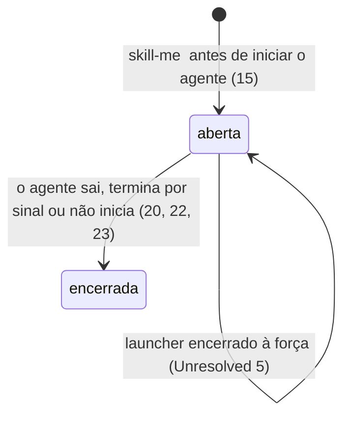
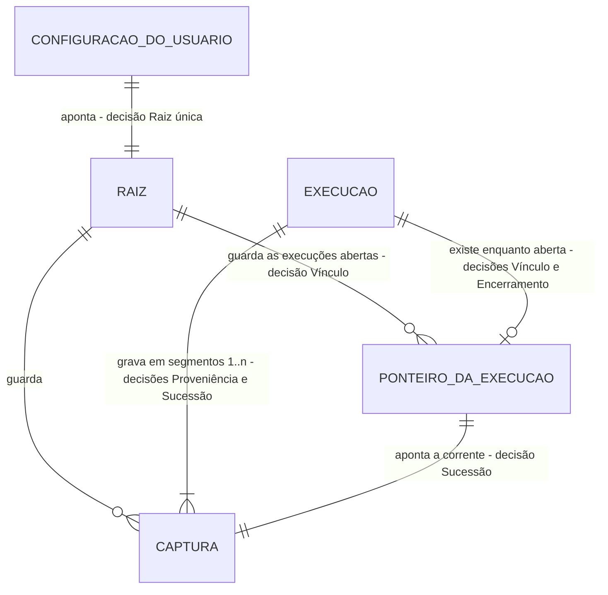

# Iniciar o agente com captura: `skill-me <agente>`

> Implementar com **tlc-implement**. Cada critério abaixo vira um check com prova, referenciado
> pelo número. Nada em `Unresolved` é decidido durante a implementação. A questão bloqueante
> (capturas sucessivas) foi respondida pelo proprietário em 26/10/2026 com a alternativa B (ver
> `Sources`). Em 26/10/2026, o proprietário aprovou o plano completo e o checklist com:
> “Aprovar plano completo e implementar”.

## Intent

Para observar uma sessão hoje, o usuário instala os hooks de cada agente com `--target`, cria uma
pasta e roda `observe setup`, liga com `npm run on`, abre o agente, desliga com `npm run off` e
pede o relatório pela CLI interna (`node src/integrations/cli.mjs report --latest`). Tudo isso
roda a partir do checkout. Além disso, o consentimento do `on` vale para toda sessão de qualquer
agente até o `off`, e não apenas para a sessão que o usuário quer observar. O proprietário paga
esse custo a cada uso. Ele pediu um comando cotidiano como `skill-me codex` (issue #25). A issue
não informa frequência de uso nem custo medido.

Depois da entrega, o usuário instala o comando uma vez a partir do checkout (`npm link`).
Depois, roda `skill-me codex`, `skill-me claude` ou `skill-me hermes` e o agente abre no terminal,
como abriria sem o comando. No primeiro uso, o próprio comando mostra a pasta das capturas, a
instalação da integração e o passo de confiança nativa, e só aplica as mudanças depois da
confirmação. Cada invocação abre uma execução própria e grava apenas a sessão iniciada por ela,
em capturas locais sucessivas: ao chegar a 500 eventos ou 8 MiB, a execução continua numa nova
captura, com chave e limites próprios, até o agente sair. A execução termina quando o agente sai,
e `skill-me report` consulta a execução inteira, captura por captura, sem que o usuário copie um
ID. A observação global `on`/`off` não muda.

34 critérios em 6 fatias · 6 decisões sem volta aprovadas com o plano · 4 questões em aberto: nenhuma bloqueia a implementação e 1 bloqueia o uso real. A fatia da harness foi autorizada em 26/10/2026 (ver Sources); os critérios 33–34 são regressões da revisão formal dentro de AC1, AC3 e AC4.

## Criteria

### Disponibilizar o comando e abrir o agente

1. Dado o checkout com `npm ci`, quando o usuário executa `npm link` nele (nas provas, com um
   prefixo npm temporário), então `skill-me --help` executado de outro diretório sai com 0 e
   imprime o uso em stdout, e o `package.json` continua com `"private": true`.
2. Dados a raiz configurada e a integração instalada, quando o usuário executa
   `skill-me <agente> <args…>` (`<agente>` ∈ `codex`, `claude`, `hermes`), então o executável que
   o PATH resolve para esse agente inicia sem shell, com exatamente `<args…>` na mesma ordem
   (inclusive argumentos com espaço, aspas, Unicode e `--`) e com stdin, stdout e stderr do
   terminal herdados. O launcher não escreve nada em stdout.
3. Quando o agente sai com o código N (0 e 7 nas provas), `skill-me` sai com N.
4. No Windows, quando o primeiro `codex` do PATH é o shim `codex.cmd` do npm, cujo pacote o
   doctor reconhece (`versionSource: package_metadata`), então `skill-me codex` inicia, com o Node
   e sem shell, o `@openai/codex/bin/codex.js` que o shim referencia, com os argumentos intactos.
   Outro `.cmd`/`.bat` não é iniciado: o comando sai com 127, o stderr mostra
   `launcher_requires_shell` e nenhuma captura é criada.
5. Enquanto o agente roda, SIGINT, SIGQUIT e SIGHUP entregues pelo terminal ao grupo de
   processos (Ctrl+C, Ctrl+\, terminal fechado) chegam ao agente uma única vez cada e não encerram
   o launcher antes dele. No Windows, Ctrl+C no console também não encerra o launcher antes do
   agente.
6. Quando o launcher recebe SIGTERM (POSIX), o agente recebe SIGTERM uma vez.

### Primeiro uso conduzido pelo próprio comando

7. Quando o agente pedido não está no PATH (doctor: `presence: absent`), `skill-me <agente>` sai
   com 127 e o stderr mostra `executable_not_found`. O comando não pergunta nada e não cria pasta,
   configuração, instalação nem captura.
8. Dado `<home>/.skill-me/observe.json` ausente, ou o `plan` da integração do agente com mudanças,
   num terminal interativo, quando o usuário executa `skill-me <agente>`, então, antes de qualquer
   escrita, o stderr mostra:
   - a pasta proposta para as capturas: `%LOCALAPPDATA%\skill-me\capturas` no Windows,
     `$HOME/.local/share/skill-me/capturas` no POSIX. O usuário aceita com Enter ou digita outro
     caminho absoluto;
   - as mudanças do `plan` no diretório de configuração de usuário do agente (`claudeHome`,
     `codexHome` e `hermesHome` do doctor, que seguem `CLAUDE_CONFIG_DIR`, `CODEX_HOME` e
     `HERMES_HOME`);
   - que cada invocação grava localmente os argumentos e resultados suportados depois da
     sanitização, em capturas sucessivas de até 500 eventos ou 8 MiB, com retenção de 7 dias;
   - a pergunta de confirmação.
9. Quando o usuário confirma, então a pasta é criada se faltar, a raiz é gravada em
   `.skill-me/observe.json` no formato da #23 e a integração é aplicada pelo `install --apply`
   existente. O stderr mostra o passo manual de confiança do agente (os `manualSteps` do
   instalador: workspace confiável e `/hooks` no Claude, `/hooks` e projeto confiável no Codex,
   `hermes plugins enable skill-me-observer` no Hermes) e o agente inicia.
10. Quando o usuário recusa ou responde qualquer coisa diferente da confirmação, nada é criado nem
    alterado (pasta, `.skill-me/observe.json`, configuração do agente), o agente não inicia e o
    comando sai com 3 (`setup_declined`).
11. Quando o caminho digitado é relativo, nenhuma pasta é criada, o `.skill-me/observe.json` não é
    gravado e o comando sai com 2 (`root_not_absolute`, a validação atual do `observe setup`).
12. Se a preparação estiver pendente e stdin ou stderr não for um terminal, o comando sai com 3
    (`setup_required`) sem perguntar nem alterar nada, e o stderr orienta rodar
    `skill-me <agente>` num terminal.
13. Dado o preparo concluído, quando `skill-me <agente>` roda de novo, nenhuma prévia nem pergunta
    aparece, os arquivos de configuração do agente e o `.skill-me/observe.json` mantêm o mesmo
    SHA-256 e o agente inicia.
14. Se a gravação da raiz (`observe setup`) ou o `plan`/`install --apply` responder conflito (4,
    por exemplo `observe_on` ou `lock_present`), configuração inválida (3) ou E/S incompleta (5),
    o stderr mostra o código e os itens do instalador, o agente não inicia e `skill-me` sai com
    esse código. A raiz já gravada permanece, e a próxima execução mostra só o que ainda falta.

### Execução isolada da invocação, em capturas sucessivas

15. Antes de iniciar o agente, `skill-me <agente>` abre uma execução nova na raiz configurada: um
    ID de execução próprio (32 hex) e a primeira captura dela, com `origin: "launch"`, o ID da
    execução em `invocation`, `segment: 1`, `content: true`, `retentionDays: 7`, chave própria e
    `limits` `{maxEvents: 500, maxBytes: 8388608}`. O ambiente do processo do agente recebe
    `SKILL_ME_LAUNCH_ROOT` (o caminho real absoluto da raiz) e `SKILL_ME_LAUNCH_ID` (o ID da
    execução); valores herdados de `SKILL_ME_LAUNCH_ROOT`, `SKILL_ME_LAUNCH_ID`,
    `SKILL_ME_CAPTURE_ROOT` e `SKILL_ME_CAPTURE_ID`, inclusive incompletos, não chegam ao agente.
    O usuário não define nenhuma variável nem roda `npm run on`/`off`.
16. Se a execução não puder ser aberta, o agente não inicia e o stderr mostra só o código fechado,
    sem caminho. Os códigos são: 3 para `root_not_found`, `root_not_directory` e `store_invalid`;
    4 para `lock_present` depois de 2 s, `link_refused`, `foreign_entry` e `root_changed`; 5 para
    `io_failure`.
17. Quando os hooks Claude e Codex, executados pela linha instalada, e o plugin Hermes, pelo
    `ingest`, recebem eventos nativos de fixture na sessão iniciada, cada evento suportado vira no
    máximo um registro `recordVersion: 1` na captura corrente da execução, com pseudônimos `h1:`
    da chave dessa captura e conteúdo só da matriz sanitizada. Nenhum registro vai para captura de
    outra execução, para uma captura manual nem para uma captura automática, também com a
    observação global `on`. Com o par `SKILL_ME_LAUNCH_*` incompleto ou inválido, nada é gravado
    (`binding_invalid`) e o evento não cai no par manual nem na observação automática.
18. Sempre, uma invocação deixa `<raiz>/skill-me-privacy/observe.json` e
    `<home>/.skill-me-authorization.json` com os mesmos bytes, ou ausentes, com a observação global
    `on` ou `off`.
19. Quando a captura corrente da execução não comporta o próximo registro (500 eventos ou 8 MiB),
    ela passa a `stopped` sem descartar nada, e uma captura sucessora da mesma execução
    (`segment` seguinte, mesma `invocation`, chave nova, os mesmos `limits`, `content` e retenção)
    recebe esse registro e os seguintes, inclusive em outro processo produtor. Nenhuma captura
    passa de 500 eventos ou 8 MiB.

### Encerramento verificável e consulta sem ID

20. Quando o agente sai, com qualquer código, o launcher espera 750 ms pelas entregas em voo e
    então encerra a execução: a captura corrente passa a `stopped`, com `endedAt`, e nenhum
    registro novo entra na execução, antes de o launcher sair. O stderr mostra o ID da execução e,
    por captura, o segmento, o ID, o estado `stopped`, o `counters.persisted` e os descartes. Com
    `persisted` 0 em todas, o resumo diz que nada foi gravado e repete o passo de confiança do
    agente.
21. Dado um Hermes de fixture cujo processo de entrega já está em execução (como depois do
    `on_session_start`) e cujo plugin entrega N registros (3 na prova) e sai logo depois do
    último, quando `skill-me hermes` termina, as capturas da execução somam
    `counters.persisted` = N e estão `stopped`.
22. Quando o agente termina por sinal (do terminal, ou SIGTERM repassado), a execução é encerrada
    como em 20 e o launcher termina pelo mesmo sinal no POSIX. No Windows, o launcher sai com o
    código do agente.
23. Se o agente não iniciar (`ENOENT` → 127; outro erro de início → 126), a execução é encerrada
    sem espera, com a captura `segment: 1` `stopped` e 0 eventos, e o stderr mostra o código de
    início.
24. Se o encerramento da execução falhar (lock ocupado por mais de 2 s, ou E/S), o stderr mostra o
    código fechado, que a captura corrente continua `active`, o ID dela e o comando `privacy stop`
    que a encerra. O código de saída continua o do agente.
25. Quando duas invocações rodam ao mesmo tempo, com agentes de fixture gravando de forma
    intercalada, cada uma tem ID de execução, capturas e chaves próprios e nenhuma captura contém
    registro da outra. A saída da primeira encerra só a execução dela: a captura da outra continua
    `active` e grava os eventos seguintes.
26. Quando `npm run off` ou `npm run on` roda durante uma invocação, a captura corrente dela
    continua `active` e o próximo evento da sessão é gravado nela.
27. Quando o usuário executa `skill-me report [--skill <SKILL.md>] [--format text|markdown|json]`,
    sem `--root` nem `--capture`, sai o relatório da execução `skill-me` iniciada por último na
    raiz configurada: todas as capturas encontradas dela, em ordem de segmento, uma seção por
    captura com o relatório existente dessa captura (linha `Captura: <id>`), precedidas do ID da
    execução, dos segmentos encontrados, dos segmentos ausentes e de se a execução ainda está
    aberta. No JSON, o mesmo em `skillMeLaunchReport` (Landing do checklist). Cada seção avalia só
    a própria captura. `integrations report --latest` e `npm run status` continuam escolhendo e
    listando só capturas `origin: "automatic"`.
28. Sem nenhuma captura `origin: "launch"` na raiz, `skill-me report` sai com 3
    (`no_launch_capture`). Sem raiz configurada, sai com 3 (`not_configured`). Os dois erros saem
    no JSON de erro `schemaVersion: 1` do `report` atual.

### Ajuda e documentação

29. `skill-me --help` (stdout, código 0) mostra:
    - o preparo único: `npm ci` e `npm link` no checkout, e depois o primeiro `skill-me <agente>`
      com a prévia e a confiança manual;
    - o fluxo diário de uma linha: `skill-me codex`, `skill-me claude`, `skill-me hermes`;
    - a consulta: `skill-me report`;
    - os limites do critério 30.

    `skill-me` sem argumento, ou com subcomando desconhecido, sai com 2 e imprime a ajuda em
    stderr.
30. O README apresenta esse preparo e o fluxo diário como o uso normal, antes do `on`/`off`, que
    continua documentado. O README e os guias (`docs/traces.md`, `docs/privacidade.md`,
    `docs/agent-observation.md`) declaram:
    - a confiança nativa é manual, por agente;
    - o Codex não tem evento nativo de ativação de skill: ler um `SKILL.md` aparece só como
      operação de ferramenta;
    - os hooks do Codex cobrem só ferramentas locais, e as hospedadas ficam fora;
    - cada captura tem até 500 eventos ou 8 MiB, e a execução continua em capturas sucessivas,
      com chave própria cada uma, até o agente sair;
    - entregas que chegam mais de 750 ms depois da saída do agente não entram na execução;
    - um encerramento forçado do launcher (SIGKILL, TerminateProcess) deixa a captura corrente
      `active` e a execução aberta;
    - o próximo passo depois da sessão é `skill-me report`.

    Os guias que descrevem o vínculo por ambiente passam a citar o par `SKILL_ME_LAUNCH_ROOT`/
    `SKILL_ME_LAUNCH_ID`, definido só pelo launcher, e a precedência dele sobre o par manual e o
    `on`.

### Concluir corretamente a espera da harness nativa do Hermes

31. Dada uma entrega ainda pendente cujos contadores ficam estáveis por mais de 300 ms,
    a harness não termina a espera como se a entrega tivesse concluído. Uma prova com
    inicialização atrasada além de 300 ms observa a conclusão efetiva e conserva os mesmos
    eventos e asserções das provas nativas existentes.
32. Quando o destino falha ou permanece travado, a espera distingue falha terminal de trabalho
    ainda pendente e conserva o prazo máximo `settleMaxMs` já configurado (5000 ms por padrão).
    Os callbacks e resultados das ferramentas continuam inalterados; as provas existentes e
    o gate completo são executados sem desabilitar casos nativos aplicáveis nem afrouxar
    asserções ou tolerâncias.

    Refinamento do critério 32 (gate B em `60bbda8`, Windows, Node 24.13.0; sem critério novo): a
    preparação das provas nativas e do I4-C35 instala o plugin de fixture versionado no `HERMES_HOME`
    temporário com os bytes exatos da fonte, também num caminho com “ação” no Node 24.13.0, e a remoção
    dele não esconde um plugin ausente. Plugins, argumentos, eventos, Unicode e asserções não mudam.

### Regressões da revisão formal (dentro de AC1, AC3 e AC4; sem escopo novo)

A revisão formal da feature em `2fd858a` (`.checks/code-review/issue-25/formal-review.stdout.txt`)
apontou dois defeitos bloqueantes P2. Os critérios abaixo fixam o comportamento já exigido por
AC3/AC4 (encerramento verificável, segmentos sucessivos com limites e chave próprios) e por AC1
(sinais aplicáveis), nos caminhos de falha que as provas não cobriam.

33. Se a publicação do ponteiro da sucessora falhar (escrita do temporário ou `rename`) depois
    de a sucessora ter sido criada, a entrega daquele lote sai com `io_failure` e conta as
    entradas como perdidas; a próxima entrega da mesma execução incorpora essa sucessora ao
    ponteiro (mesmo `id`, `segment` N+1), e nenhuma outra captura da execução recebe o
    número N+1. O encerramento normal deixa `stopped` toda captura `active` da execução —
    inclusive uma sucessora nunca publicada — e o resumo de sucesso nunca lista captura
    `active`; se parar uma delas falhar, o encerramento sai com o código, o stderr dá para
    cada captura que ficou `active` o comando `privacy stop` que a encerra, e a execução já
    não recebe registros. Capturas de outra execução da mesma raiz não mudam. Na abertura,
    se publicar o ponteiro falhar e parar o segmento 1 também falhar, o stderr diz que essa
    captura ficou `active` e dá o comando que a encerra. Se o encerramento não conseguir ler
    uma captura da raiz por falha de E/S, ele não se declara conferido: a execução já não
    recebe registros, toda captura legível dela fica `stopped`, nenhuma de outra execução muda,
    e o stderr lista as não lidas com o `privacy status` que as confere e o `privacy stop` que
    encerra a que for desta execução e estiver `active`. O encerramento só para — e o stderr
    só dá como desta execução — captura cujo estado diz ser dela: se o ponteiro da execução
    nomear uma captura de outra execução, essa captura não muda (estado, ponteiro dela e
    gravações seguintes), e nenhuma orientação manda pará-la como se fosse desta.
34. Um SIGINT, SIGQUIT ou SIGHUP do terminal, ou um SIGTERM, recebido depois do preparo e antes
    de o agente iniciar — durante a espera do lock na abertura, com a abertura em curso ou na
    conferência da entrada do shim — cancela a abertura: o agente não inicia; a captura já
    criada passa a `stopped` com 0 eventos e o ponteiro sai; o stderr mostra
    `skill-me: abertura cancelada por <SINAL>; o agente não foi iniciado.`; no POSIX o
    launcher termina pelo mesmo sinal e no Windows sai com 128 + o número do sinal (130 para
    Ctrl+C). Depois de o agente iniciar, os critérios 5, 6, 20 e 22 continuam valendo sem
    mudança.

### Regressões da segunda revisão formal (dentro de AC4 e AC6; sem escopo novo)

A segunda revisão formal, em `6d57e6e` (`.checks/code-review/issue-25/formal-review2.stdout.txt`),
apontou dois defeitos bloqueantes P2: `src/integrations/privacy/store.mjs:1042` (abertura que perde
a identidade quando a liberação do lock falha) e `tests/integrations/fixtures/hermes/settle.py:26`
(espera que termina sobre contadores transitórios de falha). Os critérios abaixo fixam o que AC4 e
AC6 já exigem nesses caminhos.

35. Se, na abertura, a captura do segmento 1 e o ponteiro já foram gravados e só a liberação do
    lock da raiz falhar, o agente não inicia e a execução não perde a identidade: o stderr diz
    `skill-me: a execução <invocation> foi aberta com a captura <id>, mas a liberação do lock da
    raiz falhou [<código>]; o agente não foi iniciado.` e o launcher tenta o encerramento de
    sempre. Se ele concluir, o resumo de sempre mostra a captura `stopped`; se não, a falha de
    sempre dá o `privacy stop` dela e nunca a declara encerrada. Quando a falha foi de E/S e o
    lock gravado pela invocação pode ter ficado, o stderr diz onde ele está, que enquanto existir
    gravações e comandos na raiz saem com `lock_present`, e que, quando a E/S voltar, se ele ainda
    contiver o `pid` do launcher e esse processo tiver terminado, removê-lo e só então rodar o
    comando mostrado encerra a captura. Lock trocado por outro ou ausente não é removido nem
    reivindicado. Outra execução da mesma raiz não muda. A saída é a do código (5 para
    `io_failure`, 4 para `root_changed`). O mesmo vale no encerramento: se as capturas da
    execução já pararam e o ponteiro saiu, e só a liberação do lock falhar, o resumo de sempre
    sai (as capturas estão `stopped`), seguido de `skill-me: a execução <invocation> foi
    encerrada, mas a liberação do lock da raiz falhou [<código>].` e, quando o lock da invocação
    pode ter ficado, da mesma linha do lock; a saída continua a do agente, e o stderr nunca diz
    que uma captura parada continua `active`.
36. A espera da harness nativa do Hermes só termina como falha terminal quando todo registro
    posto na fila tem destino contado (entregue, grande demais, não serializável ou contado em
    `deliveryFailed`). Uma leitura com a entrega desligada e registros ainda sem destino contado
    — por exemplo `active` falso com `deliveryFailed` 0, ou com só parte da perda contada —
    continua pendente até a contagem fechar ou até o `settleMaxMs` do cenário (5000 ms por
    padrão), quando termina como `timeout`. Sem destino configurado (nada posto na fila), a
    espera continua terminando na hora como `inactive`. Plugin, callbacks e prazos não mudam.

### Regressão da terceira revisão formal (dentro de AC1; sem escopo novo)

A terceira revisão formal, em `9cd06d5` (`.checks/code-review/issue-25/formal-review3.stdout.txt`),
apontou um defeito bloqueante P2 em `src/integrations/launch/agent.mjs:30`: componentes vazios do
PATH eram descartados no POSIX. O critério abaixo fixa o que AC1 já exige (iniciar o agente que o
PATH resolve) nesse caso.

37. No POSIX, cada componente vazio do PATH — no começo (`:/usr/bin`), no meio (`/a::/b`), no fim
    (`/a:`), repetido, ou o PATH inteiro definido como vazio — é o diretório em que `skill-me` foi
    executado, na posição dele, como no bash, no dash, no `execvp` e no `spawn` do Node. Então
    `skill-me <agente>` inicia o mesmo executável que a invocação direta iniciaria: o do diretório
    atual quando o componente vazio vem antes de outra instalação, o da outra instalação quando ela
    vem antes. Os argumentos continuam literais, stdin/stdout/stderr herdados, o código de saída é
    o do agente, e o PATH que o agente recebe é o mesmo. Com o PATH ausente, nada muda: sem
    diretórios, 127 com `executable_not_found`. No Windows, nada muda (componentes vazios
    continuam ignorados; PATHEXT e o shim do npm como antes), e a política do doctor também não.

### Regressão de fixture da CI do PR #28 (C28; critério 21 sem mudança)

O Verifier 7, em `a755c37`, registrou o C28 vermelho no Windows com o Node 24.13.0 da CI: o
primeiro registro do Hermes não foi gravado, a fixture esperou mais que o prazo do teste e o
resultado lido era o próprio cenário. A causa da perda do primeiro registro não é conhecida. O
critério 21 continua o mesmo; a prova passa a mostrar o que aconteceu quando ele não é cumprido: a
fixture termina dentro do prazo do teste, informa que o primeiro registro não foi gravado e não
dispara os outros hooks, e o launcher encerra a execução normalmente. Uma regressão só de teste
reproduz essa classe de falha (primeira entrega perdida), sem afirmar a causa original.

### Regressões da CI do PR #28 no Windows (C1 e C32; critérios 1 e 25 sem mudança)

Na CI 40443538957, o Windows falhou em duas provas. C1: num checkout com `core.autocrlf=true`
(o padrão do Git no Windows), o `npm link` reescreve a primeira linha de `cli.mjs` e o checkout fica
alterado — a causa foi reproduzida, e a correção é manter esse arquivo em LF em qualquer checkout.
C32: a espera pelos eventos intercalados esgotou o limite sem dizer por quê; a causa não é
conhecida. Os critérios 1 e 25 continuam os mesmos; a prova de C32 passa a falhar na hora quando uma
das invocações termina antes, a liberar os agentes de fixture e a trazer o que cada launcher
escreveu.

### Diagnóstico pontual da prova antiga T8-C15 (AC7; autorização 6440482031; C46)

Na 9ª verificação, em `dd89179`, o gate D (`npm test` no Windows, Node 24.22.1, teto de 8 arquivos)
falhou só no T8-C15 (`tests/integrations/traces/concurrency.cli.test.mjs:107`, issue #8): o produtor
`b` informou 40 entradas, 20 confirmadas e gravadas, 20 perdidas e `io_failure`; `a` confirmou 40. O
teste parou antes do export: não se sabe se as 20 sem confirmação ficaram no disco, quantos lotes
falharam, nem a operação e o código de erro. O caminho de E/S da captura manual não mudou na #25. Há
registro de `io_failure` nesse teste antes da #23, sem taxa nem causa igual demonstrada. Em 27/10/2026
o proprietário autorizou o diagnóstico pontual nesta entrega (AC7, ver `Sources`).

38. Quando dois produtores `ingest --agent hermes` simultâneos, de 40 eventos cada, gravam na mesma
    captura manual (T8-C15), a prova continua exigindo de cada um o status 0 e `{bound: true, code:
    null, entries: 40, committed: 40, persisted: 40, lost: 0}`, os 80 eventos únicos, o segmento
    coerente, os pares de hooks e a recusa com lock alheio, com os mesmos prazos e o teto de 8
    arquivos. Quando ela falha, a mensagem traz, por produtor, o relatório de entrega e as operações
    de E/S com erro (operação, tipo de arquivo, código e se ocorreram antes ou depois do commit) e,
    da captura, as contagens por produtor no export, os contadores do status, os segmentos, os
    temporários e o lock — ou que a inspeção não esteve disponível, com o código —, sem caminho,
    conteúdo, chave ou ambiente. Com uma falha injetada antes do commit, a mensagem mostra a operação
    e que as entradas perdidas não estão no export; com a confirmação perdida depois do commit,
    mostra que estão. A instrumentação não é a correção da causa. Uma correção só segue se a causa
    for demonstrada e couber nos contratos atuais (sem nova tentativa de E/S, aceitação de perdas,
    redução de concorrência ou mudança de prazos); senão, o caso concreto volta ao proprietário.

    Refinamento do critério 38 (CI 40709943742 e execução manual 40710014746 no Windows: T8-C3,
    T8-C8, T8-C14 e T8-C18, provas antigas da #8; descoberta necessária do mesmo trabalho de CI, sem
    critério novo). As quatro provas mantêm produtores, asserções e prazos. Quando a entrega de um
    produtor, ou o `privacy stop` do T8-C18, não vem como esperado, a mensagem traz por produtor:
    - o relatório de entrega;
    - as operações de disco com erro e as que ainda estavam em curso na saída, com a tomada do lock
      em que ocorreram e há quanto tempo;
    - a última operação concluída;
    - quando o processo começou e saiu;
    - o maior atraso do laço de eventos.

    Da captura, a mensagem traz o estado e os contadores, segmentos e temporários, e se o lock está
    presente e se o `pid` gravado nele coincide com o de algum produtor. A coincidência não prova
    sozinha quem deixou o arquivo. Não traz caminho, conteúdo, chave nem ambiente.

    Esses dados são evidências compatíveis com um tipo de espera, não a identificação do recurso nem
    da causa. A instrumentação não é a correção da causa; uma correção só segue se a causa for
    demonstrada e couber nos contratos atuais.

    Refinamento do critério 38 (CI 40728221657 e execução manual 40728249484 no Windows: T8-C12,
    T8-C13 e T8-C2, provas antigas da #8; descoberta necessária do mesmo trabalho de CI, sem critério
    novo). Os quatro produtores instrumentados antes passaram, e as falhas vieram de outros. Por isso a
    evidência passa à fronteira comum das provas, sem mudar produtores, asserções, prazos nem
    concorrência:
    - o formatter comum mostra o que a pré-carga já grava — as operações em curso na saída, o início,
      a saída e o laço de eventos —, sem confundir as concluídas com o total e sem zero para dado
      ausente;
    - nos arquivos de prova com produtores vermelhos nas CIs do PR, todo produtor iniciado pelos apoios
      leva a pré-carga, e, quando um teste falha, o mesmo erro sai com a evidência de todos os
      produtores do teste e das raízes deles (lock, capturas e pasta).

    Refinamento do critério 38 (gate C em `60bbda8`, WSL: I4-C36; sem critério novo): o apoio dos hooks
    instalados mede a duração de cada chamada pelo relógio monotônico, porque o relógio civil do WSL
    recua no meio das chamadas (comparação registrada). A faixa e o prazo do I4-C36 não mudam.

    Não traz caminho, conteúdo, chave nem ambiente. É evidência, não a causa nem a correção dela.

    Refinamento do critério 38 (gate B final em `cd4afc2`, Windows, Node 24.13.0: T8-C16 “tentativa
    cortada no prazo antes de obter o lock…”, `concurrency.cli.test.mjs:922`, `4 !== 3` criações do
    lock; prova antiga da #8; defeito de produto do mesmo contrato, sem critério novo). A regra já
    está decidida (`docs/traces.md`, “Falhas de entrega” e a tabela de códigos): só a recusa
    concluída do lock é repetida até o prazo; uma tentativa abandonada no prazo é a última da
    entrada; o lock obtido com o prazo esgotado não autoriza gravar. A entrega passa a cumpri-la
    também quando o timer do prazo dispara um pouco antes de o relógio da entrega chegar a ele
    (defeito demonstrado) e, só se a prova discriminante o reproduzir, quando o lock chega com o
    prazo já esgotado antes de o timer rodar (candidato). Os prazos de 750/650 ms, a espera de 10 ms
    entre tentativas, os códigos, as contagens e o store não mudam; o T8-C16 continua exigindo
    exatamente 3 criações. O defeito existe também na `main` (`63621c6`); isso não dispensa a
    correção nesta entrega.

    Refinamento do critério 38 (gate D em `dc0db9b`, interrompido pelo coordenador:
    `codex-run.cli.test.mjs` parado depois do I4-C16; prova antiga da #4 usada na regressão da #25;
    sem critério novo). O consumidor lento do I4-C16c resolve quando houver o `exit` do wrapper e o
    fim do stdout, em qualquer ordem, com os bytes e o status exatos. Carga, intervalo, wrapper,
    fixture, asserções e produto não mudam. A correção da prova não demonstra a causa da parada do D.

    Refinamento do critério 38 (F1 da verificação 19 em `5ee0e0f`, relatório em `67a459b`: o C46 (m)
    pede o pendente e o `pid` do lock na 3ª linha da árvore do produtor, e a prova só os punha na 1ª;
    lacuna de prova, sem critério novo nem defeito de produto demonstrado). A evidência mostra os 3
    processos da árvore uma vez cada, na ordem de saída, e aponta como dono possível do lock o processo
    cuja linha tem o `pid`, seja a 1ª ou a 3ª. A prova mantém o caso da 1ª linha como está e acrescenta
    o da 3ª, com valores literais. Só a prova muda; apoios, produto, prazos e asserções existentes, não.

### Regressão da execução completa instrumentada: primeira criação concorrente do store (C32; critério 25 sem mudança)

Na execução completa instrumentada em `710076e` (Windows, Node 24.22.1, teto de 8 arquivos), o T8-C15 e
os três C46 passaram e o I25-C32 falhou em 3,1 s com `eventos intercalados: B terminou antes`: B saiu
com 3 e `skill-me: não foi possível abrir a execução [store_invalid]`, sem iniciar o agente; A terminou
com 0 e 2 eventos. A raiz do C32 só tem o `observe setup`: a pasta do store nasce na primeira
abertura, e as duas invocações a criam juntas. Uma reprodução com o `io` do store injetado mostrou a
causa no código comum de criação do store (`openStore`/`initStore`, sem mudança desde a base): o
marcador é conferido antes do lock porque é imutável depois de criado, mas não durante a criação.
Com a primeira abertura dentro da criação exclusiva do `store.json` (arquivo criado, bytes ainda não
escritos), ou publicando-o entre a leitura e a listagem da segunda, a segunda sai com
`store_invalid`; se a segunda decide inicializar antes do lock e o toma depois da primeira, sai com
`io_failure`. O mesmo vale para o `privacy start` da base. A operação exata do gate não ficou
registrada. O critério 25 continua o mesmo: duas primeiras invocações na mesma raiz abrem execuções
próprias. A correção publica o marcador por temporário e `rename` e decide a adoção da pasta sob o
lock; a conferência do marcador antes do lock para store existente, a recusa de pasta alheia, link,
raiz trocada e lock alheio e os limites continuam (linha “Primeira criação concorrente do store” do
Landing; acréscimo em C32). Pedido do orquestrador em 27/10/2026: corrigir a causa demonstrada dentro
do escopo original da #25, sem retry novo, prazo maior, teto menor, serialização ou aceitação de store
inválido.

### Refinamento do diagnóstico de C32: captura em construção (Verifier 10; critério 25 sem mudança)

O Verifier 10, em `df259ed`, terminou FAIL só no ambiente C (WSL isolado): o
`I25-C32 diagnóstico das invocações simultâneas` recebeu como primeira linha um `ENOENT` ao abrir o
`state.json` de uma captura, não `eventos intercalados: B terminou antes`; o gate D não foi
iniciado. B terminou antes enquanto A ainda criava a captura da abertura (pasta presente, estado
ainda não), e a coleta do diagnóstico em `withOverlappingRuns` lançou antes de liberar as barreiras:
o erro dela mascarou o original e A ficaria na barreira até o limite do supervisor. O defeito é do
apoio de prova, não do produto. O contrato do diagnóstico fica na linha “Diagnóstico de C32 com
captura em construção” do Landing: inspeção de melhor esforço, indisponibilidade com código, e
liberação das barreiras e espera das invocações sempre, com o erro original preservado.

### CI 40514323240 no Windows: diagnóstico sem correção (critérios sem mudança)

Na CI real depois da formal 6 `ready` e do Verifier 11 PASS (`d0d5a7f`), o Windows falhou no I23-C10
(“codex A 0”) e no primeiro controle do C46, os dois por `delivery_timeout`, e o passo de integrações
terminou junto do limite de 10 min do job. No C46, os dois produtores pararam na criação do `.lock`
da abertura; o vermelho está certo, porque a precondição do controle não foi alcançada. O caminho do
I23-C10 não mudou de E/S na #25. Nenhuma correção cabe nos contratos vinculantes. A decisão é do
proprietário, com as propostas em `.checks/issue-25-agent-launch.ci40514323240-handoff.md`.

### Diagnóstico do I23-C10 e orçamento do job Windows (AC8; autorização 6460177952; C47, C48)

Em 28/10/2026 o proprietário aprovou a proposta `.checks/issue-25-agent-launch.ci40514323240-proposal.md`
(`df2441f`): diagnóstico sanitizado do I23-C10 com a pré-carga existente e provas controladas, e 20
minutos de orçamento total só para o job Windows da matriz `verify`. A causa dos `delivery_timeout` da
CI 40514323240 continua desconhecida; nenhum dos dois itens a corrige.

39. A prova I23-C10 mantém as sessões intercaladas (um hook de cada vez) e simultâneas (os três
    hooks juntos), o ingest Hermes com duas sessões, as contagens exatas, as cinco capturas com
    chaves próprias, o isolamento, os prazos e as asserções. Quando uma entrega não vem como
    esperado, a mensagem começa pela da asserção original e traz, para cada produtor da etapa, o
    relatório de entrega e as operações de disco da pré-carga de tempos existente (operação, tipo de
    arquivo, código, a tomada do lock em que ocorreram e a última operação concluída) e, da raiz, as
    capturas automáticas (estado e contadores, sem ID), os segmentos, os temporários e o lock — ou
    a indisponibilidade de cada inspeção, com o código —, sem caminho, conteúdo, IDs, chaves ou
    ambiente, e sem contagens inventadas. Provas controladas, com injeções existentes num hook pela
    mesma rotina, mostram a mensagem de antes (só o rótulo) e a de agora, e que nada vaza.

    Refinamento do critério 39 (CI 40728221657 no Windows: I23-C4; sem critério novo). O mesmo registro
    comum do critério 38 cobre os produtores do I23-C4: o hook da rota automática, cuja raiz vem do
    home temporário da prova, e os produtores em processo, medidos pela injeção pública de `io`, com o
    laço e a CPU do processo da prova. Asserções, prazos e passos não mudam.
40. No workflow, só o `timeout-minutes` do job `verify` muda, para
    `${{ matrix.os == 'windows-latest' && 20 || 10 }}`: 20 minutos no Windows, 10 no Ubuntu e no
    macOS; os jobs `changes` e `ci` continuam com 5. Passos, runner, comandos, matriz, concorrência,
    skips e os prazos de teste e de produto não mudam. A CI real valida a expressão.

### Medição comparativa do lock na CI Windows (AC9; autorização 6467154706; C49, C50)

A CI 40636157287 (`9244eea`) terminou vermelha no Windows com `lock_present` no I23-C4 e no T8-C11;
o diagnóstico em `d2d54cf` não demonstrou causa nem defeito do produto. Em 28/10/2026 o proprietário
aprovou a proposta `.checks/issue-25-agent-launch.ci-runner-measure-proposal.md` (`b2638db`): medir a
latência do lock no runner Windows, entre o temporário padrão e o `RUNNER_TEMP`, num job manual do
workflow existente. A medição não corrige nada e não substitui nenhum check regular.

**Exceção datada ao critério 40 (28/10/2026, AC9).** O critério 40 diz que, no workflow, só o
`timeout-minutes` do job `verify` muda. O AC9 autoriza **acrescentar** um job manual ao mesmo arquivo.
`changes`, `verify` e `ci` e os orçamentos 20/10/5 continuam exatamente como estão, e o critério 40
continua valendo para eles. A conferência do C48 passa a comparar os jobs regulares; o job novo é
provado pelo C49.

41. O workflow `.github/workflows/governance.yml` ganha o job `lock_diagnostics`, de nome
    `Diagnosticar lock Windows (manual)`, que só roda quando `github.event_name == 'workflow_dispatch'`.
    Ele roda em `windows-latest`, com `timeout-minutes: 10` e permissão `contents: read`, e usa os
    mesmos `checkout` e `setup-node` pinados, o Node 24.13.0, `npm ci --ignore-scripts` e
    `node scripts/ci-lock-latency.mjs`. Não entra em `ci.needs`, não tem `continue-on-error` e não
    muda nem substitui `changes`, `verify` e `ci`. Em `pull_request` e `push` ele não se aplica; esse
    skip não dispensa nenhum check regular.
42. O script `scripts/ci-lock-latency.mjs` usa `createStoreIo` e `holdLockFile` públicos, resolve os
    caminhos reais do temporário padrão e do `RUNNER_TEMP` e diz quando são o mesmo destino ou quando
    o `RUNNER_TEMP` não está disponível. Quando são distintos, roda A1 (padrão), B (`RUNNER_TEMP`) e
    A2 (padrão) no mesmo runner. Cada fase tem 3 produtores de 500 ciclos, cada um no próprio lock, e
    3 processos de carga gravando 64 KiB com flush, sob um teto de 120 s. Ele informa, por fase, os
    ciclos previstos, concluídos e incompletos, os erros por código (com `lock_present` separado dos
    de E/S) e p50, p99, máximo e as contagens ≥ 600 e ≥ 650 ms da tomada, da liberação e das
    operações de criação, escrita, fechamento e remoção do lock. Erro, ausência de dados ou término
    parcial nunca viram zero. A saída tem só rótulos e números. A limpeza só remove as próprias
    pastas, e o supervisor só encerra os filhos que criou. As provas ficam em
    `scripts/ci-lock-latency.test.mjs`, dentro de `npm run test:governance`.

    Refinamento do critério 42 (verificação 13 em `631e281`, achados 2 e 3 do relatório em
    `0e0325f`; correção necessária da ferramenta aprovada, sem critério novo):
    - **Limpeza**: uma falha ao remover a pasta própria de uma fase não derruba a medição. A guarda
      continua estrita. A falha sai na limpeza com o código, sem caminho. A pasta nunca é dada como
      removida. As fases medidas e as seguintes ficam no relatório.
    - **Supervisão**: qualquer erro do supervisor encerra só os filhos que ele criou e espera o
      fechamento de cada um, como no teto. Isso vale para um erro no início de uma fase, depois de
      filhos já iniciados, e para o erro assíncrono de um filho. A fase sai com o que já foi
      escrito, os incompletos e o código do erro, e a medição segue.

    Prazos, quantidades, carga e as demais regras deste critério não mudam.

    Refinamento do critério 42 (CI 40702252461 do PR #28, Ubuntu, `C50 caminhos` e `C50 relatório`;
    correção necessária da ferramenta aprovada, sem critério novo): o `RUNNER_TEMP` vem só do
    ambiente da medição, que é o do processo no CLI e o dado nas provas. Ausente nesse ambiente, a
    medição tem uma fase e diz que ele está ausente, mesmo que o processo tenha a variável.

## States

Ciclo de vida de cada captura `origin: "launch"`.

```mermaid
stateDiagram-v2
    [*] --> active: skill-me <agente> abre a execução com o segmento 1 (15)
    [*] --> active: a captura corrente não comporta o registro; nasce a sucessora (19)
    active --> stopped: não comporta o próximo registro; a sucessora assume (19)
    active --> stopped: o agente sai e a execução é encerrada (20)
    active --> stopped: o agente termina por sinal (22)
    active --> stopped: o agente não inicia (23)
    active --> active: o encerramento falha (24)
    active --> active: npm run on/off durante a invocação (26)
    active --> active: launcher encerrado à força (Unresolved 5)
    stopped --> disabled: privacy disable (existing)
    stopped --> [*]: privacy prune/delete --apply depois da retenção (existing)
```

Ciclo de vida da execução (o ponteiro do checklist).

## Out of scope

- Migração para SQLite e `skill-me teach`: são entregas próprias, segundo a issue.
- Publicar o pacote, enviar dados pela rede ou fazer merge automático: a issue não autoriza.
- Ligar ou desligar a observação global a partir do launcher, ou mudar `observe setup/on/off/status`, `integrations report --latest` e o wrapper `integrations run --agent codex`: a invocação autoriza só a própria sessão.
- Encerrar, numa execução seguinte, uma execução deixada aberta por encerramento forçado: depende da `Unresolved` 5 e exige um novo campo persistido.
- Avaliar a skill sobre a execução inteira, juntando capturas: seria um motor de avaliação novo; o relatório projeta o existente, uma seção por captura.
- Conceder confiança nativa ou ler a confiança de Claude/Codex: o instalador nunca altera `plugins.enabled` do Hermes, e não há fonte estática documentada para a confiança de Claude/Codex (`docs/agent-compatibility.md`).
- Primeiro uso não interativo (`--yes`), flags próprias misturadas aos argumentos do agente e escolha de outro diretório de configuração do agente por invocação: a issue não pede nenhum deles.
- Iniciar `.cmd`/`.bat` por shell: os argumentos deixariam de chegar literais. O wrapper atual já recusa pelo mesmo motivo.
- Executar um agente real ou alterar runtime, hooks e configurações pessoais nas provas. Esta entrega instrui assim: as provas usam home, prefixo npm, PATH e diretórios de configuração temporários, com agentes de fixture.
- Alterar os repositórios pilotos ou o motor vendorizado de revisão.

## Observable

| Superfície | Decisão | Destino |
| --- | --- | --- |
| comando `skill-me <agente> [args…]` | formato de saída e verbosidade | 2, 20 |
| comando `skill-me <agente> [args…]` | flags e defaults | 2: não há flag própria; todos os argumentos vão para o agente |
| comando `skill-me <agente> [args…]` | códigos de saída | 3, 4, 7, 22, 23 |
| comando `skill-me <agente> [args…]` | falha no meio | 14, 16, 23, 24 |
| comando `skill-me <agente>`, primeiro uso | prévia e confirmação antes de alterar | 8, 9, 10 |
| comando `skill-me <agente>`, primeiro uso | defaults propostos | 8 |
| comando `skill-me <agente>`, primeiro uso | códigos de saída | 10, 11, 12, 14 |
| comando `skill-me <agente>`, primeiro uso | execução repetida | 13 |
| comando `skill-me report` | formato de saída | 27: relatório existente por captura, com o cabeçalho da execução; JSON `skillMeLaunchReport` |
| comando `skill-me report` | flags e defaults | 27 |
| comando `skill-me report` | estado vazio e códigos | 28 |
| comando `skill-me report` | falha no meio | existing: consulta só leitura, sem lock; `lock_present` → 4 sem mudar nada |
| comando `skill-me --help` | conteúdo | 29 |
| comando `skill-me` sem argumento ou inválido | código e saída | 29 |
| comando `npm link` | saída, flags e códigos | n/a: é um comando do npm; o critério observa só o resultado (1) |
| documento README e guias | estrutura | 30 |
| documento README e guias | tom | existing: português direto, uma linha por ação, como o README atual |
| documento README e guias | profundidade dos limites | 30 |
| documento README e guias | próximo passo do leitor | 9 (confiança depois de instalar), 20 (passo de confiança quando nada foi gravado), 30 (`skill-me report`) |

## Swept

- validation: 4, 7, 11; 2 (argumentos repassados sem interpretação); 17 (par `SKILL_ME_LAUNCH_*` inválido).
- failure modes: 14, 16, 23, 24.
- idempotency and retry: 13. Existing: encerrar uma captura já `stopped` não muda nada (`transition` em `privacy/lifecycle.mjs`), e nenhuma entrega é reenviada (#8, `traces/delivery.mjs`).
- authorization: 9 e 10 (consentimento no primeiro uso), 15 (vínculo só no ambiente do agente), 18 (autorização global intacta), 20 (nenhum registro entra depois do encerramento).
- concurrency and ordering: 19 (sucessora criada sob o lock que gravou a cheia, também entre produtores), 21 (entregas Hermes em voo antes do encerramento), 25 (invocações simultâneas), 26 (`on`/`off` concorrentes).
- data lifecycle: 15 e 19 (retenção de 7 dias por captura) e 20 (`endedAt` inicia a retenção; a limpeza continua o `privacy prune` existente); Unresolved 5 (encerramento forçado).
- external-dependency failure: 7 (agente ausente), 20 (sem confiança, nada gravado e o resumo explica). Existing: uma falha de entrega nunca bloqueia o agente (#8, `docs/traces.md`).
- state transitions: 19, 20, 22, 23, 24, 26 (ver `States`).
- observability: 20 (resumo final), 27 e 28 (consulta sem ID, com segmentos e lacunas).

## Impact

| Frente | O que muda |
| --- | --- |
| domínio | Termo novo: `execução` (`invocation` nos dados). É uma execução de `skill-me <agente>`: um processo do agente e as capturas `origin: "launch"` sucessivas que ele grava, numeradas por `segment` a partir de 1. Vive no novo launcher, no `state.json` de cada captura e no ponteiro da execução aberta no store. |
| domínio | Termo existente: `origin`. Hoje fica ausente (manual) ou vale `automatic`; passa a aceitar `launch`, que traz também `invocation` e `segment`. Ramificam nele: `isValidState`, `publicCapture`, `automaticCaptures` (filtro do `off` e do `status`), `latestAutomaticCapture` (`report --latest`), a saída de `privacy list/status/export` e as provas de formato do store. |
| domínio | Termo existente: a sucessão de capturas por limite. Hoje só a observação automática a faz (`appendAutomatic`, chave por sessão no `observe.json` da raiz); passa a servir também à execução, pela mesma rotina, com o ponteiro da execução no lugar do mapa de sessões. |
| domínio | Termo existente: a `root` de `<home>/.skill-me/observe.json`. Hoje é a raiz da observação automática; passa a ser também a raiz das execuções do launcher, e o primeiro uso a grava. Dependem dela: `observe setup/on/off/status`, `report --latest`, a rota automática de hooks e `ingest`, e o plugin Hermes (`hermesDelivery`, gravado junto). Trocar a raiz pelo `setup` muda onde as próximas invocações gravam. |
| domínio | Vínculo por ambiente: hoje há o par manual `SKILL_ME_CAPTURE_ROOT`/`SKILL_ME_CAPTURE_ID`, com precedência sobre o `on`. Entra o par `SKILL_ME_LAUNCH_ROOT`/`SKILL_ME_LAUNCH_ID`, definido só pelo launcher no ambiente do agente, com precedência sobre os dois para hooks e `ingest`. Depende disso: `captureDeliveryFor` (hooks, `ingest` e wrapper; o wrapper continua só com o par manual). |
| pacote | `package.json` ganha `bin` com `skill-me` e continua `private: true`; os scripts não mudam. |
| configuração do agente | O primeiro uso grava hooks/plugin pelo instalador existente no diretório de configuração de usuário do agente, só depois da confirmação. Mover o checkout continua exigindo reinstalar, e o `plan` passa a mostrar a mudança. |
| dados armazenados | Nada a migrar: as capturas existentes continuam legíveis. A pasta do store ganha `launches/`, com um arquivo por execução aberta. Uma captura `launch` só é legível por um checkout com esta entrega; um checkout anterior responde `capture_invalid` para ela. |
| documentação | README, `docs/traces.md`, `docs/privacidade.md` e `docs/agent-observation.md` mudam (30). As provas de documentação existentes (`tests/integrations/**/docs*.test.mjs`) acompanham. |
| testes | Agentes de fixture no PATH, com home, prefixo npm e diretórios de configuração temporários. Verifier independente (perfil `light`). |

## Decided

Estas decisões derivam da issue, da resposta do proprietário e do código. A forma literal de
cada formato fica no `Landing` de `.checks/issue-25-agent-launch.md`, escrita antes do código.

| Decisão | Forma | Alternativa descartada |
| --- | --- | --- |
| Executável local | `package.json` → `"bin": { "skill-me": "<entrada do launcher>" }`, mantendo `"private": true`. O comando é disponibilizado por `npm link` (ou `npm install --global <checkout>`) a partir do checkout, ao qual fica ligado. | Instalador próprio que grava shims no PATH: cria um padrão de escrita fora do checkout sem outro consumidor. Publicar o pacote: a issue não autoriza. |
| Vínculo da execução | O launcher abre a execução antes do agente e põe só no ambiente do processo do agente o par novo `SKILL_ME_LAUNCH_ROOT`/`SKILL_ME_LAUNCH_ID` (raiz real e ID da execução). Os produtores encontram a captura corrente pelo ponteiro da execução no store, lido e trocado sob o `.lock` da raiz. Para hooks e `ingest`, o par novo tem precedência sobre o par manual e sobre o `on`; incompleto ou inválido não grava. O launcher encerra a execução no fim, e o ponteiro sai. | Par manual `SKILL_ME_CAPTURE_ROOT`/`SKILL_ME_CAPTURE_ID` com ID fixo: cada produtor ficaria preso à captura do início e não troca de captura no limite. Reusar `SKILL_ME_CAPTURE_ID` com o ID da execução: um checkout anterior o leria como ID de captura. Ligar o `on` global durante a invocação: autorizaria toda sessão do usuário até o `off`, e o `off` de uma invocação cortaria a outra. |
| Proveniência persistida | `state.json`, ainda `captureVersion: 1`, com `"origin":"launch"`, `"invocation"` e `"segment"` só nas capturas do launcher. As manuais e as `automatic` não mudam. Checkouts anteriores recusam essas capturas (`capture_invalid`). | `origin: "automatic"`: o `off` encerra toda captura automática ativa (`changeObservation` em `privacy/store.mjs`) e cortaria uma invocação em curso, e `status` e `report --latest` misturariam as duas origens. Lista de segmentos só no ponteiro: cresce sem limite e some com o ponteiro no fim. |
| Sucessão no limite | A mesma rotina de `appendAutomatic` (#23): numa só tomada do lock, a cheia vira `stopped` e a sucessora nasce com chave nova e recebe o registro que não coube. | Copiar a rotina para o launcher: duas regras de sucessão que divergem em silêncio. Descartar o excedente numa captura única (alternativa A): recusada pelo proprietário. |
| Encerramento | Depois da saída do agente, uma espera fixa de 750 ms (o prazo de entrega de um evento da #8) e o encerramento sob o lock: a corrente vira `stopped` e o ponteiro sai; entrega posterior é recusada sem gravar. | Encerrar sem espera: o `ingest` do Hermes lê o pipe depois da saída do agente e perderia os últimos eventos. Registro persistido de cada produtor vivo: mais estado em disco, e um produtor que ainda está iniciando continua fora dele. |
| Raiz única | As capturas do launcher usam a `root` de `<home>/.skill-me/observe.json`. O primeiro uso grava esse arquivo com o formato, a validação e a barreira do `observe setup` da #23. | Configuração própria do launcher: seria uma segunda raiz, um segundo preparo e outra fonte de verdade para o mesmo usuário. |

## Relations

## Surface

| Comando | Entrada | Saída | Código | Critérios |
| --- | --- | --- | --- | --- |
| `skill-me <codex\|claude\|hermes> [args…]` | argumentos literais para o agente; terminal herdado; no primeiro uso, as respostas à prévia | stdout e stderr do agente; no stderr do launcher, prévia, passo de confiança e resumo final | código do agente ou o mesmo sinal; 127/126 no início; 2 `root_not_absolute`; 3 `setup_declined`, `setup_required` ou execução indisponível; 4/5 do setup, do instalador ou do store | 2–26 |
| ambiente do agente | — | `SKILL_ME_LAUNCH_ROOT` e `SKILL_ME_LAUNCH_ID` da execução | — | 15, 17 |
| `skill-me report` | `--skill <SKILL.md>`, `--format text\|markdown\|json` | cabeçalho da execução e relatório existente de cada captura; JSON `skillMeLaunchReport` | 0; 2; 3 `no_launch_capture` ou `not_configured`; 4; 5 | 27, 28 |
| `skill-me --help`, `skill-me help` | — | ajuda em stdout | 0 | 29 |
| `skill-me` sem argumento ou com subcomando desconhecido | — | ajuda em stderr | 2 | 29 |
| `package.json` `bin` | `npm link` no checkout | comando `skill-me` no prefixo npm | do npm | 1 |

## Sources
- [Medição comparativa do lock na CI Windows, 28/10/2026](https://github.com/oldboydev/skill-me/issues/25#issuecomment-6467154706): o proprietário respondeu “Pode fazer a medição comparativa. Mantém os testes e prazos e segue até a CI ficar toda verde para fazer o merge do PR #28.”, aprovando a proposta `.checks/issue-25-agent-launch.ci-runner-measure-proposal.md` (`b2638db`): um job manual Windows de até 10 min no workflow existente e o script de medição A1/B/A2 (critérios 41 e 42). Produto, testes funcionais existentes, prazos de 750/650 ms, contagens, perdas/retry, carga e orçamentos regulares 20/10/5 ficam iguais; nenhuma mitigação automática; o job manual não substitui os checks regulares. A issue ganhou o AC9; contexto em `.checks/code-review/issue-25/context-ci28-verifier13-approved.json` (23 comentários, 9 ACs). Verifier 12 PASS e formal 7 `ready` ficam no histórico; as próximas rodadas seguem “Pode fazer quantas precisar”; publicar só depois de PASS e `ready`; merge com toda a CI regular verde.
- [Diagnóstico do I23-C10 e orçamento Windows, 28/10/2026](https://github.com/oldboydev/skill-me/issues/25#issuecomment-6460177952): o proprietário respondeu “Autorizar diagnóstico e orçamento Windows (recomendado)” à proposta `.checks/issue-25-agent-launch.ci40514323240-proposal.md` (`df2441f`), só nesta entrega: diagnóstico sanitizado do I23-C10 com a pré-carga existente e provas controladas, e orçamento total de 20 minutos só no job Windows da matriz `verify` (Ubuntu e macOS 10, demais jobs 5). Prazos de produto e de testes, concorrência, carga, contagens, asserções, skips e contratos ficam iguais; sem retry novo nem aceitação de perdas (critérios 39 e 40). A issue ganhou o AC8; contexto em `.checks/code-review/issue-25/context-ci28-verifier12-approved.json` (20 comentários, 8 ACs). As 11 verificações e as 6 revisões ficam preservadas; as próximas rodadas seguem “Pode fazer quantas precisar”, registradas uma a uma; depois de PASS e `ready`, publicar no PR #28, rodar a CI do novo HEAD e fazer o merge só com todos os checks verdes; nenhuma publicação do pacote.
- [Uso da autorização para a 11ª verificação, 27/10/2026](https://github.com/oldboydev/skill-me/issues/25#issuecomment-6442514838): o proprietário autorizou “Pode fazer quantas precisar”. Após o FAIL10 preservado em `788d160` e a correção concreta do diagnóstico de C32 em `619c8e0` (registro `9e289f3`, alvo122 verde nos três ambientes e npm test1004/984pass/0fail/20skips), a próxima rodada necessária é a 11ª, exclusiva da #25 e com as dez anteriores preservadas. A sexta revisão formal já está autorizada e disponível; nenhum aumento formal ou de configuração. Contexto em `.checks/code-review/issue-25/context-ci28-verifier11-approved.json`. Não repetir execução inalterada para procurar verde; PASS e ready do conteúdo novo precedem push, e merge permanece autorizado somente com toda a CI verde. Pacote privado.
- [Ajuste pontual do T8-C15 e 10ª verificação, 27/10/2026](https://github.com/oldboydev/skill-me/issues/25#issuecomment-6440482031): o proprietário respondeu “Autorizar ajuste pontual e 10ª verificação”, à proposta do comentário 6435260406 e de `.checks/issue-25-agent-launch.t8c15-handoff.md` (`a718865`). Inclui nesta entrega o diagnóstico pontual do teste antigo T8-C15 e a correção mínima de defeito confirmado dentro dos contratos atuais, preservando os 80 eventos, os produtores sobrepostos, as asserções, os prazos, o teto 8 e o histórico; sem nova tentativa de E/S, aceitação de perdas ou mudança de política (critério 38). Autoriza uma 10ª verificação independente depois das provas do autor, só para a #25; as nove anteriores ficam, inclusive o FAIL da 9ª em `4e66de2`. A 6ª revisão formal continua autorizada e não consumida; o teto formal continua 6, com 5 consumidas. Merge do PR #28 só depois de PASS, `ready` e toda a CI verde; nenhuma publicação. A issue ganhou o AC7; contexto em `.checks/code-review/issue-25/context-ci28-verifier10-approved.json` (18 comentários, 7 ACs).
- [Exceção para a 9ª verificação e a 6ª revisão, 27/10/2026](https://github.com/oldboydev/skill-me/issues/25#issuecomment-6434588924): o proprietário respondeu “Autorizar a 9ª verificação e a 6ª revisão”, somente para a #25 e com histórico preservado (handoff em [6433972110](https://github.com/oldboydev/skill-me/issues/25#issuecomment-6433972110)). Tetos: 9 verificações independentes e 6 tentativas formais no total (`roundOverrides["25"]`, perfil light, `maxRounds` 6). As oito verificações e as cinco revisões anteriores ficam no histórico; o PASS da 8ª e o `ready` da 5ª cobrem o conteúdo anterior, e o Verifier 9 e a revisão formal 6 são as únicas rodadas novas. Depois do PASS e do `ready` do conteúdo novo, atualizar o PR #28 e fazer o merge com toda a CI verde segue autorizado; o pacote continua privado e sem publicação. Contexto em `.checks/code-review/issue-25/context-ci28-verifier9-approved.json` (16 comentários, 6 ACs).
- [Exceção para C28, 26/10/2026](https://github.com/oldboydev/skill-me/issues/25#issuecomment-6432258457): o proprietário respondeu “Autorizar a 8ª verificação”, somente para a #25 e com histórico preservado. O teto do Verifier passa de 7 para 8; o formal permanece 5 (quatro consumidas). A correção da fixture estava pronta em `22e8fc5`, com regressão e provas do autor verdes. PASS e `ready` exigidos antes da atualização do PR #28; merge autorizado quando a CI estiver toda verde. Contexto em `.checks/code-review/issue-25/context-ci28-verifier8-approved.json`.
- [Exceção para a correção da CI do PR #28, 26/10/2026](https://github.com/oldboydev/skill-me/issues/25#issuecomment-6431483843): o proprietário autorizou “Autorizar a 7ª verificação”, exclusivamente para a #25, com histórico preservado. O teto do Verifier passa de 6 para 7; o de revisões formais permanece 5 (quatro consumidas). A correção e o merge após CI verde foram autorizados no pedido atual. O pacote continua privado. Contexto em `.checks/code-review/issue-25/context-ci28-verifier7-approved.json`.

- [Autorização adicional do proprietário, 26/10/2026](https://github.com/oldboydev/skill-me/issues/25#issuecomment-6419121665): “Autorizar ajuste pontual da harness”. Inclui somente a espera da harness antiga e suas provas nesta entrega, preservando o prazo máximo e as asserções; não autoriza mudar o plugin do produto ou runtimes pessoais. O AC6 da issue registra essa ampliação.

- [Exceção do proprietário para rodadas adicionais, 26/10/2026](https://github.com/oldboydev/skill-me/issues/25#issuecomment-6423912091): “Autorizar as duas rodadas adicionais”, em resposta à pergunta sobre uma 4ª verificação independente e uma 3ª revisão Codex, exclusivas da #25. Tetos desta entrega: 4 rodadas de Verifier no total e 3 revisões formais no total (`roundOverrides["25"]`, perfil light, `maxRounds` 3), preservadas as três verificações e as duas revisões `changes_requested` anteriores. A verificação precisa passar antes da revisão; push e PR só com `ready`; merge e publicação não foram autorizados. Nenhuma outra rodada foi autorizada. Contexto em `.checks/code-review/issue-25/context-exception-approved.json`.

- [Nova exceção do proprietário, 26/10/2026](https://github.com/oldboydev/skill-me/issues/25#issuecomment-6425235841): “Autorizar até 2 de cada (tetos 6/5)”, em resposta à pergunta que limitou a até mais 2 verificações independentes e 2 revisões Codex, só para a #25, com o histórico preservado e parada no primeiro `ready`. Substitui apenas o teto da exceção anterior (registro acima mantido): até 6 rodadas de Verifier e 5 revisões formais no total (`roundOverrides["25"]`, perfil light, `maxRounds` 5), preservadas as 4 verificações e as 3 revisões `changes_requested` anteriores. Usar só as rodadas necessárias; o primeiro `ready` encerra a etapa. Push e PR só com verificação aprovada e revisão `ready` do conteúdo atual; merge e publicação não foram autorizados. Contexto em `.checks/code-review/issue-25/context-bounded65-approved.json`.

- [Issue #25](https://github.com/oldboydev/skill-me/issues/25), lida de
  `.checks/code-review/issue-25/context.json`, com o AC3 atualizado. Define o problema, o
  resultado e os critérios de aceite. Trechos que decidem:
  - “O proprietário pediu nesta conversa `skill-me codex` como forma de uso e confirmou que o
    comando deve abrir o Codex CLI, capturar automaticamente até sair e seguir o mesmo padrão para
    Claude e Hermes.”
  - AC3: “Ao atingir 500 eventos ou 8 MiB, a invocação continua em capturas sucessivas até o
    agente sair, preservando os limites e a chave própria de cada captura.”
  - “Esta issue trata da experiência de execução; a migração para SQLite e o futuro
    `skill-me teach` ficam em entregas próprias. Não há autorização para publicar o pacote, enviar
    dados pela rede ou fazer merge automático.”
- [Decisão do proprietário, 26/10/2026](https://github.com/oldboydev/skill-me/issues/25#issuecomment-6407670364),
  resposta à antiga `Unresolved` 1 (A: descarte numa captura; B: capturas sucessivas): “Capturas
  sucessivas até o agente sair (recomendado)”. Fecha a questão bloqueante com B e substitui o
  descarte do plano inicial (critério 19 e decisão “Vínculo” reescritos acima).
- Pedido do proprietário nesta sessão (sem endereço): “pega a proxima issue planejar e
  implementar”. Autoriza executar o escopo decidido da #25; não aprova decisões novas.
- `.tasks/issue-23-observacao-on-off.md` e o Landing de `.checks/issue-23-observacao-on-off.md`:
  configuração única, `origin: "automatic"`, a sucessão de capturas por limite, o `off` encerra as
  automáticas, conteúdo ligado pelo `on`, códigos 0/2/3/4/5 e a paciência de 2 s com o lock.
- `.tasks/issue-8-traces.md` e `docs/traces.md`: o par herdado pelo agente, a precedência sobre o
  `on`, o prazo de entrega de 750 ms e os códigos de entrega.
- `.tasks/issue-5-privacidade.md` e `docs/privacidade.md`: a política, os limites de 500 eventos/8
  MiB e a retenção de 7 dias.
- `docs/agent-observation.md` e `src/integrations/install/run.mjs`: o instalador, `plan`,
  `install --apply`, `manualSteps` e a confiança manual.
- `docs/agent-compatibility.md`, `src/doctor/agent-resolution.mjs`,
  `src/doctor/config-sources.mjs` e `src/doctor/launcher-link/codex.mjs`: a resolução no PATH, o
  shim `codex.cmd` quando encontrado no PATH, os diretórios de configuração e a falta de
  uma fonte estática de confiança para Claude e Codex.
- `src/integrations/codex-run.mjs`: o precedente de repasse de sinais, dos códigos 127/126 e da
  recusa de `.cmd`/`.bat`.
- `src/integrations/privacy/store.mjs`: `isValidState`, `automaticCaptures`,
  `changeObservation`, `appendAutomatic` e `latestAutomaticCapture`.
- `src/integrations/hermes/plugin/__init__.py`: o plugin entrega por uma thread daemon a um
  processo `ingest` que herda o ambiente do Hermes e lê o pipe até o EOF, depois da saída dele.
- `README.md`: as pastas sugeridas para as capturas, usadas como defaults em 8.
- [OpenAI Docs: Hooks](https://learn.chatgpt.com/docs/hooks): a cobertura só de ferramentas
  locais e a falta de evento de skill. A #23 já citava esta página; este plano não a consultou de
  novo.

Os padrões que este plano escreveu enquanto o proprietário não responde estão nas linhas `open`
de `Unresolved`. Eles não são decisões do proprietário.

Este plano é o registro da decisão. Se um documento vinculado divergir, pergunte antes de
implementar.

## Unresolved

A antiga questão 1 (o que fazer no limite de 500 eventos ou 8 MiB) foi respondida pelo
proprietário com B (ver `Sources`) e saiu desta tabela; as demais mantêm o número.

| # | Kind | Question | Until answered |
| --- | --- | --- | --- |
| 2 | blocks go-live | Para o uso real, o proprietário precisa confirmar a confiança de cada agente (`/hooks` no Claude e no Codex, `hermes plugins enable skill-me-observer`) e rodar uma sessão real com `skill-me <agente>`. Só essa sessão confirma que os hooks do agente herdam o par da execução. | As provas usam agentes de fixture e não iniciam nenhum agente real. Até essa sessão, o uso real não está comprovado; sem confiança, o resumo final mostra 0 eventos gravados (20). |
| 3 | open | Conteúdo nas capturas da invocação: o padrão é `content: true`, como no `on` aprovado na #23. O critério de aceite 3 fala em eventos “sanitizados”, e o relatório depende dos comandos literais. A prévia do primeiro uso anuncia esse comportamento. A alternativa é deixar o conteúdo desligado; aí o relatório não comprova comandos. | Os critérios 8, 15 e 19 foram escritos com `content: true`. |
| 4 | open | Falha de preparação (recusa, instalador, raiz ou execução indisponível): o padrão é não iniciar o agente e sair com o código. A alternativa é iniciar o agente sem captura, com um aviso. | Os critérios 10, 14 e 16 foram escritos com o padrão. |
| 5 | open | Encerramento forçado do launcher (SIGKILL, TerminateProcess, queda de energia): o padrão é a captura corrente ficar `active` e a execução aberta, visíveis em `skill-me report` e `privacy list`, com a captura encerrável por `privacy stop` e o limite documentado. A alternativa é a próxima invocação encerrar execuções órfãs, o que exige gravar o processo dono num campo persistido novo. | `States` mostra as arestas sem critério; o critério 30 documenta o limite. |

## Registro da ordem das provas remotas — 28/10/2026

A formal8 (`bedda5c`) ficou `blocked`/`insufficient`: AC1–AC8 `met`, AC9 `unverified`, pois a medição no Actions ainda não ocorreu. O relatório e o histórico permanecem. A proposta aprovada já exige PASS/ready antes de publicar e executar uma vez o job manual na branch publicada (proposta, linhas23 e45–46). O AC9 da issue foi alinhado a essa ordem: a revisão do código comprova ferramenta, integração e provas locais; a execução e os resultados remotos permanecem obrigatórios antes do merge, junto dos cinco checks regulares verdes no HEAD aprovado, na seção própria da issue. Ready permite publicar para obter as provas remotas; não declara que já ocorreram nem libera o merge enquanto faltarem. Não foi removida nenhuma condição de entrega, prova, teste, prazo, contagem ou carga.

Registro das rodadas concretamente necessárias15/9, sob a autorização humana já vigente: https://github.com/oldboydev/skill-me/issues/25#issuecomment-6470507482. A verificação15 examina esta correção documental e a identidade dos blobs de código/testes, carregando com SHA explícito as provas executadas da R14; não afirma novas execuções nem repete testes de código inalterado. A formal9 avalia o novo contexto, preservando as oito tentativas anteriores. O código permanece `6a242a2`, provado pelo autor e independentemente em A/B/C (151/145/0/6) e D (1023/1003/0/20, doze nativos), com relato R14 em `bedda5c`. Nenhuma execução remota foi feita até este registro.

## Ambiente do passo de integrações no Windows — 28/10/2026 (CI de `86c7677`; sem critério novo)

O HEAD `86c7677` foi publicado com o Verifier 20 PASS (50/50) e a formal 12 `ready`. Na CI dele, o PR
40790722204 passou nos cinco checks (Windows 1.055/1.024/0/31). A execução manual 40790906319 terminou com o
diagnóstico, o Ubuntu e o macOS verdes e o Windows e o agregado vermelhos. No Windows, só o passo de integrações
falhou (597/570/3/24; governança 25/25, motor 16/16, doctor 410/0/7):

- dois I23-C4: `control.cli.test.mjs:547` (`listCaptures` com `lock_present`, depois de um `writeExclusive
  segmento.tmp` pendente há 310 ms após 424 ms de operações concluídas) e `:906` (um hook com `open lock`
  pendente há 651 ms, laço de eventos 25,6 ms, CPU 15 ms e lock de 0 byte);
- o controle positivo do C46 em `concurrency.cli.test.mjs:1008` (`delivery_timeout`, sem produtor registrado).

Log integral em `.checks/code-review/issue-25/ci86-windows-manual40790906319.log`. Nenhuma causa física
(antivírus, disco, hardware) foi demonstrada. Nada aqui afirma defeito do produto nem a correção dele.

No mesmo job, a medição A1/B/A2 (`measurement40790906319.json`, `-validation.json` e `.log`) completou
4.500/4.500 ciclos, sem erro, incompleto ou amostra ≥ 600 ms, com os destinos `C:` (padrão) e `D:`
(`RUNNER_TEMP`). Tomada p50/p99/máximo: A1 0,832/6,491/46,601 ms, B 0,539/1,629/4,262 ms e A2
0,834/6,374/17,222 ms. Liberação: A1 1,043/5,765/14,875 ms, B 0,912/3,003/10,243 ms e A2 1,069/5,149/7,703 ms.
Ela compara o componente de E/S do lock sob carga comparável no mesmo runner. Não reproduz o pipeline das provas,
não demonstra a causa das falhas e não prova que elas deixam de ocorrer.

**Decisão de implementação do coordenador** ([handoff 6484289722](https://github.com/oldboydev/skill-me/issues/25#issuecomment-6484289722);
reversível e restrita à CI; o usuário foi informado): o passo de integrações da matriz Windows usa o
`RUNNER_TEMP` como `TEMP` e `TMP`, só no processo do passo e nos filhos dele. Os outros sistemas e passos, o
produto, os testes funcionais, os prazos, a carga, o paralelismo, retry, perdas, os orçamentos 20/10/5 e 10, os
jobs e a medição (com os dois destinos originais) ficam como estão. Mesmas autorizações 6467154706 (“Pode fazer a
medição comparativa. Mantém os testes e prazos e segue até a CI ficar toda verde para fazer o merge do PR #28.”)
e 6442514838 (“Pode fazer quantas precisar”).

**Exceção datada ao critério 40 (28/10/2026).** O critério 40 diz que passos e comandos do workflow não mudam, e
a exceção do AC9 manteve `changes`, `verify` e `ci` como estavam. Esta decisão troca, só no `verify`, o passo
`npm run test:integrations` por dois ramos exclusivos por `matrix.os`: o mesmo passo nos sistemas que não são
Windows e, no Windows, o mesmo comando com `TEMP`/`TMP` no `RUNNER_TEMP`, que para antes do npm se o
`RUNNER_TEMP` não for o caminho absoluto de uma pasta existente. O resto do critério 40 continua valendo. O C48
recebe o acréscimo das provas; a forma literal está nas linhas “Ambiente do passo de integrações no Windows” e
“Exceção ao C48 (passo de integrações)” do Landing.

Alternativas rejeitadas: aumentar prazos ou orçamento, reduzir carga ou paralelismo, repetir tentativas ou aceitar
perda (vetados por “Mantém os testes e prazos”); trocar o temporário no job, no workflow, em `GITHUB_ENV` ou no
registro (alcançaria outros passos e persistiria fora do passo); mudar produto ou testes funcionais sem defeito
demonstrado; cair em silêncio no temporário padrão quando o `RUNNER_TEMP` falta.

## Diagnóstico do T8-C20 do D da verificação 21 — 28/10/2026 (sem critério novo)

A verificação 21 (HEAD `5a0f231`, relatório preservado em `3a15d79`) teve todas as provas nomeadas e a governança
A/B/C verdes, mas o `npm test` completo terminou sozinho com exit 1: 1.057 testes, 1.036 aprovados, 1 falha e 20
skips. Falhou só o teste antigo `T8-C20 … o exemplo é o que um hook com lock ocupado grava`
(`tests/integrations/traces/docs.test.mjs:134-184`): o hook Claude real saiu com 0 e sem saída, e o arquivo
`diagnóstico de entrega.ndjson` não existia na leitura (`ENOENT`). Ele passou na R20, no D do autor anterior e na
manual 40790906319. O log não traz tempos nem dados do hook.

**Diagnóstico** (sonda própria fora do repositório, com o cenário exato do T8-C20; detalhes na linha “Diagnóstico do
T8-C20” do Landing e no build): sem falha injetada, a linha foi gravada nas 20 execuções, ~335–349 ms antes do prazo
de 1.000 ms do relatório. Quatro classes de falha compatíveis com o contrato dão o mesmo sintoma da R21 — gravação
parada até o prazo (no `open` ou no `realpath`), `open` com erro de E/S e laço de eventos parado —, e só a linha da
pré-carga de tempos as distingue. A causa da R21 continua desconhecida e não é atribuída a nenhuma delas.

**Decisão** (dentro das autorizações 6467154706 — “Pode fazer a medição comparativa. Mantém os testes e prazos e
segue até a CI ficar toda verde para fazer o merge do PR #28.” — e 6442514838 — “Pode fazer quantas precisar”):
nenhum defeito do produto foi demonstrado, porque perder a linha no prazo ou numa falha de E/S é o melhor esforço
do contrato da #8. O defeito demonstrado é de observação da prova: a falha do T8-C20 não diz qual classe ocorreu.
A correção fica só na prova e na pré-carga de provas: o `docs.test.mjs` adota a evidência comum, o hook entra no
registro com o mesmo comando, a mesma entrada e o mesmo ambiente (mais só a pré-carga de tempos), e dois controles
com knobs novos da pré-carga provam que a mensagem distingue o prazo e a falha de E/S. O T8-C20, o guia, o produto,
os prazos 1.000/750/650 ms, o payload, as contagens, a carga e o paralelismo não mudam. O C46 recebe o refinamento
(r).

Alternativas rejeitadas: mudar o produto para garantir a linha (prazo maior, espera além do prazo, nova tentativa,
reserva do prazo), que transformaria o melhor esforço em promessa nova; aceitar a perda no guia ou na prova, pular,
repetir ou reduzir carga, vetados pelo pedido; controle com o knob de laço parado existente, cuja corrida a sonda
mediu (1 de 5 gravou a linha).

Se uma falha futura do T8-C20 mostrar, com essa evidência, a gravação parada até o prazo sob carga, a prova
positiva continuaria dependente do melhor esforço; resolver isso exigiria renegociar prazo, carga ou asserção, o
que fica com o coordenador e o proprietário.

## Ciclo de vida do `follow` no T8-C19 — 29/10/2026 (CI de `066bd98`; sem critério novo)

Na CI do HEAD publicado `066bd98` (Verifier 22 PASS, formal 13 `ready`), o PR 40814315171 falhou só no I23-C6
Claude (`delivery_timeout` do produtor 7, `sync key` 601 ms; não é defeito do produto demonstrado), e a execução
manual 40814471097 teve o Windows cancelado no teto de 20 min, sem totais das integrações. Dos 1.059 rótulos do PR,
39 não saíram, a partir do `T8-C19 trace walkthrough`.

**Diagnóstico** (sondas próprias numa cópia do HEAD, com o T8-C19 instrumentado só na cópia; detalhes na linha
“Ciclo de vida do `follow` no T8-C19” do Landing e no build): numa falha do T8-C19 antes do `stop`, o filho
`privacy follow` continua vivo até a limpeza do arquivo apagar a pasta, o que o encerra por acaso; em 1 de 20 a
limpeza colidiu com ele (`ENOTEMPTY`), e, quando ela não o alcança, o processo do arquivo fica vivo e o reporter
retém os resultados dos arquivos seguintes. Nenhuma falha natural prendeu o processo. A causa do cancelamento
continua desconhecida: o log não distingue entre o processo do `delivery.unit` (último arquivo impresso) ainda vivo,
o T8-C19 sem terminar ou o `demo.e2e` sem começar.

**Decisão** (dentro das autorizações 6467154706 — “Pode fazer a medição comparativa. Mantém os testes e prazos e
segue até a CI ficar toda verde para fazer o merge do PR #28.” — e 6442514838 — “Pode fazer quantas precisar”): a
correção fica só na harness do T8-C19. O corpo vira uma rotina do próprio arquivo, e o follow que ela inicia é
encerrado pelo próprio objeto, com o `close` real esperado, em toda saída da rotina, sem engolir a falha. Um controle
com a injeção existente da pré-carga no hook prova o mesmo erro e o follow já fechado quando a falha sai. O T8-C19,
o produto, os prazos, as cargas, as contagens, o paralelismo e o runner não mudam. O C46 recebe o refinamento (s).

Alternativas rejeitadas: `t.after` ou o `after` do arquivo (dependem do fim do corpo ou da limpeza); só enviar o
sinal; encerrar pelo pid, pela árvore ou por prefixo; `--test-force-exit` ou timeout novo; apoio comum com o
`follow.cli.test.mjs`, que tem o mesmo padrão e fica fora desta fatia (comunicado, não corrigido).

**Pendente com o coordenador — observação do runner** (proposta, não implementada): esta correção não localiza o
pendente de uma futura execução cancelada. A menor observação medida é um 2º reporter em `scripts/test-integrations.mjs`,
com destino stderr, que imprime uma linha com a hora para cada `test:dequeue` e `test:complete` de nível 0 (arquivo e
teste de topo), mantendo o reporter padrão em stdout, a seleção, o teto 8/CPU−1, os atores e o código de saída. Esses
eventos chegam a um reporter em tempo real, enquanto os resultados ficam retidos na ordem dos arquivos (sondado).
Toca o runner das integrações e as provas da governança dele, fora desta fatia, e exige Landing e prova antes do
código.
