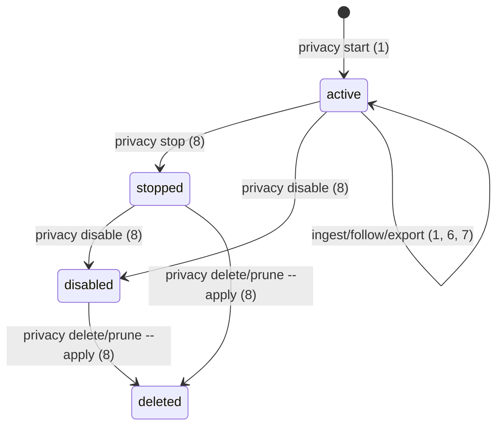

# Issue #8 — capturar e consultar traces locais

> Build this with **tlc-implement**. Cada critério abaixo vira um check com uma prova. Nada em `Unresolved` é decidido durante a implementação.

## Intent

As integrações da #4 observam eventos apenas na memória do processo. A #5 permite ingerir manualmente um fluxo NDJSON e guardar registros sanitizados em uma captura explícita, mas os hooks e o wrapper ainda não entregam suas observações a essa captura. Quem investiga uma execução precisa alimentar o comando manualmente e não consegue listar ou acompanhar capturas enquanto chegam eventos. A issue não apresenta medida de frequência ou perda.

O usuário poderá vincular explicitamente uma execução de agente a uma captura local, ver os registros persistidos enquanto chegam, recuperar uma captura e reutilizar seus registros em análises posteriores. A política, os limites e a exclusão da #5 continuam sendo a fonte de verdade. Os adaptadores da #4 continuam sendo a fonte dos contratos nativos.

13 critérios em 3 fatias · 3 decisões de contrato · 0 questões abertas, 0 bloqueantes.

## Criteria

### S1 — eventos reais chegam à captura escolhida

1. Dada uma captura `active` criada por `privacy start --root R`, quando o processo observado recebe `SKILL_ME_CAPTURE_ROOT=R` e `SKILL_ME_CAPTURE_ID=<id>`, cada evento nativo suportado dos hooks Claude/Codex, do ingest Hermes ou de `integrations run --agent codex` produz no máximo um registro `recordVersion: 1` nessa captura, com `source`, `signal`, `nativeEvent`, `observedAt`, IDs pseudonimizados, campos e `gaps` do envelope v1. O comando `privacy ingest` permanece disponível para entrada NDJSON explícita.
2. Dado o mesmo identificador nativo em dois processos da mesma captura, a exportação mostra o mesmo pseudônimo `h1:`; em capturas diferentes, pseudônimos diferentes. O conteúdo persistido passa por `applyPolicy` da #5, usa o opt-in `content` daquela captura e nunca inclui o payload nativo bruto.
3. Sem as duas variáveis de vinculação, ou quando o par é inválido, nenhuma captura é escolhida implicitamente; os comandos internos dos hooks/ingest preservam código 0 e o wrapper preserva código, sinais, stdout e stderr do agente. Uma falha de entrega não bloqueia o agente e expõe apenas código diagnóstico fechado, sem caminho, argumento, resultado ou stack.
4. Evento desconhecido, JSON inválido, linha acima de 64 KiB, envelope recusado e conteúdo não suportado seguem as categorias e os limites existentes da #4/#5. Nenhuma entrada recusada aparece como registro; motivos e contagens observáveis distinguem entrada inválida, descarte e omissão de conteúdo.

### S2 — consulta e acompanhamento pela CLI local

5. `privacy list --root R` devolve JSON v1 com até 100 capturas por página, ordenadas por `createdAt` e `id`, incluindo `id`, `state`, `createdAt`, `endedAt`, limites e contadores; `--after <id>` avança sem repetir uma captura da página anterior. Raiz ausente/estado inválido usa os códigos 3/4/5 já definidos, sem criar diretórios.
6. `privacy export --root R --capture <id>` consulta a captura ativa ou encerrada e devolve os mesmos registros sanitizados, na ordem gravada, com origem e metadados de cobertura. A leitura não modifica arquivos da captura.
7. `privacy follow --root R --capture <id>` emite NDJSON v1: uma linha `record` por registro já existente e por novo registro, com sequência crescente a partir de 1, sem repetir após uma sondagem sem alterações; ao observar `stopped` ou `disabled`, emite uma linha `end` e termina com código 0. Se a captura for excluída durante o acompanhamento, emite erro fechado e termina com código 3.
8. `privacy stop`, `disable`, `delete --apply` e `prune --apply` mantêm a política da #5: captura encerrada recusa novos registros; `delete` e `prune` continuam em prévia por padrão, removem apenas a captura própria e nunca apagam uma captura ativa por retenção. A consulta não ressuscita dados excluídos.

### S3 — consistência, limites e reutilização dos dados

9. Dois produtores independentes que entregam eventos distintos à mesma captura simultaneamente deixam o estado e o segmento consistentes, com uma ocorrência por evento confirmado. O lock existente serializa commits; conflito ou falha de E/S é distinguível de aceitação. Nenhum retry automático reenvia um evento cuja confirmação foi perdida.
10. A captura conserva os tetos da #5: 500 registros e 8 MiB de dados, com admissão em ordem e contagem do primeiro motivo que recusou o restante do lote. O limite de 64 KiB por linha nativa e o prazo de 2 s de stdin de hook continuam valendo; a tentativa de entrega local termina em até 750 ms depois de ler o evento, sem prender o agente indefinidamente.
11. Registros de uma captura podem ser lidos novamente por uma API local e passados a um consumidor analítico puro sem executar comandos nativos nem voltar a ler a skill ou o agente. O consumidor recebe somente registros v1 sanitizados, sua ordem, origem e contadores/lacunas da captura. A #6/#7 definirão correlação e relatório, sem lógica antecipada nesta entrega.
12. Uma demonstração determinística percorre início da captura, evento fixture de integração, persistência, `list`, `export`, `follow`, encerramento e leitura analítica. Ela rotula o que veio de fixture e o que foi exercitado por mecanismos nativos; não anuncia execução real de modelo que não ocorreu.
13. O guia de uso documenta Node >=24, pacote privado, configuração explícita da captura, integração local, limites, códigos de saída, retenção e exclusão. Provas executam os caminhos afetados em Windows com espaços e Unicode e nas plataformas declaradas pela CI (Windows, Ubuntu e macOS), com skips e ausências declarados.

## States

## Out of scope

- Atribuição de skill, ordenação causal, deduplicação analítica e timeline — #6.
- Interpretação de SKILL.md, comparação de instruções e relatórios — #7.
- Dashboard, step, serviço remoto, telemetria, upload, instalação global, publicação de pacote e deploy — excluídos pela issue e pela política da #5.
- Migração para SQLite, TypeScript, monorepo ou pnpm — não há requisito que invalide o store Node/NDJSON já aprovado.

## Observable

| Surface | Decision | Landing |
| --- | --- | --- |
| CLI `privacy start/stop/disable` | flags, estados e códigos | existing — #5, critério 8 |
| CLI `privacy list` | formato, ordenação, limite e paginação | 5 |
| CLI `privacy export` | consulta e formato | existing — #5, critério 6 |
| CLI `privacy follow` | vazio ativo, linhas, fim e erro | 7 |
| CLI `privacy delete/prune` | confirmação antes de excluir | existing — `--apply`, critério 8 |
| hooks e ingest instalados | formato de entrada e neutralidade em falha | 1, 3, 4 |
| wrapper Codex | argumentos, saídas e código do filho | existing — #4, critérios 1 e 3 |
| guia de uso | configuração, capacidades, limites e próximo passo | 12, 13 |

## Swept

- validation: 3–4, 5, 7; IDs e envelope continuam validados pela #4/#5.
- failure modes: 3–4, 7, 9–10.
- idempotency and retry: 1, 7, 9; duplicatas sem identidade de entrega permanecem para a análise da #6.
- authorization: existing — raiz e captura explícitas da #5; processo local do mesmo usuário, sem servidor remoto ou identidade de usuário nova.
- concurrency and ordering: 7, 9–10; serialização do store da #5.
- data lifecycle: 8; retenção e exclusão da #5.
- external-dependency failure: 3, 9; entrega local não depende de provedor externo.
- state transitions: 7–8 e diagrama `States`.
- observability: 4–5, 7, 9–10, 12.

## Impact

| Front | What changes |
| --- | --- |
| domain | `capture` continua unidade de consentimento e chave HMAC; deixa de depender somente de `privacy ingest` manual. `accepted` não passa a significar persistido; `persisted` continua separado. |
| integrations | `hook-command`, `ingest-command` e `codex-run` passam a encaminhar à mesma política/store quando vinculados; sem vinculação, preservam a observação em memória atual. |
| stored data | Reutiliza `captureVersion: 1` e `recordVersion: 1` da #5; não há backfill nem migração. `exportCapture` e exclusão mantêm o layout existente. |
| CLI/docs | Acrescenta `list` e `follow` ao namespace `privacy`, sem alterar a saída dos comandos antigos. Atualiza guias que hoje dizem que não existe consumidor real. |
| governance | `package.json` permanece privado; cinco arquivos do core de revisão não mudam. |

## Decided

| Decision | Shape | Alternative rejected |
| --- | --- | --- |
| Transporte explícito local | O par `SKILL_ME_CAPTURE_ROOT`/`SKILL_ME_CAPTURE_ID`, herdado pelo agente iniciado pelo usuário, vincula produtores locais a uma captura `active`. Cada processo encaminha pela política existente antes da gravação; ausência de qualquer membro não escolhe captura. | Servidor remoto ou descoberta automática de captura criaria destino e consentimento implícitos e acrescentaria autenticação/daemon sem necessidade demonstrada. |
| Formato persistido único | `captureVersion: 1` e `recordVersion: 1` existentes; `source`, `signal`, `nativeEvent`, `ids`, `fields`, `gaps`, `observedAt`, `privacy` e `content` são os únicos dados dos registros. | Um segundo schema de traces duplicaria sanitização e exigiria migração antes da #6/#7. |
| Fluxo da CLI | `list` responde JSON v1 paginado; `follow` responde NDJSON v1 com linhas `record`, `end` e `error`, sequência local crescente. Comandos existentes conservam o envelope e os códigos 0/2/3/4/5. | Um único JSON ao fim de `follow` não permite acompanhamento; alterar `export` quebraria o contrato da #5. |

## Surface

| Route | In | Out | Status | Criteria |
| --- | --- | --- | --- | --- |
| `privacy list` | `--root`, `--after` opcional | `schemaVersion`, `command`, `captures`, `nextAfter` | 0, 2, 3, 4, 5 | 5 |
| `privacy follow` | `--root`, `--capture` | NDJSON `record`/`end`/`error` com `schemaVersion` e sequência | 0, 2, 3, 4, 5 | 7 |
| `privacy export` | `--root`, `--capture` | `capture`, `records` | 0, 2, 3, 4, 5 | 6 |
| vínculo do processo | `SKILL_ME_CAPTURE_ROOT`, `SKILL_ME_CAPTURE_ID` | registro v1 persistido ou código diagnóstico fechado | código nativo do agente preservado | 1–4, 9–10 |

## Sources

- [Issue #8](https://github.com/oldboydev/skill-me/issues/8) — resultado, oito critérios, restrições e delegação de escolhas técnicas pelo proprietário em 13/10/2026; pedido nesta conversa para planejar e implementar a próxima issue.
- [Issue #4](https://github.com/oldboydev/skill-me/issues/4) e `.tasks/issue-4-integracoes.md` — adaptadores, envelope v1 e neutralidade das integrações; correlação analítica reservada à #6.
- [Issue #5](https://github.com/oldboydev/skill-me/issues/5), `.tasks/issue-5-privacidade.md` e `docs/privacidade.md` — política compartilhada, consentimento, limites e store local já aprovado; transporte/list/follow reservados à #8.
- `AGENTS.md` e `scripts/code-review/README.md` — governança, prova independente, revisão e entrega.

## Unresolved

| # | Kind | Question | Until answered |
| --- | --- | --- | --- |
| None | | | |
